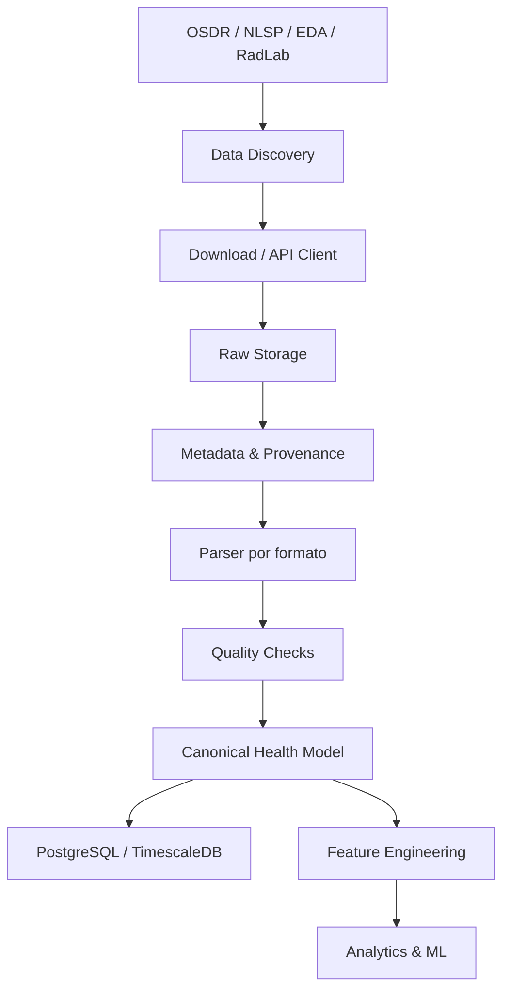
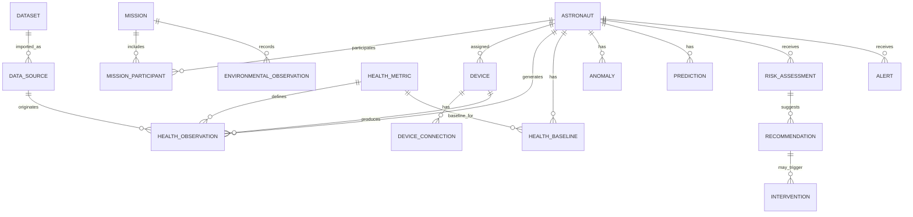
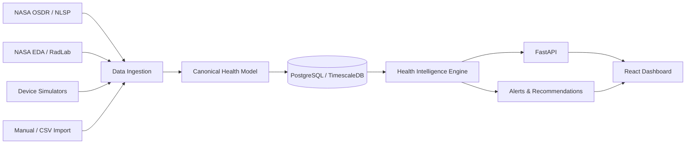
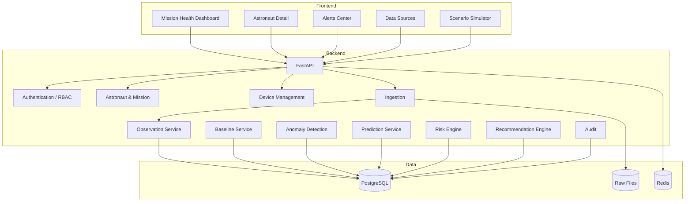
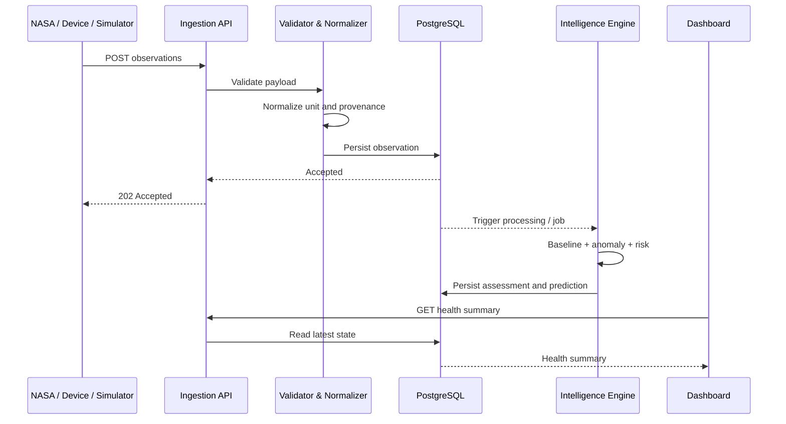

# Astronaut Health Intelligence

## Documento Mestre de Produto, Dados, Arquitetura e Implementação

**Projeto:** NASA Space Apps Challenge --- Health Monitoring Software\
**Nome de trabalho:** Astronaut Health Intelligence (AHI)\
**Tagline:** Predictive Health Monitoring & Decision Support Platform\
**Versão:** 1.0\
**Data:** 13/11/2026\
**Idioma:** Português (Brasil), mantendo nomes técnicos em inglês\
**Público:** equipe de desenvolvimento, produto, dados e apresentação do
Hackathon\
**Uso:** documento de referência para desenvolvimento com Claude Code

------------------------------------------------------------------------

# 1. Como usar este documento

Este arquivo é a especificação central do projeto. Deve ser mantido na
raiz do repositório como `PROJECT_MASTER.md`.

O Claude Code deve: 1. Ler este documento antes de implementar qualquer
funcionalidade. 2. Respeitar as decisões arquiteturais e os limites
científicos aqui descritos. 3. Implementar por etapas e histórias, sem
tentar construir tudo de uma vez. 4. Manter os contratos de API, modelo
canônico e diagramas atualizados. 5. Não inventar integrações, APIs,
dados de astronautas ou capacidades de equipamentos. 6. Distinguir
sempre dados reais, derivados e simulados. 7. Criar testes automatizados
para regras, normalização, ingestão e modelos. 8. Priorizar uma
demonstração funcional, coerente e explicável para o Hackathon.

## 1.1 Regras fundamentais do projeto

-   O sistema é uma plataforma de **monitoramento, análise de tendências
    e apoio à decisão**, não um dispositivo médico certificado.
-   O sistema não realiza diagnóstico, não prescreve medicamentos e não
    substitui o Flight Surgeon.
-   Dados públicos da NASA não devem ser apresentados como telemetria ao
    vivo.
-   Dados simulados devem estar identificados em API, banco, modelos e
    interface.
-   Correlação não significa causalidade.
-   Limites clínicos, pesos e thresholds não podem ser inventados ou
    apresentados como limites oficiais da NASA.
-   Recomendações clínicas devem ser revisadas por profissional
    autorizado; no MVP, recomendações serão informativas e baseadas em
    regras transparentes.
-   A existência de um equipamento a bordo da ISS não implica que exista
    API pública, acesso ao equipamento ou fluxo de dados disponível para
    o Hackathon.

------------------------------------------------------------------------

# 2. Visão do produto

## 2.1 Problema

Missões espaciais expõem astronautas a riscos que podem afetar saúde,
bem-estar e desempenho. A equipe precisa acompanhar indicadores
fisiológicos, comportamentais e ambientais, identificar alterações
relevantes e compreender tendências antes que evoluam para situações
mais graves.

Os dados podem estar distribuídos entre wearables, equipamentos médicos,
avaliações periódicas, amostras biológicas, sistemas de exercício e
sensores ambientais. Nem todos os dados são contínuos, nem todos possuem
a mesma frequência, unidade ou formato.

## 2.2 Solução proposta

O Astronaut Health Intelligence integra fontes de dados heterogêneas em
um modelo canônico, acompanha indicadores ao longo do tempo, compara
cada pessoa com sua própria baseline, identifica anomalias, estima
tendências e apresenta alertas e recomendações explicáveis para apoiar a
equipe médica e operacional.

## 2.3 Objetivos

1.  Integrar dados históricos, dados públicos e dados simulados.
2.  Normalizar medidas em um modelo consistente.
3.  Apresentar um dashboard de saúde e contexto da missão.
4.  Estabelecer baseline individual.
5.  Detectar desvios e padrões persistentes.
6.  Projetar tendências em janelas futuras quando houver dados
    suficientes.
7.  Classificar níveis operacionais de atenção com regras transparentes.
8.  Apresentar recomendações não prescritivas e explicáveis.
9.  Registrar alertas, decisões e intervenções.
10. Permitir demonstrar cenários controlados no Hackathon.

## 2.4 Não objetivos do MVP

-   Diagnóstico automático ou decisão clínica autônoma.
-   Prescrição de medicamentos ou tratamentos.
-   Substituição do Flight Surgeon ou Mission Control.
-   Integração direta com hardware proprietário sem documentação e
    autorização.
-   Alegação de conexão em tempo real com dispositivos da ISS.
-   Treinamento de modelo clínico robusto exclusivamente com pequenas
    bases históricas.
-   Garantia de previsão de eventos médicos.
-   Controle remoto de dispositivos de exercício ou equipamentos
    médicos.

## 2.5 Personas

  -----------------------------------------------------------------------
  Persona                 Necessidade             Funcionalidades
  ----------------------- ----------------------- -----------------------
  Astronaut               Entender seu estado e   Resumo pessoal,
                          hábitos                 tendências,
                                                  recomendações

  Flight Surgeon          Acompanhar sinais e     Dashboard clínico,
                          investigar alterações   histórico, alertas,
                                                  explicabilidade

  Mission Control         Entender riscos         Alertas prioritários,
                          operacionais            contexto ambiental,
                                                  status dos dispositivos

  Researcher              Explorar dados          Dataset, filtros,
                          históricos e padrões    proveniência,
                                                  exportação

  Admin / Data Engineer   Gerenciar fontes e      Integrações, ingestão,
                          qualidade               validação, logs
  -----------------------------------------------------------------------

------------------------------------------------------------------------

# 3. Fundamentos científicos e riscos espaciais

O produto deve considerar os cinco hazards de voos espaciais humanos
identificados pela NASA:

1.  **Radiation:** exposição à radiação espacial.
2.  **Isolation and Confinement:** isolamento e confinamento.
3.  **Distance from Earth:** distância da Terra, atraso de comunicação e
    recursos médicos limitados.
4.  **Gravity Fields:** microgravidade e transições de gravidade.
5.  **Hostile/Closed Environments:** ambientes fechados e hostis.

A plataforma não precisa modelar todos esses riscos clinicamente no MVP.
Deve, entretanto, estruturar o domínio para associar observações
fisiológicas e ambientais ao contexto da missão.

## 3.1 Domínios de indicadores

  -----------------------------------------------------------------------
  Domínio                 Indicadores possíveis   Fontes potenciais
  ----------------------- ----------------------- -----------------------
  Cardiovascular          HR, HRV, ECG, pressão   Wearables, ECG, exames
                          arterial                

  Respiratório            RR, SpO₂, volume        Wearables, monitor
                          respiratório            respiratório

  Sono e ritmo circadiano Duração, eficiência,    Actigraphy, sleep logs
                          despertares, atividade, 
                          exposição à luz         

  Atividade               Movimento,              Wrist sensor,
                          passos/atividade,       accelerometer
                          postura                 

  Musculoesquelético      Força, carga,           ARED, T2, CEVIS, testes
                          repetições, desempenho  

  Ósseo                   Densidade mineral,      Exames e amostras
                          biomarcadores           

  Imunológico             Leucócitos, linfócitos, Sangue, saliva
                          citocinas, marcadores   
                          imunes                  

  Cognitivo               Atenção, memória, tempo Testes cognitivos
                          de reação               

  Sensorimotor            Equilíbrio,             Testes e avaliações
                          coordenação, função     
                          vestibular              

  Nutricional             Ingestão, hidratação,   Questionários, amostras
                          micronutrientes         

  Psicológico             Humor, estresse         Questionários
                          percebido, bem-estar    

  Ambiental               CO₂, temperatura,       ISS EDA, RadLab,
                          umidade, radiação       sensores
  -----------------------------------------------------------------------

**Atenção:** disponibilidade, frequência, unidade e acesso variam por
estudo, equipamento e missão. O modelo deve permitir dados contínuos,
amostras pontuais, questionários e avaliações pré/intra/pós-missão.

------------------------------------------------------------------------

# 4. Estratégia de dados

## 4.1 Estratégia híbrida recomendada

Não depender de uma única base nem assumir que existe uma API pública
que forneça todos os sinais fisiológicos em tempo real.

  -----------------------------------------------------------------------
  Camada                  Origem                  Uso
  ----------------------- ----------------------- -----------------------
  Dados reais públicos    NASA OSDR / NLSP /      Referência científica,
                          estudos publicados      histórico e metadados

  Dados ambientais        NASA Environmental Data Contexto de CO₂,
                          Application (EDA)       temperatura, umidade e
                                                  outros dados de missão

  Dados de radiação       NASA RadLab             Telemetria/dosimetria
                                                  de instrumentos
                                                  disponíveis

  Dados derivados         Transformações de dados Features, agregações e
                          reais documentadas      indicadores calculados

  Dados sintéticos        Simuladores próprios    Telemetria
                                                  demonstrativa, testes
                                                  de modelos e cenários
  -----------------------------------------------------------------------

### Regra de transparência

Todo registro deve ter `data_origin`: - `REAL_PUBLIC`: dado obtido de
fonte pública. - `DERIVED`: valor calculado a partir de registros de
origem identificada. - `SIMULATED`: valor sintético. - `MANUAL`:
inserido manualmente para demonstração ou configuração.

Nunca misturar essas categorias sem manter a proveniência.

## 4.2 Fontes oficiais prioritárias

### A. NASA Open Science Data Repository (OSDR)

**Prioridade: P0 --- principal repositório científico**

-   Portal: https://osdr.nasa.gov/bio/repo/
-   Sobre o OSDR:
    https://science.nasa.gov/biological-physical/data/osdr/
-   API pública: https://api.nasa.gov/ (documentação OSDR publicada em
    https://www.nasa.gov/osdr-api/)
-   Visualização/API: https://visualization.osdr.nasa.gov/
-   FAQ: https://science.nasa.gov/reference/osdr-faq/

O OSDR reúne dados multimodais de pesquisas de ciências da vida
espacial: dados ômicos, fenotípicos, fisiológicos, comportamentais,
biomédicos, bioimagens, telemetria ambiental, hardware, metadados e
arquivos brutos/processados. Inclui dados humanos, animais, plantas,
microrganismos e modelos experimentais.

Atenção: a maioria dos datasets do repositório não é de astronautas.
Muitos estudos envolvem animais, plantas e organismos. Selecionar
explicitamente estudos humanos e verificar o desenho experimental.

A NASA informou que em junho de 2024 foi disponibilizado um dataset
aberto de dados biológicos humanos da missão comercial Inspiration4, com
quatro participantes e coletas como sangue, biópsias de pele e swabs. A
existência de dados não significa que todos os sinais sejam séries
temporais contínuas.

**Endpoints REST documentados da API OSDR Public API:**

``` http
# Busca por datasets
GET https://osdr.nasa.gov/osdr/data/search?term=human&from=0&size=20

# Arquivos de um estudo OSDR (exemplo de accession numérico)
GET https://osdr.nasa.gov/osdr/data/osd/files/87

# Metadados completos de um estudo
GET https://osdr.nasa.gov/osdr/data/osd/meta/87
```

A documentação descreve também APIs de experimentos, missões, payloads,
hardware, veículos, sujeitos e biospecimens:

``` http
GET https://osdr.nasa.gov/geode-py/ws/api/experiments
GET https://osdr.nasa.gov/geode-py/ws/api/missions
GET https://osdr.nasa.gov/geode-py/ws/api/payloads
GET https://osdr.nasa.gov/geode-py/ws/api/hardware
GET https://osdr.nasa.gov/geode-py/ws/api/subjects
GET https://osdr.nasa.gov/geode-py/ws/api/biospecimens
```

**Biological Data API:**

-   Documentação/exemplos: https://visualization.osdr.nasa.gov/biodata/
-   Portal de APIs: https://visualization.osdr.nasa.gov/

A API Biological Data oferece consultas REST e tabulares para
dados/metadados biológicos. A sintaxe e os parâmetros devem ser
confirmados na documentação atual antes de implementar um client. Não
codificar endpoints de exemplo sem teste de contrato.

**Procedimento de Data Discovery:** 1. Pesquisar `human`, `astronaut`,
`spaceflight`, `ISS`, `Inspiration4`, `sleep`, `actigraphy`,
`cardiovascular`, `immune`, `physiological`. 2. Filtrar
organismo/participante e tipo de estudo. 3. Abrir metadados e arquivos.
4. Identificar unidade, frequência, período, fase da missão e população.
5. Verificar acesso, licença, consentimento e restrições. 6. Baixar
apenas os arquivos relevantes. 7. Registrar dataset accession, versão,
URL, data de extração e hash do arquivo. 8. Criar um relatório de
adequação do dataset.

### B. NASA Life Sciences Portal (NLSP)

-   Portal: https://nlsp.nasa.gov/

Agrega recursos de pesquisa de ciências da vida e saúde humana
relacionados a voos espaciais e missões análogas, incluindo recursos
históricos associados a LSDA e HRP. A disponibilidade e o acesso
dependem do dataset.

Usar como portal de descoberta e não assumir que cada recurso tem API
aberta.

### C. NASA Standard Measures

-   Referência: https://www.nasa.gov/reference/standard-measures/

Programa que coleta medidas padronizadas antes, durante e depois das
missões. Inclui: - atividade e exposição à luz por sensor de pulso; -
relatórios de sono; - amostras de fluidos relacionadas a
dieta/nutrição; - saliva e função imunológica; - testes cognitivos; -
testes sensorimotores e equilíbrio; - força corporal; - amostras
fecais/microbioma.

É uma referência fundamental para o catálogo de métricas e o desenho de
dados. Nem todas as medidas são contínuas ou acessíveis como telemetria
pública.

### D. NASA Environmental Data Application (EDA)

-   Portal: https://visualization.osdr.nasa.gov/eda/
-   Sobre OSDR: https://science.nasa.gov/biological-physical/data/osdr/

Permite visualizar e comparar telemetria ambiental de cabine/hardware da
ISS e dados de radiação associados a missões. A documentação apresenta
medidas como temperatura, CO₂ e umidade relativa, além de dados de dose
de radiação. Dados brutos e resumidos podem ser disponibilizados para
download conforme a missão e o dataset.

Usar no MVP como fonte ambiental se os dados necessários estiverem
disponíveis para download. Não assumir API pública estável sem validar a
documentação do EDA.

### E. NASA RadLab

-   Portal: https://visualization.osdr.nasa.gov/radlab/gui/overview/

Portal e API para explorar dados de dosimetria de diferentes
instrumentos e agências espaciais. Permite selecionar, visualizar e
recuperar dados de instrumentos e períodos disponíveis. Verificar
cobertura e disponibilidade antes de integrar.

### F. NASA Standard Measures / Artemis II

-   Referência Artemis II:
    https://www.nasa.gov/reference/artemis-ii-standard-measures/

Usar como referência de medidas planejadas/coletadas e desenho de
investigação. Não inferir que dados de missão Artemis II já estejam
abertos ou disponíveis em tempo real.

## 4.3 Dataset inicial: critérios de seleção

Escolher de 3 a 5 datasets com melhor aderência. A prioridade deve
ser: 1. Estudos humanos relacionados a voo espacial. 2. Estudos com
dados longitudinais ou medições repetidas. 3. Dados de sono, atividade,
cardiovascular, imunológico ou desempenho. 4. Missões análogas (HERA,
isolamento/confinamento, bed rest), identificadas como análogas. 5.
Dados ambientais da ISS para contextualização.

Não misturar sem marcação: - dados de astronautas e participantes
análogos; - humanos e animais; - medidas em solo e em voo; - dados
contínuos e medições pontuais; - unidades diferentes; - versões
distintas de protocolos.

## 4.4 Pipeline de ingestão de dados históricos



## 4.5 Catálogo de fontes e status

  ------------------------------------------------------------------------
  Fonte             Dados             Integração MVP     Status
  ----------------- ----------------- ------------------ -----------------
  OSDR Public API   Estudos,          Sim, descoberta e  Documentada;
                    arquivos,         importação         validar datasets
                    metadados                            

  OSDR Biological   Dados/metadados   Sim, se dataset    Documentada;
  Data API          tabulares         compatível         validar schema

  NLSP              Descoberta de     Manual/assistida   Acesso por
                    estudos humanos                      recurso

  Standard Measures Catálogo de       Referência de      Documentação
                    indicadores e     domínio            
                    protocolos                           

  EDA               Telemetria        Importação de      Validar
                    ambiental         arquivos           dataset/API

  RadLab            Dosimetria        Importação de      Validar
                                      dados disponíveis  API/cobertura

  Simuladores       Sinais sintéticos Sim, obrigatório   Sob nosso
  próprios                                               controle
  ------------------------------------------------------------------------

------------------------------------------------------------------------

# 5. Dispositivos e equipamentos

## 5.1 Princípio de integração

O MVP deve implementar adapters e simuladores. A arquitetura deve
permitir integração futura, mas não afirmar que temos acesso às APIs
proprietárias ou aos equipamentos físicos da ISS.

### Matriz de equipamentos

  -----------------------------------------------------------------------------
  Equipamento /     Uso e dados potenciais Tipo de dado      Integração MVP
  modalidade                                                 
  ----------------- ---------------------- ----------------- ------------------
  Bio-Monitor /     ECG, HR, HRV,          Fisiológico       Simulador
  Astroskin         respiração, SpO₂,                        
                    temperatura da pele,                     
                    atividade; algumas                       
                    configurações incluem                    
                    estimativa de pressão                    

  Actiwatch / wrist Movimento, atividade,  Atividade/sono    Dataset ou
  actigraphy        exposição à luz e                        simulador
                    estimativas de sono                      

  ECG monitor       Sinal ECG, frequência, Fisiológico       Simulador
                    intervalos e features                    

  Blood pressure    Pressão                Medida pontual    Simulador/manual
  monitor           sistólica/diastólica                     

  Pulse oximeter    SpO₂ e pulso           Fisiológico       Simulador

  Ultrasound-2      Imagens/avaliações     Exame             Fora do MVP;
                    ultrassonográficas                       referência

  ARED              Exercício resistido,   Exercício         Simulador de
                    carga e desempenho                       sessão
                    conforme                                 
                    instrumentação                           
                    disponível                               

  T2 / COLBERT      Esteira, duração,      Exercício         Simulador de
                    velocidade e                             sessão
                    carga/harness conforme                   
                    sistema                                  

  CEVIS             Ergômetro de ciclo,    Exercício         Simulador de
                    sessão e parâmetros de                   sessão
                    exercício disponíveis                    

  Blood / saliva /  Biomarcadores, química Amostra           Importação
  urine assays      e marcadores           laboratorial      CSV/JSON
                    imunológicos                             

  CO₂ / temperatura Ambiente de cabine     Ambiental         EDA ou simulador
  / umidade                                                  

  Radiation         Dose e taxa de dose    Ambiental         RadLab ou
  dosimeter                                                  simulador
  -----------------------------------------------------------------------------

**Cuidado:** não tratar ARED, T2 ou CEVIS como monitores médicos
universais. São equipamentos de exercício; os dados disponíveis dependem
de sensores, instrumentação e sistemas associados.

## 5.2 Referências visuais dos equipamentos

As imagens abaixo são referências ilustrativas de
equipamentos/modalidades reais. Confirmar direitos e atribuição antes de
reutilizá-las em materiais públicos.

### Astroskin / Bio-Monitor


Referência NASA NTRS: https://ntrs.nasa.gov/citations/20240000117\
Canadian Space Agency Bio-Monitor:
https://www.csa-asc.gc.ca/eng/sciences/bio-monitor.asp

Sensores descritos em referências técnicas incluem ECG, frequência
cardíaca, HRV, respiração, SpO₂, temperatura da pele, atividade e
estimativa de pressão arterial. A configuração exata varia por versão.

### Actiwatch / wrist actigraphy


Referência NASA sobre wearable tech e Actiwatch Spectrum:
https://www.nasa.gov/missions/station/iss-research/wearable-tech-for-space-station-research/

O sensor de pulso pode registrar movimento e exposição à luz, usados em
estudos de sono e ritmo circadiano. Não presumir que o dado bruto esteja
publicamente disponível para todos os astronautas.

### CEVIS --- Cycle Ergometer


Crédito: NASA. Registro de imagem:
https://images.nasa.gov/details/iss072e034702

### ARED --- Advanced Resistive Exercise Device


Referência visual de exercício resistido no ISS. Contexto de
equipamentos:
https://www.nasa.gov/reference/jsc-exercise-countermeasures/

### Ultrassom em voo


Imagem ilustrativa de ultrassom em voo. O exame é uma modalidade
pontual, não um fluxo contínuo de sinais vitais.

## 5.3 Device Adapter Contract

Todos os adapters devem converter formatos específicos para o modelo
canônico.

``` python
from abc import ABC, abstractmethod
from typing import Iterable

class DeviceAdapter(ABC):
    @abstractmethod
    async def connect(self) -> None: ...

    @abstractmethod
    async def disconnect(self) -> None: ...

    @abstractmethod
    async def read_observations(self) -> Iterable[dict]: ...

    @abstractmethod
    def normalize(self, payload: dict) -> list[dict]: ...

    @abstractmethod
    async def get_device_status(self) -> dict: ...
```

Adapters previstos: - `AstroskinSimulatorAdapter` -
`ActiwatchSimulatorAdapter` - `ExerciseEquipmentSimulatorAdapter` -
`EnvironmentalSensorSimulatorAdapter` - `O zdrDatasetImportAdapter`
(nome final sem espaço: `OsdrDatasetImportAdapter`) -
`EdaFileImportAdapter` - `RadLabImportAdapter`

------------------------------------------------------------------------

# 6. Modelo de domínio e dados

## 6.1 Entidades principais

  Entidade                   Responsabilidade
  -------------------------- ---------------------------------------
  Astronaut                  Perfil pseudonimizado do participante
  Mission                    Missão, fases e contexto
  Device                     Equipamento lógico/físico
  DeviceConnection           Estado e histórico de conexão
  DataSource                 Origem do dado e tipo de fonte
  Dataset                    Dataset científico importado
  HealthMetric               Definição de métrica e unidade
  HealthObservation          Medida individual
  HealthBaseline             Referência individual por métrica
  HealthAssessment           Avaliação agregada
  Anomaly                    Desvio identificado
  Prediction                 Projeção de tendência
  RiskAssessment             Nível operacional de risco
  Recommendation             Sugestão explicável
  Intervention               Ação registrada e resultado
  Alert                      Notificação e acknowledgment
  BiologicalSample           Amostra e resultados laboratoriais
  EnvironmentalObservation   Observação ambiental
  ModelVersion               Versão de modelo e configuração
  AuditEvent                 Trilha de auditoria

## 6.2 Diagrama ER



## 6.3 Modelo canônico HealthObservation

``` json
{
  "observation_id": "uuid",
  "subject_id": "ASTRONAUT-001",
  "mission_id": "MISSION-001",
  "device_id": "DEVICE-001",
  "metric_code": "HEART_RATE",
  "value": 72.4,
  "unit": "bpm",
  "measured_at": "2026-11-13T14:30:00Z",
  "received_at": "2026-11-13T14:30:02Z",
  "data_origin": "SIMULATED",
  "source_reference": {
    "repository": null,
    "dataset_accession": null,
    "file_name": null,
    "record_reference": null
  },
  "quality": {
    "status": "VALID",
    "confidence": 1.0,
    "is_estimated": false
  },
  "context": {
    "mission_phase": "IN_FLIGHT",
    "activity": "REST"
  },
  "metadata": {}
}
```

### Campos obrigatórios

-   `observation_id`
-   `subject_id`
-   `metric_code`
-   `value`
-   `unit`
-   `measured_at`
-   `data_origin`
-   `quality.status`

### Regras

-   Armazenar timestamps em UTC.
-   Preservar timezone/origem quando relevante.
-   Normalizar unidades sem apagar o valor original.
-   Não substituir valor ausente por zero.
-   Registrar qualidade, missingness e método de cálculo.
-   Registrar fonte e dataset para cada dado importado.
-   Deduplicar usando `observation_id` ou chave idempotente de origem.

## 6.4 Catálogo inicial de métricas

  ----------------------------------------------------------------------------
  metric_code         Descrição         Unidade canônica  Frequência
                                        sugerida          
  ------------------- ----------------- ----------------- --------------------
  HEART_RATE          Frequência        bpm               Contínua/periódica
                      cardíaca                            

  HRV_RMSSD           Variabilidade     ms                Derivada por janela
                      cardíaca RMSSD                      

  ECG_SIGNAL          Sinal ECG         mV                Alta frequência

  SPO2                Saturação         \%                Periódica
                      periférica de                       
                      oxigênio                            

  RESPIRATORY_RATE    Frequência        breaths/min       Periódica
                      respiratória                        

  SYSTOLIC_BP         Pressão sistólica mmHg              Pontual/periódica

  DIASTOLIC_BP        Pressão           mmHg              Pontual/periódica
                      diastólica                          

  SKIN_TEMPERATURE    Temperatura da    °C                Periódica
                      pele                                

  ACTIVITY_LEVEL      Nível de          score/unidade da  Periódica
                      atividade         fonte             

  SLEEP_DURATION      Duração do sono   h                 Diária

  SLEEP_EFFICIENCY    Eficiência do     \%                Diária
                      sono                                

  EXERCISE_DURATION   Duração do        min               Por sessão
                      exercício                           

  EXERCISE_LOAD       Carga de          unidade da fonte  Por sessão
                      exercício                           

  CO2                 Concentração de   ppm               Ambiental
                      CO₂                                 

  CABIN_TEMPERATURE   Temperatura da    °C                Ambiental
                      cabine                              

  RELATIVE_HUMIDITY   Umidade relativa  \%                Ambiental

  RADIATION_DOSE      Dose acumulada    unidade da fonte  Ambiental
                                        (ex. mGy)         

  CORTISOL            Cortisol          unidade do ensaio Amostra

  WBC                 Leucócitos        unidade do        Amostra
                                        laboratório       
  ----------------------------------------------------------------------------

A unidade canônica deve ser confirmada por métrica e compatibilidade com
a fonte. Não converter sem documentar o fator e o método.

## 6.5 Modelo de proveniência

Cada importação deve criar um registro de dataset: - `source_name` -
`source_url` - `dataset_accession` - `dataset_version` -
`downloaded_at` - `license` - `access_classification` - `file_name` -
`sha256` - `parser_version` - `import_job_id` - `study_population` -
`mission` - `study_design` - `collection_phase` - `notes`

------------------------------------------------------------------------

# 7. Arquitetura técnica

## 7.1 Decisão arquitetural

**MVP: Modular Monolith + processamento assíncrono.**

Não iniciar com muitos microserviços. A equipe precisa demonstrar valor
rapidamente, manter baixo custo operacional e evoluir a arquitetura
apenas quando houver necessidade real.

## 7.2 Stack recomendada

  -----------------------------------------------------------------------
  Camada                  Tecnologia              Motivo
  ----------------------- ----------------------- -----------------------
  Frontend                React + TypeScript +    Ecossistema e
                          Vite                    velocidade

  UI                      Tailwind CSS +          Componentes e
                          shadcn/ui               consistência visual

  Charts                  Recharts ou ECharts     Séries temporais e
                                                  dashboards

  Backend API             Python + FastAPI        Integração natural com
                                                  dados/ML

  Schemas                 Pydantic                Validação e contratos

  ORM / migrations        SQLAlchemy + Alembic    Persistência e
                                                  versionamento

  Banco                   PostgreSQL +            Relacional e
                          TimescaleDB (opcional)  time-series

  Cache / jobs            Redis                   Cache e filas leves

  Background jobs         Celery/RQ ou worker     Importações e
                          asyncio                 processamento

  Event streaming         Redpanda/Kafka (futuro) Streaming quando
                                                  necessário

  Data science            pandas + NumPy + SciPy  Manipulação e
                                                  estatística

  ML                      scikit-learn + XGBoost  Anomalia e
                                                  classificação

  Explainability          SHAP                    Explicação de modelos
                                                  compatíveis

  Testes                  pytest + httpx +        Backend e E2E
                          Playwright              

  Observabilidade         OpenTelemetry + logs    Diagnóstico
                          estruturados            

  Deploy                  Docker Compose no MVP   Reprodutibilidade
  -----------------------------------------------------------------------

**Evitar no MVP:** Kafka obrigatório, Kubernetes, microserviços
independentes, feature store complexa, LLM como núcleo de decisão
clínica.

## 7.3 Diagrama de contexto



## 7.4 Diagrama de componentes



## 7.5 Fluxo de processamento



------------------------------------------------------------------------

# 8. Módulos funcionais

  ------------------------------------------------------------------------
  ID                Módulo            Responsabilidade   Prioridade
  ----------------- ----------------- ------------------ -----------------
  MOD-01            Astronaut &       Cadastro           P0
                    Mission           pseudonimizado,    
                                      missão e fase      

  MOD-02            Device & Data     Dispositivos,      P0
                    Source Registry   fontes e status    

  MOD-03            Data Ingestion    Receber, importar  P0
                                      e validar dados    

  MOD-04            Health Data       Observações,       P0
                    Management        métricas,          
                                      histórico e        
                                      qualidade          

  MOD-05            Health Dashboard  Estado atual,      P0
                                      tendências e       
                                      indicadores        

  MOD-06            Personal Baseline Baseline           P0
                                      individual         

  MOD-07            Anomaly Detection Desvios e          P0
                                      persistência       

  MOD-08            Risk Assessment   Regras e níveis    P0
                                      operacionais       

  MOD-09            Predictive Health Projeções de       P1
                                      tendência          

  MOD-10            Recommendation    Recomendações      P1
                    Engine            explicáveis        

  MOD-11            Alerts &          Alertas,           P1
                    Notifications     acknowledgment e   
                                      histórico          

  MOD-12            Scenario          Cenários de        P0
                    Simulator         deterioração e     
                                      intervenção        

  MOD-13            Dataset Explorer  Estudos, fontes e  P1
                                      proveniência       

  MOD-14            Audit &           Rastreabilidade e  P1
                    Governance        logs               
  ------------------------------------------------------------------------

## 8.1 Dashboard principal

Elementos: - seletor de astronauta; - missão e fase; - status geral; -
indicadores principais; - tendência de 24h/7d; - baseline individual; -
alertas ativos; - recomendações pendentes; - qualidade e origem dos
dados; - badge claro `REAL`, `DERIVED` ou `SIMULATED`.

## 8.2 Astronaut Detail

Abas: 1. Overview 2. Vitals 3. Sleep & Activity 4. Exercise 5.
Environmental Exposure 6. Predictions 7. Alerts & Interventions 8. Data
Provenance

## 8.3 Scenario Simulator

Permitir escolher um cenário e reproduzir uma sequência temporal: -
baseline estável; - fadiga progressiva; - sono insuficiente; - queda de
desempenho físico; - alteração ambiental; - perda de telemetria; -
recuperação após intervenção simulada.

O usuário deve conseguir comparar: - cenário sem intervenção; - cenário
com intervenção hipotética.

A comparação deve ser apresentada como simulação, não como eficácia
clínica comprovada.

------------------------------------------------------------------------

# 9. Inteligência analítica e modelos

## 9.1 Princípio

Construir primeiro estatística explicável e depois adicionar ML. O
modelo não deve produzir diagnóstico. Deve descrever tendências, desvios
e incerteza.

## 9.2 Personal Baseline

Baseline individual é preferível a comparar todos os astronautas com uma
média populacional genérica.

A baseline pode considerar: - período de referência; - missão e fase; -
atividade (repouso, exercício, sono); - hora do dia; - qualidade dos
dados; - tamanho mínimo da amostra.

Não construir baseline se houver dados insuficientes. Exibir
`INSUFFICIENT_DATA`.

## 9.3 Modelos estatísticos

  -----------------------------------------------------------------------
  Método                  Objetivo                MVP
  ----------------------- ----------------------- -----------------------
  Moving Average          Suavizar ruído          Sim

  Rolling Median / IQR    Resistente a outliers   Sim

  Z-Score individual      Desvio da baseline      Sim

  EWMA                    Mudanças persistentes   Sim

  CUSUM                   Pequenas mudanças       Opcional
                          acumuladas              

  Isolation Forest        Anomalia multivariada   P1

  Exponential Smoothing   Projeção simples        P1

  ARIMA                   Séries temporais        P2
                          adequadas               

  XGBoost                 Estimar risco com       P2
                          dataset rotulado        
                          suficiente              

  Survival Analysis       Tempo até evento, com   Futuro
                          dados longitudinais     
                          apropriados             
  -----------------------------------------------------------------------

## 9.4 Regras de anomalia

Exemplos conceituais: - valor atual fora da faixa individual; - desvio
persistente por múltiplas janelas; - queda sustentada de HRV em relação
à baseline; - alteração combinada de sono, atividade e frequência
cardíaca; - queda progressiva de desempenho; - dado ambiental fora de
configuração operacional; - perda de sinal ou baixa qualidade do sensor.

Thresholds devem ser: - configuráveis; - versionados; - acompanhados de
unidade; - acompanhados da fonte científica ou justificativa; -
aprovados por responsável médico quando clínicos; - contextualizados
pela atividade e qualidade do dado.

## 9.5 Risk Assessment

Níveis operacionais: - `LOW` - `MODERATE` - `HIGH` - `CRITICAL`

Não são diagnósticos nem classificações médicas validadas. São níveis de
atenção do protótipo.

Variáveis: - desvio individual; - persistência; - tendência; - número de
métricas envolvidas; - qualidade dos dados; - contexto de missão; -
exposição ambiental; - regra acionada.

Cada avaliação deve guardar: - `risk_level` - `risk_score` (se
utilizado, escala documentada) - `contributing_factors` -
`triggered_rules` - `confidence` - `model_version` - `evaluated_at` -
`data_window` - `limitations`

## 9.6 Forecasting

Previsões candidatas: - 6h; - 24h; - 48h; - 72h.

Somente mostrar horizontes suportados pela quantidade e qualidade de
dados. Não extrapolar longos períodos com séries pequenas.

Toda projeção deve incluir: - valor estimado; - unidade; - intervalo de
incerteza; - horizonte; - método/model version; - dados de entrada; -
confidence/calibration quando aplicável; - aviso de que é projeção
estatística.

## 9.7 Recommendation Engine

Arquitetura: 1. Rules Engine identifica condição. 2. Catálogo de
recomendações oferece ações aprovadas. 3. Contexto da missão e perfil
filtram aplicabilidade. 4. LLM pode explicar em linguagem natural uma
recomendação já selecionada. 5. Human-in-the-loop revisa recomendações
relevantes.

Exemplos não prescritivos: - revisar rotina de sono e exposição à luz; -
avaliar carga e recuperação de exercícios; - reforçar hidratação e
nutrição conforme protocolo; - solicitar avaliação da equipe médica; -
verificar sensor e qualidade da medição; - acompanhar tendência em nova
janela.

O LLM não pode: - inventar limite clínico; - diagnosticar; - recomendar
medicamento; - criar tratamento; - transformar correlação em
causalidade; - ocultar incerteza ou origem simulada.

------------------------------------------------------------------------

# 10. APIs internas

Base URL local: `http://localhost:8000/api/v1`

## 10.1 Endpoints

  Método   Endpoint                             Descrição
  -------- ------------------------------------ ---------------------------------
  POST     `/observations`                      Ingestão de observações
  POST     `/datasets/import`                   Criar job de importação
  GET      `/datasets`                          Listar datasets importados
  GET      `/data-sources`                      Listar fontes
  POST     `/astronauts`                        Criar astronauta pseudonimizado
  GET      `/astronauts`                        Listar astronautas
  GET      `/astronauts/{id}/health`            Resumo atual
  GET      `/astronauts/{id}/history`           Histórico
  GET      `/astronauts/{id}/baseline`          Baseline
  GET      `/astronauts/{id}/anomalies`         Anomalias
  GET      `/astronauts/{id}/risks`             Avaliações de risco
  GET      `/astronauts/{id}/predictions`       Projeções
  GET      `/astronauts/{id}/recommendations`   Recomendações
  POST     `/alerts/{id}/acknowledge`           Reconhecer alerta
  POST     `/interventions`                     Registrar intervenção
  POST     `/scenarios/{scenario_id}/run`       Executar simulação
  GET      `/devices`                           Listar dispositivos
  GET      `/devices/{id}/status`               Status do dispositivo
  GET      `/health/ready`                      Readiness
  GET      `/health/live`                       Liveness

## 10.2 Exemplo de ingestão

`POST /api/v1/observations`

``` json
{
  "subject_id": "ASTRONAUT-001",
  "mission_id": "MISSION-001",
  "source_id": "SIM-ASTROSKIN-001",
  "data_origin": "SIMULATED",
  "observations": [
    {
      "metric_code": "HEART_RATE",
      "value": 82,
      "unit": "bpm",
      "measured_at": "2026-11-13T14:30:00Z",
      "quality_status": "VALID"
    },
    {
      "metric_code": "SPO2",
      "value": 98,
      "unit": "%",
      "measured_at": "2026-11-13T14:30:00Z",
      "quality_status": "VALID"
    }
  ]
}
```

Resposta `202 Accepted`:

``` json
{
  "status": "ACCEPTED",
  "batch_id": "uuid",
  "accepted_count": 2,
  "rejected_count": 0,
  "data_origin": "SIMULATED"
}
```

## 10.3 Interoperabilidade FHIR

Usar HL7 FHIR R4 como referência de interoperabilidade: - `Patient` -
`Device` - `Observation` - `DiagnosticReport` - `QuestionnaireResponse`

Documentação: https://www.hl7.org/fhir/

FHIR não é protocolo universal para conexão física de sensores. Criar
adapters para cada fonte e mapear para o modelo canônico;
exportar/importar FHIR quando necessário.

------------------------------------------------------------------------

# 11. Backlog priorizado

## 11.1 Priorização

-   **P0:** indispensável para demonstrar MVP.
-   **P1:** aumenta qualidade e credibilidade.
-   **P2:** evolução após demo estável.

Estimativas são relativas e devem ser refinadas pela equipe.

## EPIC E01 --- Foundation & Project Setup

### US-001 --- Inicializar estrutura do projeto

**Prioridade:** P0

Como equipe de desenvolvimento, quero uma estrutura organizada para
implementar frontend, backend, engine de IA e infraestrutura.

Critérios de aceite: - monorepo criado; - frontend e backend
inicializam; - Docker Compose funcional; - `.env.example` criado; -
README com instruções; - lint e testes configurados.

### US-002 --- Configurar persistência

**Prioridade:** P0

Critérios: - PostgreSQL sobe por Docker; - migrations funcionam; -
tabelas centrais criadas; - health check da conexão; - testes de
repository.

## EPIC E02 --- Astronaut, Mission & Device Registry

### US-003 --- Cadastrar astronauta pseudonimizado

**Prioridade:** P0

Critérios: - identificador sem PII; - missão associada; - perfil de
demonstração; - histórico de criação.

### US-004 --- Registrar missão e fase

**Prioridade:** P0

Critérios: - nome/código da missão; - data de início/fim quando
disponível; - fase da missão; - contexto de ambiente.

### US-005 --- Cadastrar dispositivos e fontes

**Prioridade:** P0

Critérios: - tipo de dispositivo; - fabricante/modelo opcional; -
status; - astronauta/missão associada; - origem real ou simulada; -
última comunicação.

## EPIC E03 --- Data Ingestion & Canonical Model

### US-006 --- Ingerir observações via API

**Prioridade:** P0

Critérios: - endpoint `POST /observations`; - validação Pydantic; -
validação de unidade e métrica; - timestamps; - idempotência; - resposta
com accepted/rejected; - origem registrada.

### US-007 --- Normalizar dados

**Prioridade:** P0

Critérios: - converter para métrica canônica; - preservar valor
original; - rejeitar unidade incompatível; - registrar parser/version; -
testes por adapter.

### US-008 --- Importar dataset NASA

**Prioridade:** P0

Critérios: - selecionar dataset OSDR; - registrar accession, fonte e
versão; - armazenar arquivo original; - parser documentado; -
transformar registros compatíveis; - preservar proveniência; -
classificar `REAL_PUBLIC`; - não importar dados sem metadados mínimos.

### US-009 --- Validar qualidade dos dados

**Prioridade:** P0

Critérios: - detectar valores ausentes; - detectar timestamps
inválidos; - detectar duplicidades; - sinalizar outliers sem apagar
automaticamente; - registrar status de qualidade.

## EPIC E04 --- Simulators & Demo Data

### US-010 --- Criar simulador AstroSkin/Bio-Monitor

**Prioridade:** P0

Critérios: - gerar HR, HRV, RR, SpO₂, temperatura e atividade; - perfis
estáveis e de alteração progressiva; - dados marcados `SIMULATED`; -
seed reproduzível; - timestamps consistentes.

### US-011 --- Criar simulador de sono/atividade

**Prioridade:** P0

Critérios: - gerar registros diários; - duração e eficiência de sono; -
atividade e exposição à luz simuladas; - cenário de privação de sono.

### US-012 --- Criar simulador ambiental

**Prioridade:** P1

Critérios: - gerar CO₂, temperatura e umidade; - cenário normal e
cenário de alteração; - marcar origem simulada.

### US-013 --- Criar simulador de exercício

**Prioridade:** P1

Critérios: - sessões ARED/T2/CEVIS; - duração, carga e desempenho; -
queda progressiva de performance; - não declarar integração real.

## EPIC E05 --- Dashboard & Historical View

### US-014 --- Dashboard de saúde

**Prioridade:** P0

Critérios: - astronauta e missão selecionados; - cards de indicadores; -
status de origem dos dados; - alertas ativos; - atualização automática
ou refresh controlado.

### US-015 --- Visualizar séries históricas

**Prioridade:** P0

Critérios: - gráfico temporal; - filtro por período e métrica; - unidade
visível; - baseline sobreposta; - lacunas de dados identificadas.

### US-016 --- Visualizar proveniência

**Prioridade:** P1

Critérios: - origem do dado; - dataset e arquivo quando aplicável; -
real/derivado/simulado; - data de importação; - qualidade.

## EPIC E06 --- Baseline & Anomaly Detection

### US-017 --- Calcular baseline individual

**Prioridade:** P0

Critérios: - janela configurável; - média, mediana, desvio e quantis; -
segmentação por contexto quando possível; - mínimo de amostras; - status
de dados insuficientes; - versão da baseline.

### US-018 --- Detectar anomalias univariadas

**Prioridade:** P0

Critérios: - Z-score robusto ou IQR; - persistência por janelas; -
explicação do desvio; - não gerar diagnóstico; - testes com cenários
conhecidos.

### US-019 --- Detectar anomalias multivariadas

**Prioridade:** P1

Critérios: - Isolation Forest opcional; - treinamento com dataset
apropriado; - features documentadas; - versionamento; - avaliação de
falsos positivos.

## EPIC E07 --- Risk & Prediction

### US-020 --- Calcular risk assessment

**Prioridade:** P0

Critérios: - regras transparentes; - níveis
LOW/MODERATE/HIGH/CRITICAL; - fatores contribuintes; - qualidade dos
dados; - configuração versionada; - texto explicando que não é
diagnóstico.

### US-021 --- Projetar tendências

**Prioridade:** P1

Critérios: - previsão apenas para métricas elegíveis; - horizonte
6h/24h/48h conforme dados; - intervalo de incerteza; - método e
versão; - fallback para "dados insuficientes".

### US-022 --- Comparar cenário com e sem intervenção

**Prioridade:** P1

Critérios: - cenários claramente hipotéticos; - premissas visíveis; -
comparação de trajetória; - não declarar eficácia clínica.

## EPIC E08 --- Recommendations & Alerts

### US-023 --- Gerar recomendações baseadas em regras

**Prioridade:** P1

Critérios: - catálogo versionado; - regra acionadora; - motivo; -
prioridade; - público-alvo; - aprovação/revisão humana quando aplicável.

### US-024 --- Explicar recomendação com IA

**Prioridade:** P2

Critérios: - LLM apenas recebe recomendação já selecionada; - resposta
estruturada; - não pode criar diagnóstico ou prescrição; - mostrar fonte
e limitações; - fallback sem LLM.

### US-025 --- Criar alertas e acknowledgment

**Prioridade:** P1

Critérios: - alerta com severidade; - timestamp; - astronauta/missão; -
regra acionada; - acknowledge; - trilha de auditoria.

## EPIC E09 --- Demo & Governance

### US-026 --- Executar cenários de demonstração

**Prioridade:** P0

Critérios: - cenários reproduzíveis; - botão iniciar/pausar/reset; -
evolução temporal; - alertas e tendências visíveis; - dados
identificados como simulados.

### US-027 --- Registrar auditoria

**Prioridade:** P1

Critérios: - registrar alteração de regra; - registrar execução de
modelo; - registrar acknowledge; - registrar intervenção; - armazenar
actor e timestamp.

### US-028 --- Preparar demo final

**Prioridade:** P0

Critérios: - seed de dados; - ambiente limpo reproduzível; - roteiro de
3 a 5 minutos; - fallback sem internet; - fontes e limitações
apresentáveis.

------------------------------------------------------------------------

# 12. Plano de execução por etapas

## Etapa 0 --- Data Discovery e validação científica

**Objetivo:** confirmar o que existe de fato nos datasets antes de
construir os modelos.

Tarefas: 1. Pesquisar OSDR por estudos humanos, astronautas, ISS,
Inspiration4 e sleep/physiology. 2. Selecionar 3--5 datasets. 3.
Verificar formatos, colunas, unidades, timestamps e períodos. 4. Avaliar
licenças e restrições. 5. Criar `docs/data-source-inventory.md`. 6.
Criar exemplos de arquivos de entrada. 7. Registrar limitações.

**Definition of Done:** inventário com datasets reais testados, URLs,
accession, arquivos, indicadores e adequação.

## Etapa 1 --- Foundation

**Objetivo:** aplicação inicial executável.

Tarefas: - monorepo; - Docker Compose; - frontend; - FastAPI; -
PostgreSQL; - migrations; - health checks; - CI básica; - seed de
astronauta e missão.

**Definition of Done:** um comando documentado inicia toda a aplicação.

## Etapa 2 --- Data Ingestion

**Objetivo:** receber e normalizar dados.

Tarefas: - modelo canônico; - API de observações; - Device Adapter; -
simuladores; - importador OSDR; - proveniência; - validação de
qualidade.

**Definition of Done:** dados reais de pelo menos um dataset selecionado
e dados simulados aparecem no banco com origem correta.

## Etapa 3 --- Dashboard

**Objetivo:** tornar os dados compreensíveis.

Tarefas: - dashboard; - cards; - histórico; - filtros; - baseline
inicial; - selo de origem dos dados.

**Definition of Done:** usuário consegue selecionar astronauta e
consultar indicadores e histórico.

## Etapa 4 --- Health Intelligence

**Objetivo:** detectar desvios e gerar análise.

Tarefas: - baseline individual; - Z-score robusto/IQR; - EWMA; - regras
de risco; - explicações; - testes com cenários.

**Definition of Done:** um cenário simulado gera anomalia e avaliação de
risco explicável.

## Etapa 5 --- Forecast & Recommendations

**Objetivo:** demonstrar análise preditiva sem promessas indevidas.

Tarefas: - previsão de tendência; - intervalos; - catálogo de
recomendações; - comparação de cenários; - revisão humana.

**Definition of Done:** dashboard apresenta tendência futura com método,
incerteza e limitações.

## Etapa 6 --- Demo, segurança e acabamento

**Objetivo:** entregar apresentação robusta.

Tarefas: - alertas; - auditoria; - testes E2E; - documentação; - seed; -
roteiro; - fallback offline; - revisão de claims científicos.

**Definition of Done:** demo reproduzível e funcional, com
rastreabilidade de dados e sem confundir simulação com telemetria real.

------------------------------------------------------------------------

# 13. Cenários de demonstração

## Cenário A --- Progressive Fatigue

Sequência simulada: 1. Sono cai ao longo de vários dias. 2. Atividade e
desempenho físico diminuem. 3. HRV se afasta da baseline individual. 4.
Frequência cardíaca de repouso apresenta tendência de alta. 5. Sistema
identifica alterações combinadas. 6. Dashboard apresenta tendência e
sugere avaliação da equipe e revisão de rotina.

Mensagem: o sistema não espera um indicador isolado ultrapassar um valor
arbitrário; observa padrão, persistência e contexto.

## Cenário B --- Environmental Change

1.  CO₂ ou outro indicador ambiental varia no dataset/simulador.
2.  Dados fisiológicos são apresentados no mesmo eixo temporal.
3.  Sistema identifica coocorrência e correlação temporal.
4.  Dashboard exibe contexto e ressalva que correlação não prova
    causalidade.

## Cenário C --- Physical Performance Decline

1.  Sessões de exercício demonstram redução de carga/desempenho.
2.  Histórico mostra tendência.
3.  Sistema compara com baseline individual.
4.  Gera alerta de tendência e recomendação de avaliação.

## Cenário D --- Sensor/Data Quality Failure

1.  Dispositivo deixa de enviar dados.
2.  Sistema detecta ausência de telemetria.
3.  Dashboard mostra `DATA_STALE` ou `DEVICE_OFFLINE`.
4.  O sistema não interpreta ausência de dado como valor fisiológico
    normal.

------------------------------------------------------------------------

# 14. Requisitos não funcionais

  -----------------------------------------------------------------------
  Categoria                           Requisito MVP
  ----------------------------------- -----------------------------------
  Performance                         P95 ingestão menor que 2s em carga
                                      de demo

  Dashboard                           Atualização em até 5s após
                                      processamento, meta MVP

  Reliability                         Idempotência e retry em importação

  Data Quality                        Missingness, duplicidade e unidade
                                      inválida sinalizadas

  Security                            TLS em ambiente publicado; secrets
                                      fora do código

  Privacy                             Dados pseudonimizados; sem PII real

  Authorization                       RBAC básico para perfis

  Auditability                        Histórico de regras, modelos e
                                      ações

  Observability                       Logs estruturados e health
                                      endpoints

  Explainability                      Fatores e regras apresentados ao
                                      usuário

  Reproducibility                     Seeds e versões de datasets/modelos

  Accessibility                       Contraste, navegação e labels
                                      adequados
  -----------------------------------------------------------------------

------------------------------------------------------------------------

# 15. Estrutura do repositório

``` text
astronaut-health-intelligence/
├── PROJECT_MASTER.md
├── README.md
├── .env.example
├── docker-compose.yml
├── frontend/
│   └── web/
│       ├── src/
│       │   ├── app/
│       │   ├── components/
│       │   ├── features/
│       │   │   ├── dashboard/
│       │   │   ├── astronauts/
│       │   │   ├── health/
│       │   │   ├── alerts/
│       │   │   ├── predictions/
│       │   │   ├── scenarios/
│       │   │   └── data-sources/
│       │   ├── services/
│       │   └── types/
│       └── tests/
├── backend/
│   ├── app/
│   │   ├── main.py
│   │   ├── api/
│   │   ├── core/
│   │   ├── modules/
│   │   │   ├── astronauts/
│   │   │   ├── missions/
│   │   │   ├── devices/
│   │   │   ├── data_sources/
│   │   │   ├── observations/
│   │   │   ├── baselines/
│   │   │   ├── anomalies/
│   │   │   ├── risk/
│   │   │   ├── predictions/
│   │   │   ├── recommendations/
│   │   │   ├── alerts/
│   │   │   ├── interventions/
│   │   │   └── audit/
│   │   ├── integrations/
│   │   │   ├── osdr/
│   │   │   ├── eda/
│   │   │   ├── radlab/
│   │   │   ├── astroskin_simulator/
│   │   │   ├── actiwatch_simulator/
│   │   │   ├── exercise_simulator/
│   │   │   └── environmental_simulator/
│   │   ├── models/
│   │   ├── schemas/
│   │   └── repositories/
│   ├── migrations/
│   └── tests/
├── ai_engine/
│   ├── baselines/
│   ├── anomaly_detection/
│   ├── forecasting/
│   ├── risk_assessment/
│   ├── recommendations/
│   ├── explainability/
│   └── evaluation/
├── data/
│   ├── raw/
│   ├── processed/
│   ├── synthetic/
│   ├── samples/
│   └── manifests/
├── docs/
│   ├── architecture/
│   ├── api/
│   ├── data-source-inventory.md
│   ├── data-dictionary.md
│   ├── model-cards/
│   ├── decisions/
│   └── demo-script.md
├── scripts/
│   ├── discover_osdr.py
│   ├── import_osdr_dataset.py
│   ├── generate_demo_data.py
│   └── seed_demo.py
└── infrastructure/
    ├── docker/
    └── monitoring/
```

------------------------------------------------------------------------

# 16. Estratégia de testes

## Unit tests

-   conversão de unidades;
-   validação de métricas;
-   cálculo de baseline;
-   Z-score/IQR/EWMA;
-   regras de risco;
-   recomendação;
-   classificação de origem dos dados.

## Integration tests

-   API de ingestão;
-   PostgreSQL;
-   importador de dataset;
-   adapters;
-   persistência e idempotência;
-   processamento assíncrono.

## E2E tests

-   abrir dashboard;
-   selecionar astronauta;
-   visualizar histórico;
-   executar cenário;
-   identificar anomalia;
-   visualizar risco e recomendação;
-   reconhecer alerta.

## Data tests

-   schema;
-   unidade;
-   timestamps;
-   missing values;
-   duplicidade;
-   faixa plausível (sem descartar automaticamente);
-   proveniência;
-   consistência entre dataset e metadados.

------------------------------------------------------------------------

# 17. Segurança, ética e governança

1.  Não importar dados pessoais identificáveis sem autorização.
2.  Respeitar termos, licenças e restrições de cada dataset.
3.  Não tentar contornar controles de acesso do OSDR.
4.  Usar pseudônimos nos dados de demonstração.
5.  Não registrar informações sensíveis desnecessárias nos logs.
6.  Não tratar dados de animais como dados humanos.
7.  Não apresentar resultados de estudos análogos como resultados de
    astronautas.
8.  Versionar modelos, parâmetros e regras.
9.  Permitir rastrear de qual dado veio cada alerta.
10. Exibir limitações e incerteza.
11. Exigir validação humana para decisões de saúde.
12. Usar IA generativa apenas para explicação e sumarização controlada.

------------------------------------------------------------------------

# 18. Claude Code --- instruções de execução

## 18.1 Instrução inicial

Cole no Claude Code após colocar este arquivo na raiz:

``` text
Leia integralmente o arquivo PROJECT_MASTER.md antes de executar qualquer ação.

Você atuará como um time sênior multidisciplinar composto por:
- Product Manager;
- Software Architect;
- Backend Engineer;
- Frontend Engineer;
- Data Engineer;
- ML Engineer;
- QA Engineer;
- UX/UI Designer.

Objetivo: implementar o Astronaut Health Intelligence descrito no documento.

REGRAS:
1. Não implemente tudo de uma vez.
2. Primeiro analise o repositório existente e identifique o que já existe.
3. Não sobrescreva arquivos sem entender seu conteúdo.
4. Preserve as decisões arquiteturais do documento.
5. Comece pela Etapa 0 — Data Discovery e Foundation.
6. Transforme o backlog em tarefas rastreáveis.
7. Antes de cada etapa, apresente plano, arquivos afetados e critérios de aceite.
8. Implemente, teste e documente cada entrega.
9. Não invente APIs, credenciais, dados ou capacidades de dispositivos.
10. Toda fonte externa deve ter URL, data de consulta e proveniência.
11. Dados simulados devem sempre carregar data_origin=SIMULATED.
12. Não apresente estimativas como evidência clínica.
13. Não crie microserviços desnecessários no MVP.
14. Mantenha os diagramas Mermaid atualizados.
15. Ao concluir uma etapa, informe entregas, testes executados, limitações e próxima etapa.

Primeira tarefa:
- inspecione o repositório;
- identifique ferramentas disponíveis;
- valide a estrutura e dependências;
- produza um plano de execução da Etapa 0;
- não comece funcionalidades fora do escopo antes de aprovar o plano.
```

## 18.2 Prompt para iniciar cada etapa

``` text
Leia PROJECT_MASTER.md e o backlog existente.

Vamos executar a próxima etapa ainda não concluída.
Antes de codificar:
1. Liste as histórias incluídas.
2. Liste dependências e riscos.
3. Defina os arquivos que serão criados/alterados.
4. Defina testes e critérios de aceite.

Depois implemente em pequenos incrementos.
Execute testes relevantes.
Atualize documentação, backlog e diagramas.
Não marque uma história como concluída sem evidência de teste.
```

## 18.3 Definition of Done global

Uma história só está concluída quando: - código implementado; -
validações e erros tratados; - testes automatizados criados e
executados; - documentação atualizada; - contratos preservados; - origem
dos dados rastreável; - nenhuma credencial no repositório; - critérios
de aceite demonstrados.

------------------------------------------------------------------------

# 19. Roteiro de apresentação do Hackathon

**Duração sugerida: 4 minutos**

1.  **Problema (30s):** riscos e complexidade de monitorar saúde em
    missões espaciais.
2.  **Dados (40s):** mostrar NASA OSDR, fontes históricas, dados
    ambientais e distinção de dados simulados.
3.  **Dashboard (50s):** visão do astronauta e tendências.
4.  **Anomalia (50s):** executar cenário de fadiga progressiva.
5.  **Predição (40s):** mostrar projeção, incerteza e fatores
    contribuintes.
6.  **Recomendação (30s):** explicar a ação sugerida e supervisão
    humana.
7.  **Impacto (20s):** suporte à prevenção, acompanhamento e tomada de
    decisão.

Frase central: \> Transformamos dados históricos, fisiológicos e
ambientais em uma visão integrada da saúde do astronauta, identificando
tendências e sinais de atenção antes que se tornem problemas
operacionais.

------------------------------------------------------------------------

# 20. Checklist de entrega do MVP

-   [ ] Repositório e Docker Compose funcionais
-   [ ] Frontend e backend executáveis
-   [ ] PostgreSQL e migrations
-   [ ] Cadastro de astronauta e missão fictícios
-   [ ] Inventário de datasets NASA
-   [ ] Pelo menos um dataset público importado e documentado, se houver
    um adequado
-   [ ] Modelo canônico e proveniência
-   [ ] Simulador AstroSkin
-   [ ] Simulador de sono/atividade
-   [ ] Simulador ambiental
-   [ ] Dashboard
-   [ ] Histórico e baseline
-   [ ] Anomaly Detection
-   [ ] Risk Assessment explicável
-   [ ] Forecast com incerteza, quando houver dados suficientes
-   [ ] Recomendações baseadas em regras
-   [ ] Cenário de demo
-   [ ] Selo REAL / DERIVED / SIMULATED
-   [ ] Testes automatizados
-   [ ] Roteiro de apresentação
-   [ ] Fontes e limitações documentadas

------------------------------------------------------------------------

# 21. Referências oficiais e bibliografia

## NASA --- dados e pesquisas

-   NASA OSDR: https://osdr.nasa.gov/bio/repo/
-   About OSDR: https://science.nasa.gov/biological-physical/data/osdr/
-   OSDR Public API: https://www.nasa.gov/osdr-api/
-   OSDR FAQ: https://science.nasa.gov/reference/osdr-faq/
-   OSDR Visualization Portal: https://visualization.osdr.nasa.gov/
-   NASA Life Sciences Portal: https://nlsp.nasa.gov/
-   NASA Standard Measures:
    https://www.nasa.gov/reference/standard-measures/
-   Artemis II Standard Measures:
    https://www.nasa.gov/reference/artemis-ii-standard-measures/
-   Environmental Data Application:
    https://visualization.osdr.nasa.gov/eda/
-   RadLab: https://visualization.osdr.nasa.gov/radlab/gui/overview/
-   NASA Five Hazards: https://www.nasa.gov/hrp/hazards/

## NASA --- dispositivos e monitoramento

-   Wearable Tech for Space Station Research:
    https://www.nasa.gov/missions/station/iss-research/wearable-tech-for-space-station-research/
-   NASA NTRS --- Spaceflight and Non-invasive Biosensors:
    https://ntrs.nasa.gov/citations/20240000117
-   Canadian Space Agency Bio-Monitor:
    https://www.csa-asc.gc.ca/eng/sciences/bio-monitor.asp
-   NASA Exercise Countermeasures:
    https://www.nasa.gov/reference/jsc-exercise-countermeasures/
-   NASA ISS Reference Guide:
    https://www.nasa.gov/wp-content/uploads/2022/06/508318main_iss_ref_guide_nov2010.pdf

## Padrões e interoperabilidade

-   HL7 FHIR R4: https://www.hl7.org/fhir/
-   ISA Model: https://isa-specs.readthedocs.io/

## Nota de pesquisa

As fontes acima sustentam a existência dos repositórios, modalidades de
pesquisa, indicadores e equipamentos descritos. A disponibilidade de
cada arquivo, série temporal, API, licença e campo deve ser confirmada
durante a Etapa 0. Não assumir que todos os equipamentos listados
possuem integração pública nem que todos os dados humanos estão abertos.

------------------------------------------------------------------------

**Fim do documento --- Astronaut Health Intelligence v1.0**
