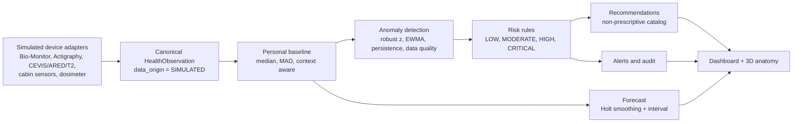

# AHI: Astronaut Health Intelligence

Real-time health monitoring and decision support for astronauts. NASA Space Apps Challenge 2026, *Health Monitoring Software*.

AHI integrates (simulated) data from the equipment astronauts wear and use, compares every signal with each person's own baseline, detects deviations and trends, and shows the result on a 3D anatomical body so anyone on the crew can understand their health at a glance and act early.

> Decision support only. Not a medical device, not a diagnosis. All device data in this MVP is **simulated** and labeled `SIMULATED` everywhere.

## Run it

Requirements: Node 20+.

```bash
cd frontend/web
npm install
npm run dev
```

Open http://localhost:5173 (best at 1440x900 or larger). No backend, no internet needed after install: the whole simulation runs in the browser, so the demo works offline.

Other commands (inside `frontend/web`): `npm test` (engine unit and scenario tests), `npx tsc -b` (typecheck), `npx vite build` (production build).

## What you see

| Area | Purpose |
| --- | --- |
| Top bar | Mission, mission elapsed time, comm delay, `SIMULATED DATA` provenance badge, scenario player (play, pause, speed, reset), alerts bell |
| Crew (left) | One card per astronaut with plain-language status ("All good", "Keep an eye", "Act soon", "Act now", "Signal lost") and live vitals |
| 3D body (center) | Procedural anatomy (skin, muscles, skeleton, organs, vessels). Organs glow in their status color, the heart beats at the live heart rate and the lungs breathe at the live breathing rate. Click an organ to focus it |
| What needs attention (right) | Status, why (contributing factors), recommended actions (Mark done logs an intervention), forecasts with uncertainty |
| Bottom | Live vital tiles with sparklines and personal normal band, cabin environment, device status |

Status always combines color, icon and words, and missing data is never shown as normal.

### v2 additions

- **Start demo**: a 10-step guided tour that drives the scenarios by itself (ideal for judges).
- **Ground view / Crew view**: mission control layout vs a calm, tablet-friendly view for the astronaut. **Presentation mode** (P) enlarges text for projectors.
- **Earth link and Mars delay**: switch ISS, Moon, Mars (4 or 22 min one way). Health packets and consult requests travel with the delay, simulated flight surgeon replies come back later, and AHI shows what the crew can do on board first.
- **Status timeline** with alert, action, check-in and message markers; event markers on every trend chart.
- **Daily check-in** (mood, fatigue, stress, sleep quality, symptoms) that corroborates objective signals.
- **What if**: hypothetical trajectories with vs without a recommended action (simulation, never a claim of clinical efficacy).
- **Mission overview**: radiation dose vs a demo budget, exercise adherence, weekly sleep, resting HR and HRV over the mission.
- **Shift handover report**: printable, with FHIR R4 Bundle export (pseudonymized).
- **Data and model**: two real public NASA OSDR datasets (Inspiration4 blood panels, `REAL_PUBLIC`, full provenance), the simulated device list and the model card.
- **Alert escalation** when CRITICAL or HIGH alerts stay unacknowledged; keyboard shortcuts (press ?).

Engine evaluation: `npm run evaluate` regenerates [docs/model-card.md](docs/model-card.md). Real data provenance: [docs/data-source-inventory.md](docs/data-source-inventory.md). Data team guide (metrics, schemas, NASA sources, pt-BR): [docs/data-guide.md](docs/data-guide.md).

## Demo scenarios

| Scenario | Who | What happens |
| --- | --- | --- |
| Nominal day | All | Stable, within personal ranges |
| Progressive fatigue | LYRA | Sleep drops, HRV falls, resting HR drifts up over days (use 1 h/s) |
| Cabin CO2 rise | Cabin | CO2 climbs, breathing rate and reaction time shift for everyone |
| Exercise performance decline | ATLAS | Workout output falls session after session |
| Sensor failure | VEGA | Bio-Monitor shirt goes stale, then offline: regions turn grey |
| Acute cardio event | ORION | HR climbs, SpO2 drops, CRITICAL alert within simulated minutes |

Step-by-step pitch: [docs/demo-script.md](docs/demo-script.md).

## How it works



- `frontend/web/src/engine/`: simulators, analytics and rules (documented in [its README](frontend/web/src/engine/README.md)). All thresholds live in `config.ts` and are demo configuration, not official NASA limits.
- `frontend/web/src/state/store.ts`: zustand store and simulation clock.
- `frontend/web/src/features/anatomy/`: procedural 3D anatomy (three.js / react-three-fiber), no external model files.
- `frontend/web/src/types/domain.ts`: canonical model and shared contract (follows `PROJECT_MASTER.md` section 6).

## Limitations and next steps

- Device data is simulated; the adapter contract is ready for real feeds. No claim of live ISS connectivity.
- Physiology model, thresholds and intervention effects are simplified and hypothetical.
- Eyes are drawn as passive anatomy only: no eye monitoring device feeds this MVP. Spaceflight associated neuro-ocular syndrome (SANS) tracking from periodic exams (OCT, ocular ultrasound) is a future extension.
- Next: import public NASA OSDR datasets as `REAL_PUBLIC`, FastAPI ingestion backend behind the same adapters, flight surgeon review workflow, role-based access.

Full product, data and architecture spec: [PROJECT_MASTER.md](PROJECT_MASTER.md).
