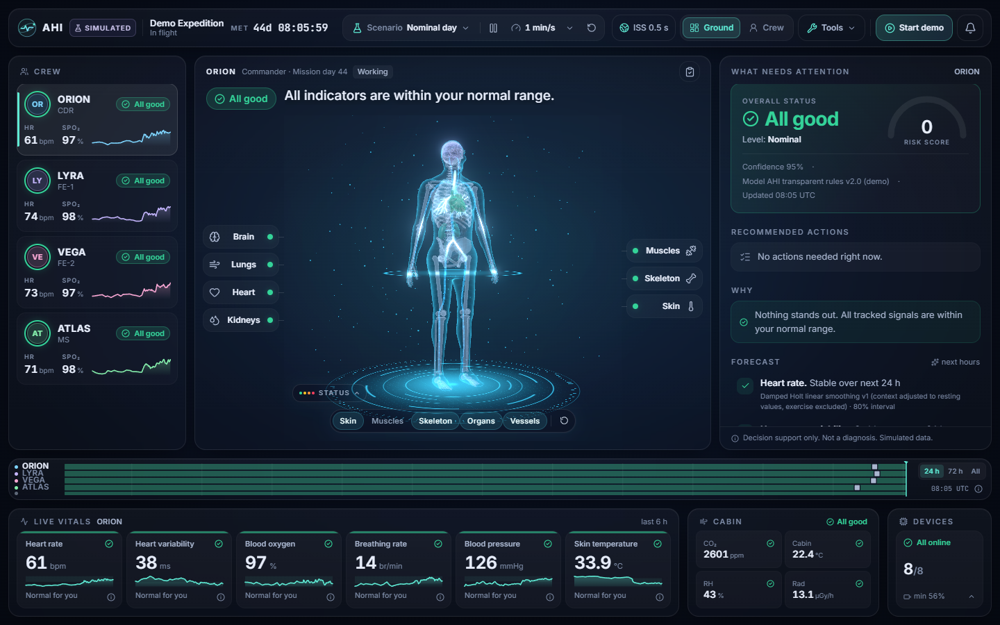
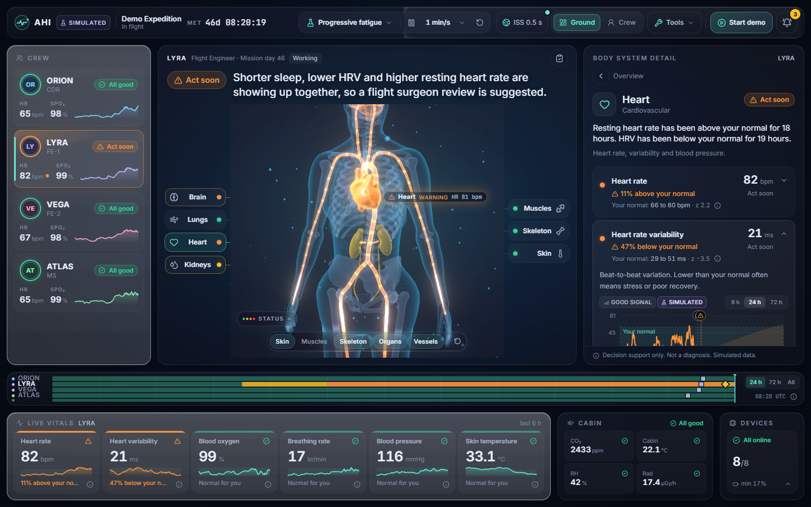
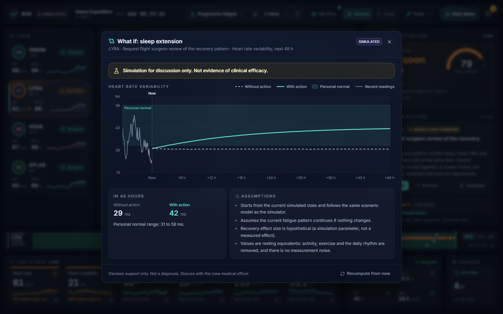
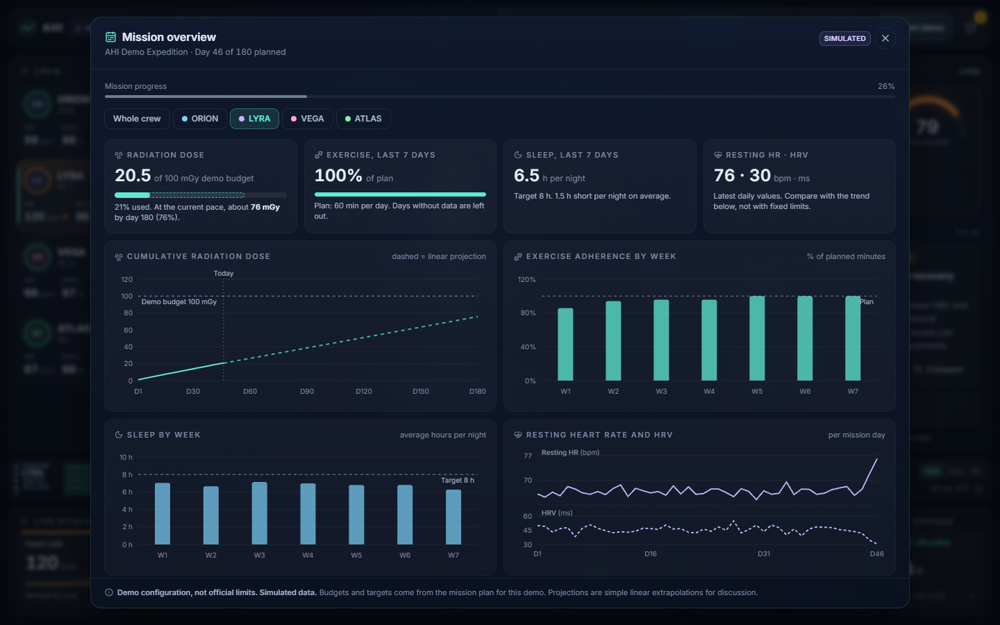
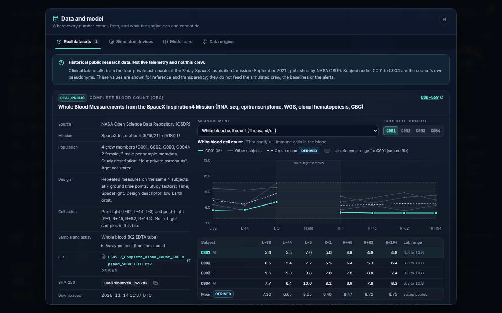
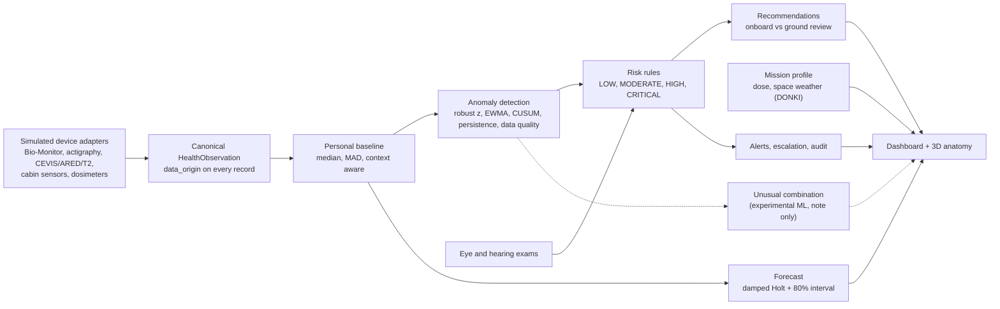

<div align="center">

# Astronaut Health Intelligence Platform

**Real-time health monitoring and decision support for astronauts, with a 3D view of the body.**

[](https://github.com/lucaspalharesbarbosa/astronaut-health-intelligence-platform/actions/workflows/ci.yml)
[](https://lucaspalharesbarbosa.github.io/astronaut-health-intelligence-platform/)
[](https://www.spaceappschallenge.org/2026/challenges/health-monitoring-software/)
[](LICENSE)
[](frontend/web/public/anatomy/LICENSE.md)


[Documentation](https://lucaspalharesbarbosa.github.io/astronaut-health-intelligence-platform/) ·
[Documentação em português](https://lucaspalharesbarbosa.github.io/astronaut-health-intelligence-platform/pt/) ·
[Quick start](#quick-start) ·
[Demo scenarios](#demo-scenarios)



</div>

> [!IMPORTANT]
> AHI is **decision support, not a medical device**. It does not diagnose or prescribe. All device data in this project is **simulated** and labeled `SIMULATED` everywhere. Real NASA data (OSDR lab panels, DONKI space weather) is shown only as reference and mission context, with full provenance, and never feeds a personal status.

---

## Table of contents

- [Why AHI](#why-ahi)
- [What it does](#what-it-does)
- [Quick start](#quick-start)
- [Demo scenarios](#demo-scenarios)
- [How it works](#how-it-works)
- [Data and science](#data-and-science)
- [Project structure](#project-structure)
- [Documentation](#documentation)
- [Limitations and roadmap](#limitations-and-roadmap)
- [License and acknowledgments](#license-and-acknowledgments)

---

## Why AHI

Long missions expose crews to the five hazards of human spaceflight: **radiation, isolation and confinement, distance from Earth, altered gravity and hostile closed environments**. Health signals come from many devices at different rates, and medical support may be minutes away. On a Mars mission, a question to Earth and its answer take up to 44 minutes.

The crew needs to understand its own health **at a glance** and act early. AHI turns physiological and environmental signals into one integrated, explainable view of each astronaut, comparing every person **with their own normal**, not with a population average.

## What it does

| | |
| --- | --- |
| **3D anatomy** | A realistic anatomical atlas (Z-Anatomy) with 250 structures. Zoom toward the pointer, **Monitor** mode (only monitored systems react) or **Explore** mode (every structure), a keyboard body navigator and a scan band that shows monitoring is live. The heart beats at the live heart rate and the lungs breathe at the live breathing rate. |
| **Personal baselines** | Each metric is compared with that astronaut's own normal band (robust median and MAD, aware of sleep, rest, work and exercise). |
| **Statistics first** | Robust z, EWMA drift, CUSUM for small steady drifts and persistence rules give a status (All good, Keep an eye, Act soon, Act now, Signal lost) with reasons in plain language. An experimental Isolation Forest adds an "Unusual combination" note and never changes a status. Missing data is never shown as normal. |
| **Mission profiles** | Launch, ISS, Moon and Mars transit with cited reference values (dose rate, gravity, distance, delay), the mission dose against the NASA 600 mSv career limit, and a space weather advisory built on real NASA DONKI events. |
| **Eyes and ears** | Periodic simulated eye exams for SANS (OCT, ultrasound, acuity) and hearing tests, compared with the pre-flight baseline; daily noise against NASA-STD-3001. |
| **What to do** | Non-prescriptive recommended actions, tagged "Can act on board now" or "Needs flight surgeon", plus a hypothetical with vs without comparison. |
| **Distance from Earth** | ISS, Moon and Mars link profiles. Messages travel with the light time delay, and AHI puts on board steps first when Earth is far. |
| **Forecasts** | Projections from 24 h to 15 days with an 80% band that widens with the horizon, only when there is enough history. |
| **Devices** | "Measured by" lists the devices behind every reading; an operator can pause a device (its readings read "Paused by operator", never normal). |
| **Accessibility** | Alert sounds per severity that repeat and escalate until acknowledged, audio description (`D`), skip links, live regions and full keyboard use. |
| **Languages** | English by default. Português (Brasil), Español, 日本語 and Deutsch are optional in Tools > Language: machine assisted, pending native review. |
| **Ask AHI** | A plain language assistant that explains what the engine shows, with a "Based on:" line. Demo with the Claude API through the backend; a real mission needs the onboard offline design in [docs/assistant-architecture.md](docs/assistant-architecture.md). |
| **Two views** | Ground view for flight surgeons and mission control, Crew view for the astronaut (with "Your body systems" cards). Presentation mode and a 10 step guided demo. |
| **Backend (optional)** | FastAPI modular monolith: ingestion, observations, NASA DONKI and OSDR connectors, assistant, experimental analytics. The app runs fully without it (offline demo mode). |

<table>
  <tr>
    <td width="50%"><br/><sub><b>Acute event:</b> critical banner, heart and lungs highlighted in red, actions with flight surgeon flag.</sub></td>
    <td width="50%"><br/><sub><b>Crew view:</b> plain language, top two actions, daily check-in.</sub></td>
  </tr>
  <tr>
    <td width="50%"><br/><sub><b>Body system detail:</b> personal normal band, history and forecast cone.</sub></td>
    <td width="50%"><br/><sub><b>What if:</b> hypothetical trajectories with and without an action.</sub></td>
  </tr>
  <tr>
    <td width="50%"><br/><sub><b>Mission overview:</b> radiation, exercise, sleep, HR and HRV over the mission.</sub></td>
    <td width="50%"><br/><sub><b>Real NASA data:</b> Inspiration4 blood count with provenance.</sub></td>
  </tr>
</table>

## Quick start

### App only (offline demo mode)

Requirements: **Node.js 20 or newer**. No backend and no API key: after `npm install` the demo works offline, with a bundled real NASA DONKI snapshot for space weather.

```bash
git clone https://github.com/lucaspalharesbarbosa/astronaut-health-intelligence-platform.git
cd astronaut-health-intelligence-platform/frontend/web
npm install
npm run dev
```

Open http://localhost:5173 (best at 1440x900 or larger) and click **Start demo**.

### App plus backend

Requirements: **Python 3.12 or newer**. In a second terminal:

```bash
cd backend
python -m venv .venv
# Windows: .venv\Scripts\activate    macOS or Linux: source .venv/bin/activate
pip install -r requirements-dev.txt
cp .env.example .env
uvicorn app.main:create_app --factory --reload --port 8000
```

API docs at http://localhost:8000/docs. Reload the app: Data and model, NASA context says "Connected to AHI API", space weather comes live from NASA DONKI and the OSDR study search is available. SQLite is used by default. No NASA API key is needed.

**Ask AHI** needs a Claude API key in `backend/.env` (gitignored, never commit it):

```bash
ANTHROPIC_API_KEY=your-key-here
```

Without it the app shows "Assistant offline" and everything else works.

### Docker Compose

From the repository root, `docker compose up --build` starts PostgreSQL 17 and the API on port 8000 (migrations run on start). Run the web app with `npm run dev` as above. For static hosting, build the app with `VITE_API_URL=off`.

| Command | Where | What it does |
| --- | --- | --- |
| `npm run dev` | `frontend/web` | Development server on port 5173 |
| `npm test` | `frontend/web` | 375 unit and scenario tests (vitest) |
| `npx tsc -b` | `frontend/web` | Type check |
| `npx vite build` | `frontend/web` | Production build into `dist/` |
| `npm run evaluate` | `frontend/web` | Re-runs the engine evaluation and regenerates `docs/model-card.md` |
| `npm run api:types` | `frontend/web` | Regenerates the API types from `backend/openapi.json` |
| `npm run anatomy:validate` | `frontend/web` | Checks the published 3D atlas against its manifest contract |
| `python -m pytest` | `backend` | Backend tests (external HTTP mocked) |
| `python -m app.cli donki-snapshot` | `backend` | Refreshes the bundled DONKI snapshot |

The first load calibrates personal baselines and downloads the 3D anatomy (about 3 MB for the default view), so it takes a few seconds. Full setup and troubleshooting: [Setup, commands and troubleshooting](https://lucaspalharesbarbosa.github.io/astronaut-health-intelligence-platform/engineering/quick-start).

## Demo scenarios

Pick a scenario in the top bar, or click **Start demo** for the guided tour.

| Scenario | Who | What happens | First alert (simulated time) |
| --- | --- | --- | --- |
| Nominal day | All | Stable, within personal ranges | None (0 false alerts in 60 crew days) |
| Acute cardio event | ORION | Heart rate jumps, blood oxygen drops, CRITICAL | 7 min |
| Sensor failure | VEGA | Bio-Monitor shirt goes stale, then offline; organs turn grey | 14 min |
| Cabin CO₂ rise | Cabin | CO₂ climbs, breathing rate and reaction time shift for everyone | 90 min (HIGH at 2.3 h) |
| Progressive fatigue | LYRA | Sleep drops, HRV falls, resting heart rate drifts up | 31.8 h (HIGH at 33.0 h) |
| Exercise performance decline | ATLAS | Workout output falls session after session | 27.5 h (HIGH at 75.5 h) |
| Eye changes (SANS like) | ORION | Simulated eye exams drift from the pre-flight baseline | Watch from the flight day 30 exam, Warning at flight day 90 |

Times come from `npm run evaluate` (engine `ahi-engine 2.0.0`, 5 seeds). Any scenario runs under any **mission profile** (Launch, ISS, Moon, Mars transit). A 4 to 5 minute pitch script is in [docs/demo-script.md](docs/demo-script.md).

## How it works



- **The app runs in the browser.** A zustand store drives a simulation clock (from real time up to 1 hour per second). The engine is pure TypeScript and unit tested. Without the backend the app is in offline demo mode.
- **Optional backend.** A FastAPI modular monolith (`backend/`) validates and stores canonical observations (idempotent ingestion), reads NASA DONKI and OSDR, hosts the assistant demo and an experimental scikit-learn analytics endpoint. SQLite by default, PostgreSQL with Docker Compose. Frontend API types are generated from its OpenAPI schema.
- **Adapter contract.** Each simulated device follows the adapter contract from the project spec, so real feeds can replace the simulators without changing the UI.
- **Anatomical atlas in 3D.** The body is the open Z-Anatomy atlas, prepared in Blender and shipped as one compressed GLB per anatomical system (250 structures, about 880k triangles, 4.64 MB), loaded on demand. One file (`atlas/health.ts`) maps each structure to a monitored body region; structures that nothing measures are shown as context only, with no status. If the atlas cannot load, a procedural model generated in code takes over automatically.

**Stack:** React 19, TypeScript, Vite, Tailwind CSS v4, three.js with react-three-fiber, zustand, recharts, vitest. Backend: Python 3.12, FastAPI, Pydantic, SQLAlchemy, Alembic, scikit-learn, pytest. 3D asset preparation: Blender (headless) and glTF Transform. Documentation site: VitePress.

## Data and science

| Data | Origin | Status |
| --- | --- | --- |
| Vital signs, sleep, activity, exercise, hydration, cognition | Simulated devices, calibrated to plausible ranges | `SIMULATED` |
| Daily check-in (mood, fatigue, stress, sleep quality) | Typed in the app | `MANUAL` |
| Cabin CO₂, temperature, humidity, radiation | Simulated (NASA EDA real replay is the next step) | `SIMULATED` |
| Eye exams (SANS) and hearing tests | Simulated periodic exams on NASA's published schedule | `SIMULATED` |
| Blood count and metabolic panel (Inspiration4, OSD-569 and OSD-575) | NASA Open Science Data Repository | `REAL_PUBLIC` (reference only) |
| Space weather events (flares, SEP, CME, storms) | NASA DONKI (CCMC), live through the backend or a bundled snapshot of 105 events retrieved 2026-11-15 | `REAL_PUBLIC` (mission context only) |
| Mission profile reference values | Published sources cited per value (for example Berger et al. 2017, Zeitlin et al. 2013, Zhang et al. 2020, NASA-STD-3001) | Cited reference |
| 3D anatomical model (reference anatomy, not health data) | Z-Anatomy atlas, based on BodyParts3D; kidneys are AHI procedural geometry | Third party asset, CC BY-SA 4.0 |

The 3D body is one reference model shown for every crew member. It is not a scan of anyone, and the status colors on it come from the simulated health data.

Principles: every record carries its origin, astronaut and analog or animal data are never mixed, thresholds are **demo configuration, not official NASA limits**, and correlation is never presented as causation.

- Mission profiles and their citations: [Mission profiles, radiation and space weather](https://lucaspalharesbarbosa.github.io/astronaut-health-intelligence-platform/intelligence/mission-profiles)
- Data sources and provenance: [docs/data-source-inventory.md](docs/data-source-inventory.md)
- Data team guide (metrics, schemas, NASA sources, in Portuguese): [docs/data-guide.md](docs/data-guide.md)
- Model card and evaluation: [docs/model-card.md](docs/model-card.md)
- 3D anatomy assets (provenance, license, rebuild guide): [docs/anatomy-assets.md](docs/anatomy-assets.md)

## Project structure

```text
.
├── frontend/web/             # The app (React + TypeScript + Vite)
│   ├── src/engine/           # Simulators, baselines, anomalies, CUSUM, risk, forecast, recommendations,
│   │                         # exams (eyes, ears), missions (profiles, dose, space weather), ml (experimental)
│   ├── src/state/            # zustand store and simulation clock
│   ├── src/features/         # UI features (anatomy, crew, attention, timeline, comms, ...)
│   ├── src/types/domain.ts   # Canonical data model and shared contract
│   ├── public/anatomy/       # 3D atlas: one GLB per anatomical system, manifest.json, LICENSE.md (CC BY-SA 4.0)
│   └── scripts/              # Engine evaluation, NASA OSDR import, anatomy asset pipeline (scripts/anatomy)
├── backend/                  # Optional AHI API (FastAPI): ingestion, observations, NASA, assistant, analytics
├── docker-compose.yml        # PostgreSQL 17 and the API
├── data/                     # NASA OSDR raw files, manifests (provenance) and processed data
├── docs/                     # Demo script, model card, data inventory, data team guide, anatomy assets guide,
│                             # assistant architecture
├── docs-site/                # Documentation website (VitePress, English and Portuguese)
└── PROJECT_MASTER.md         # Product, data and architecture specification (Portuguese)
```

## Documentation

The full documentation is published with GitHub Pages, in **English and Brazilian Portuguese**:

**https://lucaspalharesbarbosa.github.io/astronaut-health-intelligence-platform/**

It covers the product tour, mission features, demo scenarios, architecture, data model, health intelligence engine, 3D anatomy, NASA data sources, model card, ethics and limits, roadmap and contributing guide. Good starting points:

- [Feature status matrix](https://lucaspalharesbarbosa.github.io/astronaut-health-intelligence-platform/overview/feature-status): what is implemented, experimental or planned
- [Backend and API](https://lucaspalharesbarbosa.github.io/astronaut-health-intelligence-platform/architecture/backend) and [offline demo mode](https://lucaspalharesbarbosa.github.io/astronaut-health-intelligence-platform/architecture/backend#offline-demo-mode)
- [Mission profiles, radiation and space weather](https://lucaspalharesbarbosa.github.io/astronaut-health-intelligence-platform/intelligence/mission-profiles)
- [Eye health (SANS) and hearing](https://lucaspalharesbarbosa.github.io/astronaut-health-intelligence-platform/intelligence/eye-and-hearing)
- [Anomaly detection](https://lucaspalharesbarbosa.github.io/astronaut-health-intelligence-platform/intelligence/anomaly-detection) (CUSUM and the experimental multivariate detector)
- [Ask AHI assistant](https://lucaspalharesbarbosa.github.io/astronaut-health-intelligence-platform/product/assistant) and [accessibility](https://lucaspalharesbarbosa.github.io/astronaut-health-intelligence-platform/product/accessibility)
- [Roadmap](https://lucaspalharesbarbosa.github.io/astronaut-health-intelligence-platform/resources/roadmap)

To run the documentation locally:

```bash
cd docs-site
npm install
npm run docs:dev
```

## Limitations and roadmap

- Device data is simulated. No public continuous physiological telemetry of astronauts exists, so vital signs stay simulated and calibrated. No claim of live ISS connectivity.
- Physiology model, thresholds and intervention effects are simplified and hypothetical.
- The 3D body is one reference model for every crew member (adult male source model with a neutral groin; build, proportions and chest remain those of the source). It is not the astronaut's scan and does not adapt to sex, height or body composition. It has no textures, and the kidneys are simple procedural shapes.
- Indicators relate to a body system, not to a single structure: a highlighted structure marks its body system, never a finding in that structure. Structures that nothing measures (digestive organs, glands, nerves and others) are context only and show no status.
- The mission dose is an approximation (absorbed dose times a reference quality ratio), not NASA's effective dose method. The machine learning detector has only seen simulated data.
- The assistant demo uses a cloud model, which is not acceptable on a real mission.
- The health engine runs in the browser; the backend does not run it yet. No authentication or access profiles.
- Performance was only observed on one development laptop; it is not a benchmark.

Next steps: port the health engine to the Python backend, a clinical review flow, access profiles, replay of real ISS cabin telemetry from NASA EDA, and for the 3D anatomy textures, a female reference model and BodyParts3D kidney geometry. See the [roadmap](https://lucaspalharesbarbosa.github.io/astronaut-health-intelligence-platform/resources/roadmap).

## License and acknowledgments

This repository has two licenses:

- **Code**: released under the [MIT License](LICENSE).
- **3D anatomy assets** (`frontend/web/public/anatomy/*.glb` and `manifest.json`): a derived work of the Z-Anatomy atlas, distributed under [CC BY-SA 4.0](https://creativecommons.org/licenses/by-sa/4.0/). The MIT License does not apply to these files. See [frontend/web/public/anatomy/LICENSE.md](frontend/web/public/anatomy/LICENSE.md) and [docs/anatomy-assets.md](docs/anatomy-assets.md).

Required attribution for the anatomy assets:

```text
Z-Anatomy - The libre 3D atlas of anatomy - CC-BY-SA 4.0 (https://www.z-anatomy.com/)
BodyParts3D - The Database Center for Life Science - CC-BY-SA 2.1 Japan
```

The assets were modified by this project (structures grouped, decimated, re-oriented and compressed; ear, kidney and reproductive structures left out; kidneys rebuilt as AHI procedural geometry).

Acknowledgments:

- Real data: NASA Open Science Data Repository, studies **OSD-569** and **OSD-575** (SpaceX Inspiration4 biospecimen program). The source does not state a license; see [docs/data-source-inventory.md](docs/data-source-inventory.md).
- Built for the [NASA Space Apps Challenge 2026](https://www.spaceappschallenge.org/2026/challenges/health-monitoring-software/), *Health Monitoring Software*.
- Not affiliated with or endorsed by NASA.
