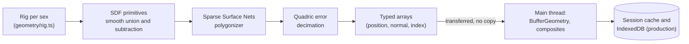

# 3D Anatomy Rendering

The body in the center of the screen of the Astronaut Health Intelligence Platform (AHI) is generated **procedurally in code**: there are no external model files. In one line: signed distance functions polygonized with Surface Nets in 8 Web Workers, then simplified from about 842k to about 200k triangles drawn per frame, and cached in the browser. It is a holographic, layered human body (skin, muscles, skeleton, organs, vessels) where each body system shows its status, the heart beats at the live heart rate and the lungs breathe at the live breathing rate.

Code: `frontend/web/src/features/anatomy/` (three.js with react-three-fiber). Status colors come from the engine's region status ([Risk assessment](../intelligence/risk-assessment#body-regions)).

## Procedural geometry

1. **Signed distance fields (SDF).** Each body part is a list of primitives, each a distance function with an axis aligned bounding box, combined with smooth union or smooth subtraction.
2. **Sparse, block culled Surface Nets.** The polygonizer only evaluates 8x8x8 node blocks close to the surface, and only with the primitives overlapping each block. According to the code, a full human body at 5 mm resolution builds in a few hundred milliseconds.
3. **Resolution per part.** Body skin (hands excluded) uses a 5.5 mm grid; hands use 2.8 mm so the fingers separate, and are joined to the body at the wrist planes.
4. **Simplification.** Quadric error decimation (half edge collapse, Garland and Heckbert) removes most of the triangles on flat and gently curved areas with no visible change. Surviving vertices stay exactly in place, so the analytic SDF normals remain valid.
5. **Level of detail.** Skin and hands are built in a high and a light variant. The light skin is used when the projected body is shorter than 620 device pixels.
6. **Other parts.** Skeleton (axial and limbs), muscles, brain, heart, lungs, bronchi, kidneys, context organs, eyes, vessels (tubes along Catmull-Rom splines) and invisible pick proxies for clicking organs.

### Workers and cache

| Step | Detail |
| --- | --- |
| Parallel build | Parts are split into 8 build groups of roughly equal cost, each built in its own Web Worker |
| Transfer | Typed arrays are transferred back to the main thread (no copy) |
| Fallback | If a worker cannot start, that group is built on the main thread, yielding between groups so the page can paint |
| Composites | Skin, light skin and skeleton are merged from pieces on the main thread |
| Session cache | One build per body variant (male and female) per session; the other variant is prefetched in the background so switching crew members is instant |
| Persistent cache | Production builds store the meshes in IndexedDB (versioned `ahi-anatomy-v2`), so repeat visits skip the build. Development skips this cache on purpose |
| Lazy chunk | The whole viewer is a lazily loaded chunk |

The female variant is rendered slightly smaller (scale 0.94, a population average height ratio).

## Layers

| Layer | Default | Notes |
| --- | --- | --- |
| Skin | on | Fresnel rim shell with fine scanlines and chest expansion while breathing |
| Muscles | automatic | Appears when muscles are selected or not nominal |
| Skeleton | on | Additive X-ray look, edges brighter than faces |
| Organs | on | Brain, heart, lungs, kidneys: lit translucent volumes with a fresnel rim |
| Vessels | on | Arteries with a glow and a pressure pulse traveling outward from the heart |

Toggle layers with the pill under the body. The reset button frames the whole body again. Selecting a region always forces its layer visible.

## Regions and status colors

Seven monitored regions map to the metric catalog (see [Data dictionary](../data/data-dictionary#body-regions)): brain, heart, lungs, kidneys, muscles, skeleton (bones) and skin.

| Status | Visual |
| --- | --- |
| `LOW` | Calm, cool hologram tint per region (cyan, teal, indigo...), so any warm color reads as attention |
| `MODERATE` | Amber, brighter, gentle pulse |
| `HIGH` | Orange, brighter, stronger pulse |
| `CRITICAL` | Red, brightest, strongest pulse |
| `NO_DATA` | Slate grey, dimmed, no pulse, no animation |

- On the skin, the alarm moves to the **silhouette** (a status colored rim, a pulsing edge and a faint drifting hatch) instead of tinting the whole body, so the organs stay readable.
- When a region's status changes, a short **scan pulse** (a spherical wavefront) starts from that region to draw the eye. It does not fire on first load or when switching crew members.
- Whole body systems (skin, muscles, skeleton) pulse from the body center; organs pulse from their own anchor.

::: info Eyes
Eyes are drawn as passive context anatomy only. No eye monitoring device feeds this prototype, so they have no status. SANS tracking from periodic exams is on the [roadmap](../resources/roadmap).
:::

## Animation from live vitals

The 3D scene reads the selected astronaut's live heart rate and breathing rate from the store **every frame, without subscribing**, so the animation never causes React re-renders.

| Organ | Driven by | How |
| --- | --- | --- |
| Heart | Live heart rate | The beat phase advances by HR / 60 per second. Each beat is a "lub dub" curve (S1, then S2 at about 30% of the period); the heart scales up by up to 6.5% |
| Arteries | Heart beat | Two pressure fronts travel outward from the heart on each beat |
| Lungs | Live breathing rate | The breath phase advances by RR / 60 per second, about 40% inhale and 60% exhale; the lungs scale on three axes |
| Skin and muscles | Breathing | Chest expansion with the same breath curve |
| Bronchi | Breathing | Airflow glow during inhale |

When the heart or lungs region is `NO_DATA`, or the value is missing, the animation stops. A body that stops beating during the sensor failure scenario is deliberate: missing data is never shown as normal.

## Interaction

- **Orbit** with the mouse; the body **auto rotates** slowly when idle and pauses while a region is hovered.
- **Click** an organ or a body system chip to fly the camera to that region and open its detail in the right panel. `Esc` goes back.
- **Hover** shows a tooltip with the region and its key value.
- Whole body shots are **fitted to the viewport**: the body fills about 88% of the free height between the top reserve and the control pill, and is re-fitted when the container resizes.
- The critical alert banner floats over the stage header instead of pushing it down, so the body keeps its full size during alerts (at 1280x720 with an active critical alert, the body height went from 247 to 359 px after this change).

## Labels and legend

- **Floating labels** (for example "Heart WARNING HR 81 bpm") appear for every region that is not nominal and for the focused region. They are plain DOM in an overlay above the canvas, so text stays crisp at any scale.
- A small projector inside the canvas projects the anchors every frame, **stacks labels per side so they never overlap**, keeps them clear of the legend and the control pill, and writes positions straight to the elements (no React renders per frame).
- Labels use the same icons as the rest of the app: shape plus color plus words, never color alone.
- **Legend**: collapsible, open by default when the viewer is wider than 820 px. It lists the five levels with their crew wording and the note "Vs personal baseline. Simulated data."
- In **presentation mode** labels, tooltip and legend scale up by 1.3.

## Rendering

| Element | Detail |
| --- | --- |
| Materials | Custom holographic shader materials sharing a few global uniforms (time, scan line height, reveal height), so one write per frame updates every material |
| Environment | Holographic floor disc, a sweeping scan plane and drifting particles |
| Reveal | The body materializes from the floor once the geometry is ready |
| Post processing | Bloom glow (can be disabled through a prop for very low end GPUs) |
| Compact mode | Smaller controls for narrow containers such as the Crew view |

## Development lab

`npm run dev` also serves a dev only lab page at `/anatomy-lab.html`. It fakes region statuses and vitals through the store so every visual state can be checked, and reports the triangles drawn per frame.

## Status

<StatusBadge status="IMPLEMENTED" /> The 3D viewer has no automated tests; it is checked visually with the development lab page. The eyes have no monitoring: <StatusBadge status="PLANNED" />.

## Next steps

- [Architecture overview](./overview): where the viewer sits in the app.
- [Product tour](../product/product-tour#_3d-body-and-body-system-chips): how users interact with it.
- [Design system and accessibility](../product/design-system): status colors and cues.
