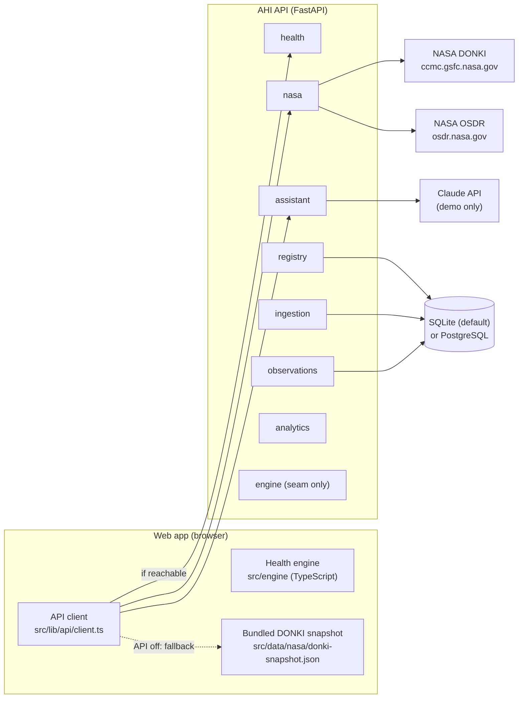

# Backend & API

## What it is

The **AHI API** (`backend/`) is a **modular monolith** in Python with FastAPI: one deployable service, one module per responsibility, each module owning its router, schemas and tables. It stores canonical observations, reads public NASA data, hosts the demo assistant and an experimental analytics endpoint. It follows the decision recorded in the product spec (section 7.1): no microservices, no message bus, no Kubernetes in the MVP.

The **web app does not need it.** Without the API the app runs in **offline demo mode**: the health engine runs in the browser and space weather comes from a bundled real DONKI snapshot. With the API running, the app shows "Connected to AHI API" and loads NASA data live.



## Modules

All endpoints live under `/api/v1`. Interactive documentation is served at `/docs` when the API runs.

| Module | Endpoints | Purpose |
| --- | --- | --- |
| `health` | `GET /health`, `/health/live`, `/health/ready` | API and database status; `/health` is what the web app probes |
| `registry` | `POST/GET /astronauts`, `GET /astronauts/{id}`, `POST/GET /missions`, `POST/GET /devices` | Pseudonymized registry: unknown fields such as a real name are rejected |
| `ingestion` | `POST /observations` (202) | Validates and stores canonical `HealthObservation` batches |
| `observations` | `GET /observations?subject_id=&metric_code=&data_origin=&start=&end=` | Query one subject's observations in UTC order |
| `nasa` | `GET /space-weather?days=30`, `GET /nasa/osdr/studies?q=` | Real public NASA data, cached 15 min in process |
| `assistant` | `POST /assistant/chat` (server sent events), `GET /assistant/status` | Demo assistant ([Ask AHI](../product/assistant)) |
| `analytics` | `POST /analytics/multivariate` | Experimental, machine learning: scikit-learn parity path of the browser detector ([Anomaly detection](../intelligence/anomaly-detection#unusual-combination-experimental)) |
| `engine` | none | Documented seam for porting the TypeScript engine to Python |

## Ingestion rules

Ingestion enforces the data rules of the product spec on the server side:

- `data_origin` is mandatory and must come with its provenance: `REAL_PUBLIC` needs a repository and a dataset accession, `SIMULATED` needs a `device_id`, `DERIVED` needs `metadata.method`.
- `value: null` is accepted only with `quality.status` `MISSING` or `INVALID`, and is stored as NULL, never as zero.
- Timestamps must carry a time zone and are stored in UTC.
- A batch is validated as a whole: one invalid observation gives 422 and nothing is stored.
- Ingestion is **idempotent by `observation_id`**: resending the same observation is a no op, reusing an id with different content is reported as rejected.

## NASA connectors

No NASA API key is needed. Both sources are public.

- **DONKI** (Space Weather Database Of Notifications, Knowledge, Information, run by CCMC at NASA Goddard): `https://ccmc.gsfc.nasa.gov/DONKI/WS/get/{FLR,SEP,CME,GST}`. CCMC retired the former `kauai.ccmc.gsfc.nasa.gov` host; the paths after `/DONKI/` did not change. If any of the four feeds fails the endpoint answers 502, never a partial list that would read as "no storms".
- **OSDR** study search: `https://osdr.nasa.gov/osdr/data/search`, filtered to human studies; returns accession, title, link, project type, mission and release date. Only available while the API runs.

Both are `REAL_PUBLIC` mission context, not astronaut measurements ([NASA data sources](../data/sources)).

## Offline demo mode

| Setting | Behavior |
| --- | --- |
| `VITE_API_URL` unset | The app probes `http://localhost:8000`; if it answers it goes live, otherwise it stays offline |
| `VITE_API_URL=https://...` | Same, against that address |
| `VITE_API_URL=off` | Never calls an API: for static hosting (for example GitHub Pages) |

Offline, the engine, the simulation and the 3D viewer work exactly as online. Space weather uses the bundled snapshot, OSDR search and the assistant are shown as unavailable.

## Generated types

The API schema is exported to `backend/openapi.json` (`python -m app.cli openapi`) and turned into TypeScript with `npm run api:types` in `frontend/web` (writes `src/types/api.gen.ts`). The hand written contract in `src/types/domain.ts` and `src/types/nasa.ts` stays the source for the engine; the generated file keeps the client honest about the API shapes.

## Storage and migrations

SQLite (`sqlite:///./ahi.db`) is the default and needs no setup. `docker-compose.yml` at the repository root runs PostgreSQL 17 and the API together. Alembic migrations run on start (`AUTO_MIGRATE=true`) or by hand with `alembic upgrade head`.

## Engine port seam

The health engine stays in TypeScript today so the app works with no server. `app/modules/engine/__init__.py` defines a `HealthEngine` protocol (input: canonical observations from the `observations` module; output: the `domain.ts` shapes tagged `DERIVED` with their method). The plan is a module by module port, reusing the vitest fixtures as pytest cases, with the TypeScript engine kept as the offline fallback. See the [Roadmap](../resources/roadmap).

## Running it

```bash
cd backend
python -m venv .venv
# Windows: .venv\Scripts\activate    macOS or Linux: source .venv/bin/activate
pip install -r requirements-dev.txt
uvicorn app.main:create_app --factory --reload --port 8000
# open http://localhost:8000/docs
```

Or, from the repository root, `docker compose up --build` (PostgreSQL and the API). Python 3.12 or newer. Configuration comes from `backend/.env` (copy `backend/.env.example`; never commit `.env`). Tests: `python -m pytest` in `backend` (external HTTP is mocked, the live NASA sources are never called).

## Status

<StatusBadge status="IMPLEMENTED" /> Modules, connectors, ingestion and the assistant are covered by pytest. <StatusBadge status="EXPERIMENTAL" /> for the analytics endpoint. <StatusBadge status="PLANNED" /> for the Python engine port, authentication and role based access.

## Next steps

- [Architecture overview](./overview)
- [Target architecture](./target-architecture): what is still conceptual.
- [Setup and commands](../engineering/quick-start)
