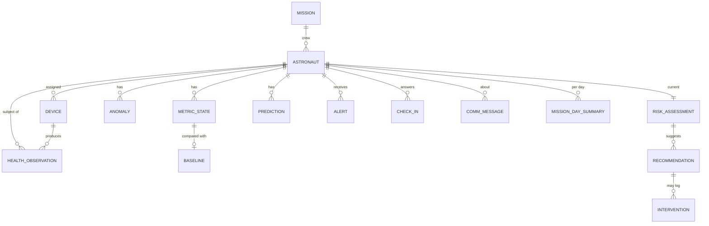

# Data Model & Contracts

The single source of truth for the data contracts of the Astronaut Health Intelligence Platform (AHI) is `frontend/web/src/types/domain.ts`, shared by the engine, the store and every UI feature. It follows section 6 of `PROJECT_MASTER.md`. The list of metric codes, units and regions is in the [Data dictionary](../data/data-dictionary).

::: warning Additive changes only
`domain.ts` is a shared contract. Add new optional fields or new union members; never rename or remove fields that other modules use. TypeScript `enum` is not allowed (`erasableSyntaxOnly`), so enumerations are string unions.
:::

## HealthObservation (canonical model)

One record per measurement. Vitals, cabin readings (`subject_id: "CABIN"`), lab results and self report all use the same shape.

```json
{
  "observation_id": "uuid or an idempotent key from the source",
  "subject_id": "AST-01",
  "mission_id": "MISSION-001",
  "device_id": "DEV-BIO-AST-01",
  "metric_code": "HEART_RATE",
  "value": 72.4,
  "unit": "bpm",
  "measured_at": "2026-11-13T14:30:00Z",
  "received_at": "2026-11-13T14:30:02Z",
  "data_origin": "SIMULATED",
  "source_reference": {
    "repository": null,
    "dataset_accession": null,
    "file_name": null,
    "record_reference": null
  },
  "quality": { "status": "VALID", "confidence": 1.0, "is_estimated": false },
  "context": { "mission_phase": "IN_FLIGHT", "activity": "REST" },
  "metadata": {}
}
```

| Field | Required | Type | Rules |
| --- | --- | --- | --- |
| `observation_id` | yes | string | Unique. Use an idempotent key from the source to deduplicate |
| `subject_id` | yes | string | Pseudonym (`AST-01`...), or `"CABIN"` for the environment |
| `mission_id` | recommended | string | Mission or study |
| `device_id` | recommended | string | Logical device or instrument |
| `metric_code` | yes | `MetricCode` | One of the codes in the [Data dictionary](../data/data-dictionary) |
| `value` | yes | number or `null` | **`null` when missing, never zero** |
| `unit` | yes | string | Canonical unit after normalization |
| `measured_at` | yes | ISO 8601 UTC | Always UTC |
| `received_at` | recommended | ISO 8601 UTC | Ingestion time |
| `data_origin` | yes | `DataOrigin` | `REAL_PUBLIC`, `DERIVED`, `SIMULATED` or `MANUAL` |
| `source_reference` | yes if imported | object | Repository, accession, file and record |
| `quality.status` | yes | `QualityStatus` | `VALID`, `QUESTIONABLE`, `INVALID`, `MISSING` |
| `quality.confidence` | recommended | 0 to 1 | Lower for estimated or doubtful values |
| `quality.is_estimated` | recommended | boolean | `true` for derived or interpolated values |
| `context.mission_phase` | recommended | `MissionPhase` | `PRE_FLIGHT`, `IN_FLIGHT`, `POST_FLIGHT` |
| `context.activity` | recommended | `ActivityContext` | `SLEEP`, `REST`, `WORK`, `EXERCISE`, `EVA` |
| `metadata` | optional | object | Original value and unit, time point label, population type |

Rules from the spec: store timestamps in UTC, normalize units without deleting the original value, never replace a missing value with zero, record quality and source for every imported record, and deduplicate by `observation_id`.

## Entities



| Entity | Purpose | Key fields |
| --- | --- | --- |
| `Astronaut` | Pseudonymized crew member | `id` (`AST-01`), `callsign`, `role`, `roleShort`, `age`, `sex`, `missionDay`, `color` |
| `Mission` | Mission and phase | `id`, `name`, `vehicle`, `phase`, `startedAt`, `commDelaySec` (one way) |
| `Device` | Logical device and its state | `id`, `kind`, `name`, `assignedTo`, `state`, `batteryPct`, `signalPct`, `lastSeenAt`, `data_origin`, `metrics`, `detail` |
| `MetricState` | Latest state of one metric for one subject | `current`, `status`, `zScore`, `ewma`, `trendPerHour`, `baseline`, `quality`, `driftZ`, `deviationPct`, `persistenceHours`, `baselineContext`, `contextBaselines`, `ruleId`, `explanation` |
| `Baseline` | Personal normal for one metric | `status` (`READY` or `INSUFFICIENT_DATA`), `n`, `median`, `mad`, `mean`, `sd`, `p05`, `p95`, `low`, `high`, `windowLabel`, `version` |
| `Anomaly` | A detected deviation | `metric`, `detectedAt`, `method` (`ROBUST_Z`, `EWMA`, `PERSISTENCE`, `COMBINED`, `DATA_QUALITY`), `severity`, `explanation` |
| `RiskAssessment` | Attention level of one astronaut | `risk_level`, `risk_score` (0 to 100), `contributing_factors`, `triggered_rules`, `confidence`, `model_version`, `evaluated_at`, `data_window`, `limitations`, `headline` |
| `Prediction` | Short term forecast of one metric | `method`, `horizonHours`, `points` (`t`, `v`, `lo`, `hi`), `intervalLabel`, `hoursToBandExit`, `eligible`, `disclaimer` |
| `Recommendation` | Non-prescriptive next step | `ruleId`, `title`, `rationale`, `priority`, `audience`, `region`, `requiresHumanReview`, `status`, `interventionKind`, `active`, `catalogVersion`, `autonomy` |
| `Intervention` | An action logged by a person | `kind`, `recommendationId`, `loggedAt`, `actor`, `note` |
| `Alert` | Notification with acknowledgement | `severity`, `title`, `detail`, `region`, `metric`, `ruleId`, `createdAt`, `acknowledgedAt`, `acknowledgedBy`, `resolvedAt`, `escalatedAt`, `escalationLevel` |
| `AuditEvent` | Audit trail entry | `at`, `actor`, `action`, `detail` |
| `CheckIn` | Daily subjective check-in | `mood`, `fatigue`, `stress`, `sleepQuality` (1 to 5), `symptoms`, `note`, `data_origin` |
| `CommMessage` | Message between vehicle and Earth | `direction`, `kind`, `title`, `body`, `sentAt`, `arrivesAt`, `status`, `relatedRecommendationId`, `relatedAlertId`, `data_origin` |
| `MissionDaySummary` | One mission day for the long term view | `missionDay`, `date`, `sleepHours`, `exerciseMinutes`, `exercisePlannedMinutes`, `restingHr`, `hrv`, `radiationDoseMgy`, `cumulativeDoseMgy`, `riskLevel`, `exerciseLoadPct`, `synthesized` |
| `MissionPlan` | Long term budgets (demo configuration) | `plannedDurationDays`, `radiationBudgetMgy`, `exercisePlanMinutesPerDay`, `sleepTargetHours`, `note` |
| `StatusFrame` | Snapshot for the timeline, every 15 sim minutes | `t`, `levels` (astronaut id or `CABIN` to status) |
| `InterventionComparison` | What-if result | `metric`, `kind`, `horizonHours`, `without`, `with`, `band`, `assumptions`, `disclaimer` |
| `DatasetRecord` | Provenance of a real public dataset | `source_name`, `source_url`, `dataset_accession`, `dataset_version`, `title`, `downloaded_at`, `license`, `access_classification`, `file_name`, `sha256`, `parser_version`, `study_population`, `mission`, `study_design`, `collection_phase`, `notes`, `data_origin` |

Other shared types: `RegionState` (status and summary per body region), `AstronautHealth` (activity, metrics, regions, risk, predictions), `EnvironmentState` (cabin metrics, status, forecasts, headline), `ScenarioDefinition`, `SimulationClock`, `CommProfile`, `EngineEvaluation`, and the store contract `AppState` / `AppStateV2`.

## Enumerations

| Type | Values | Notes |
| --- | --- | --- |
| `DataOrigin` | `REAL_PUBLIC`, `DERIVED`, `SIMULATED`, `MANUAL` | Required on every record. See [Data origins](../data/data-origins) |
| `QualityStatus` | `VALID`, `QUESTIONABLE`, `INVALID`, `MISSING` | Questionable data is capped at MODERATE |
| `RiskLevel` | `LOW`, `MODERATE`, `HIGH`, `CRITICAL` | Operational attention level, not a medical classification |
| `Status` | `RiskLevel` plus `NO_DATA` | `NO_DATA` covers stale data and offline devices |
| `MissionPhase` | `PRE_FLIGHT`, `IN_FLIGHT`, `POST_FLIGHT` | |
| `ActivityContext` | `SLEEP`, `REST`, `WORK`, `EXERCISE`, `EVA` | Baselines use `SLEEP`, `REST`, `WORK`, `EXERCISE`. Context comes from the schedule today |
| `DeviceKind` | `BIO_MONITOR`, `ACTIGRAPHY`, `BP_MONITOR`, `EXERCISE_CEVIS`, `EXERCISE_ARED`, `EXERCISE_T2`, `ENV_SENSOR`, `DOSIMETER` | |
| `DeviceState` | `ONLINE`, `DEGRADED`, `DATA_STALE`, `OFFLINE` | Degraded values are `QUESTIONABLE` |
| `BodyRegionId` | `brain`, `heart`, `lungs`, `kidneys`, `muscles`, `bones`, `skin` | Plus `environment` for cabin metrics |
| `InterventionKind` | `REST_PROTOCOL`, `SLEEP_EXTENSION`, `HYDRATION`, `EXERCISE_ADJUSTMENT`, `SENSOR_CHECK`, `CABIN_VENTILATION`, `MEDICAL_CONSULT` | |
| `Recommendation.audience` | `CREW`, `FLIGHT_SURGEON`, `MISSION_CONTROL` | |
| `Recommendation.autonomy` | `ONBOARD`, `GROUND_REVIEW` | Who can close the loop |
| `AuditEvent.action` | `ALERT_ACK`, `INTERVENTION_LOGGED`, `SCENARIO_CHANGED`, `RULE_EVALUATED`, `RECOMMENDATION_UPDATED`, `ALERT_ESCALATED`, `COMM_SENT`, `COMM_RECEIVED`, `COMM_PROFILE_CHANGED`, `CHECKIN_RECORDED` | |
| `CommProfileId` | `ISS`, `MOON`, `MARS_NEAR`, `MARS_FAR` | |
| `CommMessage.kind` | `HEALTH_PACKET`, `CONSULT_REQUEST`, `GROUND_REPLY`, `HANDOVER_REPORT` | Direction `DOWNLINK` (to Earth) or `UPLINK` (to the vehicle) |
| `ScenarioId` | `NOMINAL`, `PROGRESSIVE_FATIGUE`, `ENVIRONMENTAL_CO2`, `PERFORMANCE_DECLINE`, `SENSOR_FAILURE`, `ACUTE_CARDIO` | See [Demo scenarios](../product/demo-scenarios) |

## Contracts between modules

| Contract | Rule |
| --- | --- |
| `domain.ts` | Additive changes only: new optional fields or new union members; never rename or remove a used field |
| Device adapter | `id`, `kind`, `name`, `assignedTo`, `metrics`, `read(simNow)` returning `HealthObservation[]`, optional `readEvents(from, to)`, `status(simNow)` ([Extending](../engineering/contributing#add-a-device-adapter)) |
| Engine to store | `EngineEvaluation` slices with a version per slice; unchanged slices keep their references |
| Store to UI | `AppState` / `AppStateV2` (state plus actions) |
| Export | FHIR R4 `Bundle` (`collection`) with `Patient`, `Device`, `Observation` ([FHIR export](../product/mission-features#fhir-r4-export)) |

The planned REST API that would expose the same entities is described in [Target architecture](./target-architecture).

## Next steps

- [Data dictionary](../data/data-dictionary): every metric code.
- [Data origins and provenance](../data/data-origins)
- [Engine and simulation](./engine-and-simulation)
