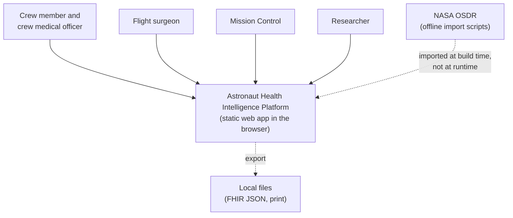
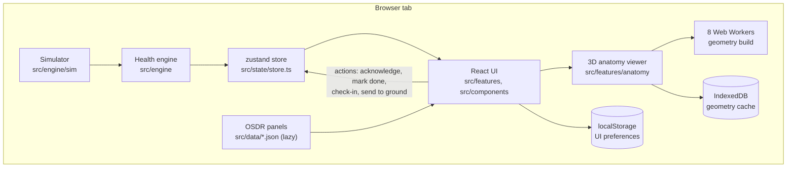
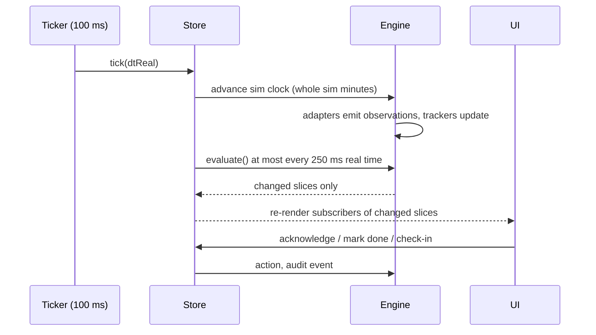

# Architecture Overview

The Astronaut Health Intelligence Platform (AHI) is a **browser only** application today. The simulation of the crew devices, the health engine, the state store and the 3D viewer all run in one browser tab. There is no backend, no database, no authentication and no network call after the page loads.

This keeps the hackathon demo reliable (it works offline) while the code follows the contracts of the product spec, so a real backend can plug in later without changing the engine or the UI. The planned backend is described separately in [Target architecture](./target-architecture) (conceptual).

## Context (C4 level 1)

People use one web page. The only external system is NASA OSDR, and it is contacted by the import scripts during development, never by the running app.

## Containers (C4 level 2)

| Container | Technology | Responsibility | Details |
| --- | --- | --- | --- |
| Simulator | TypeScript | Crew physiology, devices, cabin, scenarios; emits canonical observations | [Device simulation](../intelligence/scenario-simulation) |
| Health engine | TypeScript, no DOM | Baselines, anomalies, risk, forecasts, recommendations, alerts, Earth link, check-ins | [Engine and simulation](./engine-and-simulation) |
| Store | zustand | Owns the engine, drives the sim clock, publishes changed slices | [Frontend and state](./frontend) |
| UI | React 19, Tailwind CSS v4, Recharts | Ground view, Crew view, drawers and dialogs | [Frontend and state](./frontend) |
| 3D viewer | three.js, react-three-fiber, drei, postprocessing | Procedural body, status colors, live heart beat and breathing | [3D anatomy](./anatomy-3d) |
| OSDR panels | Static JSON | Real public lab data as reference | [Dataset catalog](../data/dataset-catalog) |

## Stack

| Layer | Technology |
| --- | --- |
| UI framework | React 19 + TypeScript |
| Build and dev server | Vite 8 |
| Styling | Tailwind CSS v4 |
| 3D | three.js with react-three-fiber, drei and postprocessing (bloom) |
| Charts | Recharts |
| State | zustand |
| Icons | lucide-react |
| Tests | vitest |
| Lint | oxlint |
| Documentation | VitePress (this portal) |

## Data flow

Details of the clock and publishing model: [Engine and simulation](./engine-and-simulation#simulation-clock-and-publishing).

## Performance decisions

| Decision | Effect |
| --- | --- |
| 3D geometry built in **8 parallel Web Workers** | About 842k generated triangles reduced to about 200k drawn per frame; typed arrays are transferred without copies |
| **IndexedDB geometry cache** (production builds) | Repeat visits skip the geometry build |
| **Narrow store selectors** and slice versioning | A 250 ms publication does not re-render the whole app |
| The 3D canvas reads live vitals **without subscribing** | Heart and breathing animation run every frame with no React re-render |
| **Lazy chunks** | The anatomy viewer, the Data and model dialog and the OSDR datasets are loaded with dynamic `import()` |
| **Bounded histories** | Last 2 h at 1 min, 5 days at 5 min; daily metrics keep 40 points; alerts, audit, comms and check-ins have caps |
| Streaming detection | O(1) per sample per metric; baselines recomputed every 24 accepted samples |

Observed by the team on the development laptop: 58 to 60 fps at 60x simulation speed and about 45 fps at 3600x; development first load about 2 to 4 s. These are informal observations, not a benchmark ([Results](../validation/results#measured-performance)).

## Next steps

- [Frontend and state](./frontend)
- [Data model and contracts](./data-model)
- [Project structure](../engineering/project-structure)
