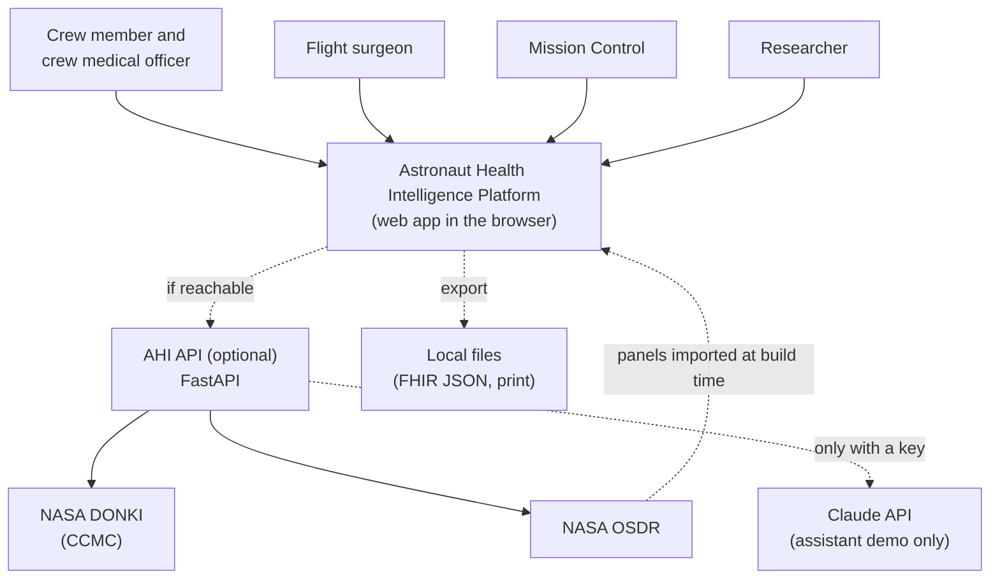
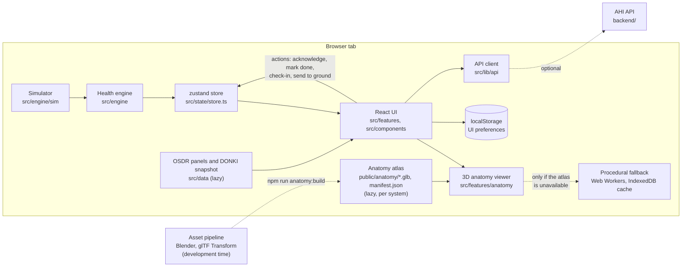
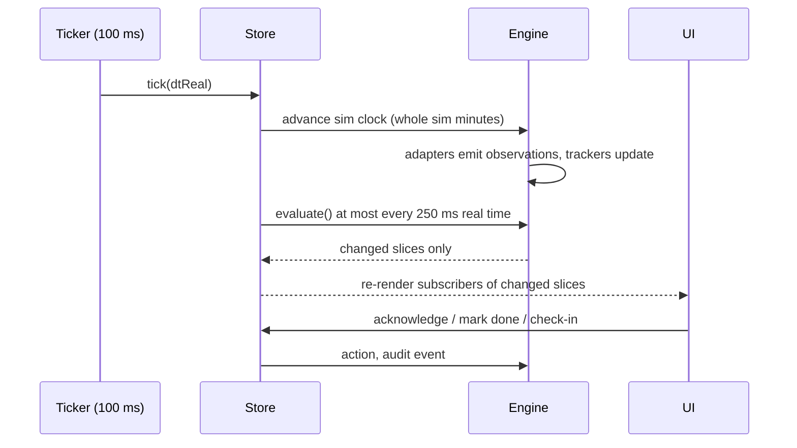

# Architecture Overview

The Astronaut Health Intelligence Platform (AHI) has two deployable parts:

- The **web app** (`frontend/web`): the simulation of the crew devices, the health engine, the state store and the 3D viewer all run in one browser tab.
- The optional **AHI API** (`backend/`): a FastAPI modular monolith that stores canonical observations, reads public NASA data (DONKI, OSDR), hosts the demo assistant and an experimental analytics endpoint ([Backend and API](./backend)).

The app **does not depend on the API**. Without it the app runs in **offline demo mode**: everything works, space weather comes from a bundled real DONKI snapshot, and only the live OSDR search and the assistant are unavailable. This keeps the hackathon demo reliable while the contracts of the product spec (canonical `HealthObservation`, `data_origin`, versioned rules) are already shared by both parts. What is still conceptual (authentication, the Python engine, background jobs) is in [Target architecture](./target-architecture).

## Context (C4 level 1)

People use one web page. The browser never calls NASA or the Claude API directly: when the AHI API is reachable it does that on the app's behalf; otherwise the app uses what it ships (the OSDR panels imported at build time, the DONKI snapshot and the 3D anatomy built by the asset pipeline during development).

## Containers (C4 level 2)

| Container | Technology | Responsibility | Details |
| --- | --- | --- | --- |
| Simulator | TypeScript | Crew physiology, devices, cabin, scenarios; emits canonical observations | [Device simulation](../intelligence/scenario-simulation) |
| Health engine | TypeScript, no DOM | Baselines, anomalies, risk, forecasts, recommendations, alerts, Earth link, check-ins | [Engine and simulation](./engine-and-simulation) |
| Store | zustand | Owns the engine, drives the sim clock, publishes changed slices | [Frontend and state](./frontend) |
| UI | React 19, Tailwind CSS v4, Recharts | Ground view, Crew view, drawers and dialogs | [Frontend and state](./frontend) |
| 3D viewer | three.js, react-three-fiber, drei, postprocessing | Anatomical atlas with selectable structures, status highlights, live heart beat and breathing; procedural fallback | [3D anatomy](./anatomy-3d) |
| Anatomy atlas | Static GLB files (meshopt) and `manifest.json` | Third party reference anatomy (Z-Anatomy, CC BY-SA 4.0), built by the asset pipeline at development time | [3D anatomy assets](../data/anatomy-assets) |
| OSDR panels and DONKI snapshot | Static JSON | Real public data as reference and mission context | [Dataset catalog](../data/dataset-catalog), [NASA data sources](../data/sources) |
| API client | TypeScript, types generated from OpenAPI | Probes the API, falls back to offline paths | [Backend and API](./backend#offline-demo-mode) |
| AHI API (optional) | Python 3.12, FastAPI, Pydantic, SQLAlchemy, Alembic | Registry, ingestion, observations, NASA connectors, assistant, analytics | [Backend and API](./backend) |
| Database (with the API) | SQLite by default, PostgreSQL 17 with Docker Compose | Observations, registry | [Backend and API](./backend#storage-and-migrations) |

## Stack

| Layer | Technology |
| --- | --- |
| UI framework | React 19 + TypeScript |
| Build and dev server | Vite 8 |
| Styling | Tailwind CSS v4 |
| 3D | three.js with react-three-fiber, drei and postprocessing (bloom) |
| 3D asset preparation (development time) | Blender 4.5 LTS (headless), glTF Transform, meshoptimizer |
| Charts | Recharts |
| State | zustand |
| Icons | lucide-react |
| Backend | Python 3.12, FastAPI, Pydantic, SQLAlchemy, Alembic, httpx, scikit-learn (experimental analytics), Anthropic SDK (assistant demo) |
| Database | SQLite (default), PostgreSQL 17 (Docker Compose) |
| Tests | vitest (web), pytest (backend) |
| Lint | oxlint |
| Documentation | VitePress (this portal) |

## Data flow

Details of the clock and publishing model: [Engine and simulation](./engine-and-simulation#simulation-clock-and-publishing).

## Performance decisions

| Decision | Effect |
| --- | --- |
| 3D atlas as **one compressed GLB per anatomical system**, loaded on demand | 4.64 MB in total; the default view downloads about 3.0 MB and the largest file (muscles) only when needed |
| **One mesh per structure, shared materials and uniforms** | Selection, alerts and hover change materials on events; per frame work is a few uniform writes |
| **Narrow store selectors** and slice versioning | A 250 ms publication does not re-render the whole app |
| The 3D canvas reads live vitals **without subscribing** | Heart and breathing animation run every frame with no React re-render |
| **Lazy chunks** | The anatomy viewer, the Data and model dialog and the OSDR datasets are loaded with dynamic `import()` |
| **Bounded histories** | Last 2 h at 1 min, 5 days at 5 min; daily metrics keep 40 points; alerts, audit, comms and check-ins have caps |
| Streaming detection | O(1) per sample per metric; baselines recomputed every 24 accepted samples |

Observed by the team on one development laptop with the atlas viewer: 55 to 57 fps in the Ground view at 1440x900, and the atlas on screen 2.4 to 3.6 s after navigation with a warm cache. These are informal observations, not a benchmark ([Results](../validation/results#measured-performance)).

## Next steps

- [Frontend and state](./frontend)
- [Data model and contracts](./data-model)
- [Project structure](../engineering/project-structure)
