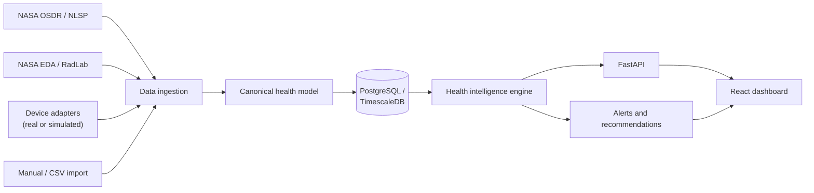
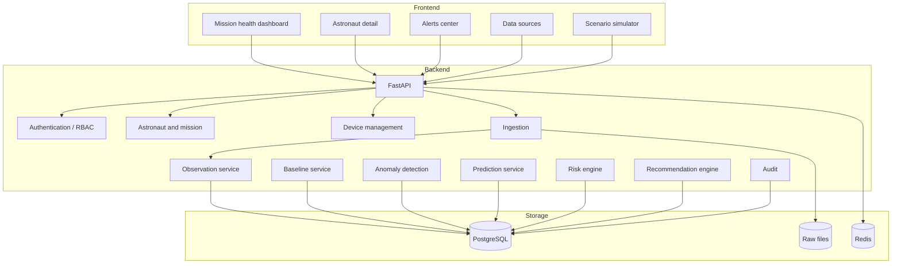
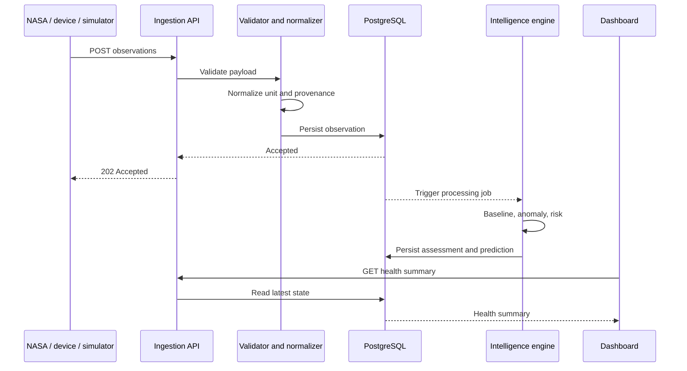

# Target Architecture

::: warning Partly implemented
This page is the **design target** from the product spec (`PROJECT_MASTER.md`, sections 7 and 10). Part of it now exists in the [AHI API](./backend): the modular monolith, ingestion, observations, registry, NASA connectors, SQLite or PostgreSQL with Alembic, Docker Compose. Still conceptual: the engine services on the server, background jobs, Redis, authentication and role based access. The running system is described in [Architecture overview](./overview).
:::

The Astronaut Health Intelligence Platform (AHI) was built browser first so the hackathon demo is reliable offline, and its contracts (canonical `HealthObservation`, device adapter interface, `data_origin`, versioned rules) were chosen so that the server could be added without changing the engine rules or the UI. That is how the backend was added.

## Architectural decision

**Modular monolith with asynchronous processing** (spec section 7.1): one deployable backend with clear internal modules, background jobs for imports and analytics, and no microservices, Kafka or Kubernetes in the MVP. A language model must not be the core of any clinical decision.

## Context

Conceptual (not implemented). Adapted from the product spec, section 7.3.

## Components

Conceptual (not implemented). Adapted from the product spec, section 7.4.

## Recommended stack (spec section 7.2)

| Layer | Technology | Status |
| --- | --- | --- |
| Frontend | React + TypeScript + Vite, Tailwind CSS, Recharts | <StatusBadge status="IMPLEMENTED" /> (without shadcn/ui) |
| Backend API | Python + FastAPI, Pydantic schemas | <StatusBadge status="IMPLEMENTED" /> [Backend and API](./backend) |
| ORM and migrations | SQLAlchemy + Alembic | <StatusBadge status="IMPLEMENTED" /> |
| Database | PostgreSQL, TimescaleDB optional | <StatusBadge status="IMPLEMENTED" /> PostgreSQL 17 with Docker Compose, SQLite by default; no TimescaleDB |
| Cache and jobs | Redis; Celery, RQ or an asyncio worker | <StatusBadge status="PLANNED" /> (in process 15 min cache for NASA data only) |
| Data science | pandas, NumPy, SciPy | <StatusBadge status="IMPLEMENTED" /> NumPy only, for the analytics endpoint |
| ML and explainability | scikit-learn, XGBoost, SHAP | <StatusBadge status="EXPERIMENTAL" /> scikit-learn Isolation Forest; XGBoost and SHAP not implemented ([AI and analytics](../intelligence/ai-and-analytics)) |
| Tests | pytest, httpx, Playwright | <StatusBadge status="IMPLEMENTED" /> pytest with mocked HTTP; vitest for the engine |
| Observability | OpenTelemetry, structured logs | <StatusBadge status="IMPLEMENTED" /> structured request logs; <StatusBadge status="PLANNED" /> OpenTelemetry |
| Deployment | Docker Compose | <StatusBadge status="IMPLEMENTED" /> `docker-compose.yml` (PostgreSQL and the API) |

## Processing flow

Partly implemented: ingestion, validation and persistence exist; the server side engine job does not. Adapted from the product spec, section 7.5.

## API of the spec (section 10)

Base URL `http://localhost:8000/api/v1`.

| Method | Endpoint | Purpose | Status |
| --- | --- | --- | --- |
| POST | `/observations` | Ingest a batch of observations | <StatusBadge status="IMPLEMENTED" /> |
| GET | `/observations` | Query observations of one subject | <StatusBadge status="IMPLEMENTED" /> |
| POST | `/datasets/import` | Create an import job | <StatusBadge status="PLANNED" /> |
| GET | `/datasets`, `/data-sources` | List imported datasets and sources | <StatusBadge status="PLANNED" /> |
| POST, GET | `/astronauts`, `/missions`, `/devices` | Pseudonymized registry | <StatusBadge status="IMPLEMENTED" /> |
| GET | `/astronauts/{id}/health`, `/history`, `/baseline`, `/anomalies`, `/risks`, `/predictions`, `/recommendations` | Per astronaut views | <StatusBadge status="PLANNED" /> (needs the Python engine) |
| POST | `/alerts/{id}/acknowledge` | Acknowledge an alert | <StatusBadge status="PLANNED" /> |
| POST | `/interventions` | Log an intervention | <StatusBadge status="PLANNED" /> |
| POST | `/scenarios/{scenario_id}/run` | Run a simulation | <StatusBadge status="PLANNED" /> |
| GET | `/devices/{id}/status` | Device status | <StatusBadge status="PLANNED" /> |
| GET | `/health`, `/health/ready`, `/health/live` | Status, readiness and liveness | <StatusBadge status="IMPLEMENTED" /> |

`POST /observations` answers `202 Accepted` with `accepted_count`, `rejected_count` and the batch `data_origin`. The batch format is shown in [Pipeline, normalization and quality](../data/pipeline-and-quality#ingestion-batch-planned-backend).

## Role based access

<StatusBadge status="PLANNED" /> Roles match the personas: crew member, crew medical officer, flight surgeon, Mission Control, researcher and admin or data engineer. Each role sees only what it needs ([Use cases and stakeholders](../overview/use-cases)).

## What carries over from the prototype

| Today | In the target |
| --- | --- |
| `HealthObservation` in `domain.ts` | Pydantic schema with the same fields |
| `DeviceAdapter` (`read()`, `status()`) | Python adapters (`connect`, `disconnect`, `read_observations`, `normalize`, `get_device_status`) |
| Engine modules (baseline, anomaly, risk, forecast, recommendations, alerts) | Backend services with the same rules and versions; the seam (`HealthEngine` protocol) already exists in `backend/app/modules/engine` |
| In-memory audit | Persistent audit table |
| FHIR R4 export in the browser | Same export, server side when needed; FHIR stays an exchange format, not a sensor protocol |

## Next steps

- [Roadmap](../resources/roadmap): the order of these steps.
- [Feature status matrix](../overview/feature-status)
