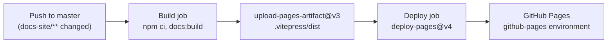

# Documentation & Deployment

This portal documents the Astronaut Health Intelligence Platform (AHI). It is a static site built with **VitePress**, published on **GitHub Pages** by **GitHub Actions**, in English (root) and Brazilian Portuguese (`/pt/`).

- Published URL: [lucaspalharesbarbosa.github.io/astronaut-health-intelligence-platform](https://lucaspalharesbarbosa.github.io/astronaut-health-intelligence-platform/)
- Base path: `/astronaut-health-intelligence-platform/` (set in `config.mts`)

## Run the portal locally

```bash
cd docs-site
npm install
npm run docs:dev      # local preview with hot reload
npm run docs:build    # production build into .vitepress/dist, fails on dead links
npm run docs:preview  # serve the production build
```

Dependencies are pinned to exact versions in `docs-site/package.json`: `vitepress`, `mermaid`, `vitepress-plugin-mermaid` and `markdown-it-footnote`.

## Writing pages

| Topic | Rule |
| --- | --- |
| Paths | English at `docs-site/<section>/<page>.md`, Portuguese at `docs-site/pt/<section>/<page>.md`, identical paths |
| Navigation | Sections and page labels (EN and PT) are defined once in `SECTIONS` in `.vitepress/config.mts`; both sidebars and the top nav are generated from it |
| Frontmatter | `title`, `description`, and for feature pages `status`, `origin`, `code`, `tests`, `verified` (below) |
| Status and origin badges | `<StatusBadge status="PLANNED" />`, `<OriginBadge origin="REAL_PUBLIC" />` |
| Code links | `<CodeLink path="frontend/web/src/engine/risk.ts" />` links to the file on GitHub (`master`) |
| Callouts | `::: tip`, `::: info`, `::: warning`, `::: danger` |
| References | Footnotes `[^1]` with `[^1]: ...` (markdown-it-footnote) |
| Diagrams | Fenced `mermaid` blocks; do not use reserved words such as `end` as node ids; caption conceptual diagrams "Conceptual (not implemented)" |
| Screenshots | Real captures only, in `public/screenshots/`, referenced as `/screenshots/<name>.png` |
| Writing | No em dash or en dash characters; app UI labels stay in English |

### Page frontmatter

```yaml
---
title: Personal Baseline
description: One sentence for SEO and search.
status: IMPLEMENTED          # IMPLEMENTED | EXPERIMENTAL | PLANNED | CONCEPTUAL | NOT_IMPLEMENTED | DEPRECATED
origin: SIMULATED            # REAL_PUBLIC | DERIVED | SIMULATED | MANUAL, comma separated
code:
  - frontend/web/src/engine/baseline.ts
tests:
  - frontend/web/src/engine/baseline.test.ts
verified: 2026-11-14
---
```

The theme renders these keys automatically above the page title (component `PageMeta`, injected through the `doc-before` layout slot): breadcrumbs from the active sidebar, the status badge, origin badges, "Source of truth" code links, test links and "Verified on". Pages without these keys show only the breadcrumbs.

## Theme components

| Component | Props | Renders |
| --- | --- | --- |
| `StatusBadge` | `status` (required), `label` (optional override) | Colored pill with a dot and the localized label; tooltip explains the status; `NOT_IMPLEMENTED` is struck through and dashed |
| `OriginBadge` | `origin` (one value or a comma separated list) | One monospace chip per origin with a localized tooltip |
| `CodeLink` | `path` (repo relative), `label` (optional) | Link to `github.com/.../blob/master/<path>` labeled with the file name |
| `PageMeta` | none (reads frontmatter) | Breadcrumbs and the status bar described above |

Source: `docs-site/.vitepress/theme/` (`index.ts`, `components/*.vue`, `meta.ts` with the EN and PT vocabulary, `custom.css`).

## Publishing to GitHub Pages



Workflow `.github/workflows/docs-deploy.yml`:

| Setting | Value |
| --- | --- |
| Triggers | Push to `master` touching `docs-site/**` or the workflow file; manual `workflow_dispatch` |
| Permissions | `contents: read`, `pages: write`, `id-token: write` (minimal for Pages with the built-in token) |
| Concurrency | Group `pages`, never cancels a deployment in progress |
| Build | Node 22, `npm ci` with the npm cache, `actions/configure-pages@v5`, `npm run docs:build` (fails on dead links), `actions/upload-pages-artifact@v3` with `docs-site/.vitepress/dist` |
| Deploy | `actions/deploy-pages@v4` in the `github-pages` environment |

**One time repository setting:** Settings > Pages > Build and deployment > Source = **GitHub Actions**. No `gh-pages` branch and no personal token are needed.

## Validation

The CI workflow (`.github/workflows/ci.yml`) runs on every push and pull request to `master` with `contents: read` only:

| Job | Steps |
| --- | --- |
| App | `npm ci`, `npx tsc -b`, `npm test`, `npx vite build` in `frontend/web` |
| Docs portal | `npm ci`, `npm run docs:build` in `docs-site` (VitePress fails the build on dead internal links) |

Dead link policy: `ignoreDeadLinks: 'localhostLinks'`, so only links to a local dev server (for example `http://localhost:5173`) are allowed to be unreachable; every internal link must resolve.

Local checks before pushing documentation:

```bash
cd docs-site
npm run docs:build
grep -rnP '\x{2014}|\x{2013}' --include=*.md --exclude-dir=node_modules .   # must print nothing
```

## The app itself

The web app is a static bundle (`npx vite build` in `frontend/web` writes `dist/`) and could be served by any static host. Hosting it publicly for judges is <StatusBadge status="PLANNED" /> ([Roadmap](../resources/roadmap)); today it runs locally ([Setup](./quick-start)).

## Next steps

- [Project structure](./project-structure)
- [Testing strategy](./testing)
