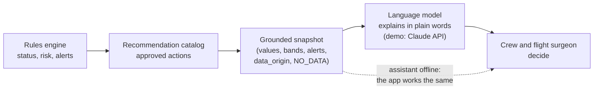

# AI & Analytics Approach

"Health intelligence" in the Astronaut Health Intelligence Platform (AHI) means **explainable statistics and transparent rules first**. Machine learning and a language model exist, but each in a narrow, labeled role that cannot change a status. This page says precisely what runs, what does not, and why.

::: tip In one sentence
Status, risk and alerts come only from statistics and versioned rules. One **experimental machine learning** detector adds an informational "Unusual combination" note. A **language model** is used only by the optional Ask AHI assistant, as a demo through the AHI API, to explain what the engine already computed.
:::

## Four families of techniques

| Family | What it is | In AHI | Status |
| --- | --- | --- | --- |
| **Statistical processing** | Descriptive statistics on each person's recent data | Median, MAD, quantiles, robust z-score, EWMA drift, CUSUM, persistence counts, 30 min window means | <StatusBadge status="IMPLEMENTED" /> |
| **Rule based scoring** | Explicit, versioned rules with ids and a documented formula | Metric rules, exam rules, three combined rules, noisy-OR risk score, confidence, recommendation catalog, autonomy | <StatusBadge status="IMPLEMENTED" /> |
| **Predictive and machine learning models** | Time series models and trained models | Damped Holt linear smoothing (no training step); a per astronaut Isolation Forest for unusual combinations | <StatusBadge status="IMPLEMENTED" /> Holt, <StatusBadge status="EXPERIMENTAL" /> Isolation Forest |
| **Language models (LLMs)** | Generative text models | Ask AHI explains engine outputs (demo, Claude API through the AHI API) | <StatusBadge status="EXPERIMENTAL" /> demo only |

### Statistical processing

Each person is compared with themselves. The baseline uses medians and MAD because they resist outliers; drift uses an EWMA because a slow change is invisible to a single reading; CUSUM catches an even smaller shift that never stops. Pages: [Personal baseline](./personal-baseline), [Anomaly detection](./anomaly-detection).

### Rule based scoring

Rules turn statistics into decisions a human can audit: each hit has a rule id, a level, a plain-language label and a weight, and the score formula fits in one line. Pages: [Risk assessment](./risk-assessment), [Recommendations](./recommendations), [Thresholds](./thresholds).

### Predictive and machine learning models

| Method | Status | Why |
| --- | --- | --- |
| Damped Holt linear smoothing with 80% interval | <StatusBadge status="IMPLEMENTED" /> | Simple, stable, needs no training data, uncertainty is explicit ([Forecasting](./forecasting)) |
| Isolation Forest, per astronaut, PCA whitened | <StatusBadge status="EXPERIMENTAL" /> | Spec US-019. Trained on each person's own window, so it needs no population data; it only adds a note and lists its contributing signals ([Anomaly detection](./anomaly-detection#unusual-combination-experimental)). A scikit-learn version runs in the backend for comparison |
| ARIMA | <StatusBadge status="NOT_IMPLEMENTED" /> | Spec P2; damped Holt with explicit eligibility covers the horizons offered |
| XGBoost risk model | <StatusBadge status="NOT_IMPLEMENTED" /> | Needs a labeled dataset of real outcomes, which does not exist publicly |
| SHAP explanations | <StatusBadge status="NOT_IMPLEMENTED" /> | Rules list their factors; the Isolation Forest lists per signal contributions |
| IQR rule | <StatusBadge status="NOT_IMPLEMENTED" /> | Covered by the robust z |

### Why machine learning stays experimental

- **No real data.** There is no public continuous astronaut telemetry and no labeled outcomes; the detector has only seen simulated data, so it may mostly learn the simulator.
- **Explainability first.** Spec section 9.1: explainable statistics first, then machine learning. A flight surgeon must be able to see why a level changed, so the detector cannot change one.
- **Personal, not population.** The detector is trained per astronaut on their own days, the same principle as the baseline.
- **Non goal.** The spec excludes training a robust clinical model on small historical datasets (section 2.4).

## Language model: the Ask AHI assistant

<StatusBadge status="EXPERIMENTAL" /> The assistant follows the narrow role of spec US-024 and section 9.7: it sits **after** the engine and explains.

| The model may | The model may not |
| --- | --- |
| Explain statuses, alerts and recommendations already in the app | Invent a clinical limit |
| End each answer with "Based on:" naming what it used | Diagnose |
| Be switched off, with the app working without it | Recommend medication or create a treatment |
| Say "the app does not show that" | Turn correlation into causation, hide uncertainty or the simulated origin of the data |

A cloud model is acceptable only for the hackathon demo. A real mission needs an onboard, offline model; see [Ask AHI](../product/assistant#the-onboard-target).

## AI in the development process

The codebase and these documents were developed with the help of an AI coding assistant (Claude Code). That is a property of how the project was built, like the choice of editor; it does not run inside the platform, does not see crew data and does not make any decision in the product. All engine behavior is in reviewed source code and covered by tests ([Testing strategy](../engineering/testing)).

## Next steps

- [Overview and methods status](./overview)
- [Model card](../validation/model-card)
