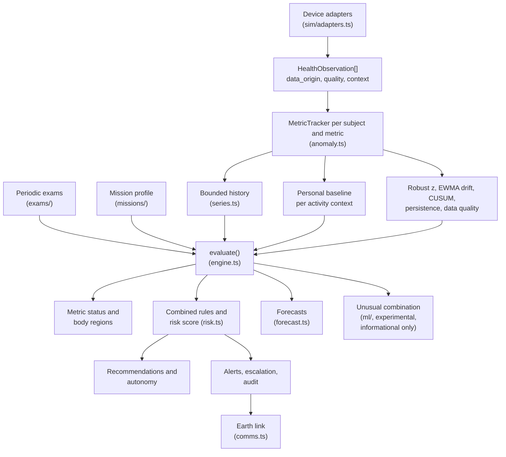

# Overview & Methods Status

The health engine of the Astronaut Health Intelligence Platform (AHI) lives in `frontend/web/src/engine/`. It turns simulated device readings and check-ins into a status per metric, body region and astronaut, a transparent risk score, short forecasts, recommendations and alerts. It is pure TypeScript, runs in the browser and is unit tested with vitest.

::: info Statistics first
Status, risk and alerts come only from classical statistics and explicit rules with an id. One **experimental** machine learning detector (a per astronaut Isolation Forest) adds an informational "Unusual combination" note and never changes a status. The optional [Ask AHI](../product/assistant) assistant explains engine outputs and computes nothing. Why: [AI and analytics approach](./ai-and-analytics).
:::

## Pipeline

| Stage | Page | Code |
| --- | --- | --- |
| Personal normal per metric and context | [Personal baseline](./personal-baseline) | <CodeLink path="frontend/web/src/engine/baseline.ts" /> |
| Acute deviation, drift, persistence, data quality | [Anomaly detection](./anomaly-detection) | <CodeLink path="frontend/web/src/engine/anomaly.ts" /> |
| Combined rules, score, confidence, regions | [Risk assessment](./risk-assessment) | <CodeLink path="frontend/web/src/engine/risk.ts" /> |
| Projection with interval, 24 h to 15 days | [Forecasting](./forecasting) | <CodeLink path="frontend/web/src/engine/forecast.ts" /> |
| Eye (SANS) and hearing exams | [Eye health and hearing](./eye-and-hearing) | <CodeLink path="frontend/web/src/engine/exams/assess.ts" /> |
| Mission profile, dose, space weather | [Mission profiles](./mission-profiles) | <CodeLink path="frontend/web/src/engine/missions/profiles.ts" /> |
| Experimental multivariate note | [Anomaly detection](./anomaly-detection#unusual-combination-experimental) | <CodeLink path="frontend/web/src/engine/ml/multivariate.ts" /> |
| Next steps, who can act, what-if | [Recommendations, autonomy and what-if](./recommendations) | <CodeLink path="frontend/web/src/engine/recommendations.ts" /> |
| Alert lifecycle and escalation | [Alerts and escalation](./alerts) | <CodeLink path="frontend/web/src/engine/alerts.ts" /> |
| Where the data comes from | [Device simulation and scenarios](./scenario-simulation) | <CodeLink path="frontend/web/src/engine/sim/adapters.ts" /> |
| Check-ins and communication delay | [Self-report and Earth link](./self-report-and-earth-link) | <CodeLink path="frontend/web/src/engine/comms.ts" /> |
| Every fixed number | [Thresholds and limitations](./thresholds) | <CodeLink path="frontend/web/src/engine/config.ts" /> |

How the engine is wired into the app (clock, publishing, bounded memory) is in [Engine and simulation architecture](../architecture/engine-and-simulation).

## Versions

| Component | Version string (in `config.ts`) |
| --- | --- |
| Engine | `ahi-engine 2.0.0` |
| Risk model | `AHI transparent rules v2.0 (demo)` |
| Baseline | `robust-baseline v1 (median/MAD)` |
| Forecast | `Damped Holt linear smoothing v1` |
| Recommendation catalog | `rec-catalog v2.0` |
| CUSUM | `Tabular CUSUM on hourly mean robust z v1` |
| Multivariate detector | `ahi-iforest-ts v1 (experimental, PCA whitened)` |

Versions are stored on every baseline, risk assessment, prediction and recommendation, so each output says which method produced it.

## Methods status

The product spec (section 9.3) lists candidate methods. This table is the audit of that list against the code: statistics first, machine learning only where the statistics leave a gap, and then only as an experimental, informational layer.

| Method | Purpose | Status | Where |
| --- | --- | --- | --- |
| Rolling robust baseline (median, MAD, p05 / p95, context buckets) | Personal normal | <StatusBadge status="IMPLEMENTED" /> | [Personal baseline](./personal-baseline) |
| Robust z-score | Acute deviation from the personal normal | <StatusBadge status="IMPLEMENTED" /> | [Anomaly detection](./anomaly-detection#robust-z-score) |
| EWMA of z | Slow, persistent drift | <StatusBadge status="IMPLEMENTED" /> | [Anomaly detection](./anomaly-detection#ewma-drift) |
| Persistence windows | Repeated daily deviations | <StatusBadge status="IMPLEMENTED" /> | [Anomaly detection](./anomaly-detection#daily-persistence) |
| Data quality and staleness | Missing, stale or questionable data | <StatusBadge status="IMPLEMENTED" /> | [Anomaly detection](./anomaly-detection#data-quality) |
| Transparent rule based risk score 0 to 100 | Attention level | <StatusBadge status="IMPLEMENTED" /> | [Risk assessment](./risk-assessment) |
| Damped Holt linear smoothing with 80% interval | Short term projection | <StatusBadge status="IMPLEMENTED" /> | [Forecasting](./forecasting) |
| Band exit and recovery rule | Time until leaving the normal range | <StatusBadge status="IMPLEMENTED" /> | [Forecasting](./forecasting#band-exit-and-recovery) |
| Deterministic noise free what-if projection | Discussion of an action | <StatusBadge status="EXPERIMENTAL" /> | [Recommendations](./recommendations#what-if-projection) |
| Moving average / rolling median | Smoothing | <StatusBadge status="IMPLEMENTED" /> 30 min window means feed forecasts; the acute check uses a rolling median of 3 readings | [Forecasting](./forecasting#inputs) |
| IQR rule | Outlier detection | <StatusBadge status="NOT_IMPLEMENTED" /> robust z covers it | |
| CUSUM | Small but steady shifts that stay under the EWMA rule | <StatusBadge status="IMPLEMENTED" /> Watch only | [Anomaly detection](./anomaly-detection#cusum) |
| Isolation Forest | Unusual combination of several signals | <StatusBadge status="EXPERIMENTAL" /> per astronaut, informational only, spec US-019 | [Anomaly detection](./anomaly-detection#unusual-combination-experimental) |
| ARIMA | Time series forecasting | <StatusBadge status="NOT_IMPLEMENTED" /> | [AI and analytics](./ai-and-analytics) |
| XGBoost | Risk from a labeled dataset | <StatusBadge status="NOT_IMPLEMENTED" /> no labeled data | [AI and analytics](./ai-and-analytics) |
| SHAP | Model explanation | <StatusBadge status="NOT_IMPLEMENTED" /> rules explain themselves | [AI and analytics](./ai-and-analytics) |
| Survival analysis | Time to event | <StatusBadge status="NOT_IMPLEMENTED" /> | |

## Design principles

- **Personal first.** Status compares each person with their own baseline; fixed thresholds are a demo safety net.
- **Explainable by construction.** Every hit has a rule id, a plain-language label and a weight; the score formula is public. The experimental detector lists its top contributing signals.
- **Missing is not normal.** No valid value within a stale window is `NO_DATA`, and it lowers confidence.
- **Bounded and streaming.** O(1) work per sample per metric; histories and logs have caps.
- **Deterministic.** Seeded simulation; the same seed gives the same results (tested).

## Next steps

- [Personal baseline](./personal-baseline)
- [Validation results](../validation/results): what the evaluation measured.
