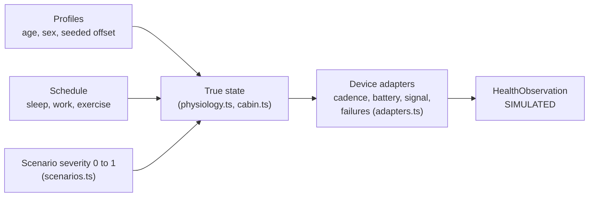

# Device Simulation & Scenarios

## What it does

There is no public, continuous physiological telemetry of astronauts, so every device reading in the Astronaut Health Intelligence Platform (AHI) comes from a **seeded, reproducible simulator** that runs in the browser. It models a crew of four, their schedule, their devices, their periodic eye and hearing exams and the cabin, and seven scripted scenarios that make specific health stories happen on demand. Everything it produces is labeled `SIMULATED`.

::: warning Simulated data is not clinical evidence
The simulator is a simplified, plausible model written for a demo. It is not calibrated against real crews, and anything measured on it (see [Results](../validation/results)) describes the prototype, not human physiology. Planned calibration with published ranges: [Roadmap](../resources/roadmap).
:::

## Inputs

| Input | Detail |
| --- | --- |
| Crew | ORION (Commander, AST-01, 46, M), LYRA (Flight Engineer, AST-02, 38, F), VEGA (Flight Engineer, AST-03, 41, F), ATLAS (Mission Specialist, AST-04, 35, M); mission day 44 at startup |
| Seed | `SIM.seed = 20261114`; every noise channel has its own random stream |
| Scenario | One of seven, starting at 08:00 UTC sim time |
| Mission profile | Launch, ISS, Moon or Mars transit: changes the dosimeter rate ([Mission profiles](./mission-profiles)) |
| Interventions | Logged actions apply a hypothetical relief |

## Method

### Layers



1. **Profiles** (`profiles.ts`): per astronaut parameters with plausible differences by age and sex plus a seeded individual offset (for example resting heart rate around 60 bpm, maximum heart rate by the Tanaka formula 208 - 0.7 x age).
2. **Schedule** (`schedule.ts`, UTC like ISS GMT): sleep 22:00 to 06:00 (bedtime shifts later with fatigue), work 07:00 to 12:00 and 13:00 to 19:00, a 1 h exercise block per astronaut rotating CEVIS, ARED and T2, 20 min of recovery, reaction tests at 07:30 and 19:30. The schedule also provides the activity context used by baselines.
3. **True state** (`physiology.ts`): targets per context, circadian rhythm, scenario effects, a first order lag (heart rate rises in about 1 min and recovers in about 2.5 min) and **Ornstein-Uhlenbeck noise**, which is smooth and correlated rather than white jitter. Exercise has warm-up, main set and cool-down (ARED has sets). Sleep length and efficiency come from a nightly plan.
4. **Cabin** (`cabin.ts`): CO2, temperature, humidity, and a dose rate with latitude modulation twice per ISS-like orbit plus South Atlantic Anomaly passes on some orbits. Outside the ISS profile the dose rate follows the mission profile reference.
5. **Exams** (`sim/exams.ts`): periodic eye exams (OCT, ocular ultrasound, visual acuity) and hearing tests on the schedule of [Eye health and hearing](./eye-and-hearing), plus one crew worn noise reading per day.
6. **Device adapters** (`adapters.ts`): sample the true state at each device's cadence and add device behavior: battery (recharged daily), signal strength, `DEGRADED` (weak signal, values `QUESTIONABLE`, some dropped), `DATA_STALE`, `OFFLINE`.

The Ornstein-Uhlenbeck process used for noise is:

```text
x_t+dt = x_t e^(-dt / tau) + sqrt(1 - e^(-2 dt / tau)) N(0, 1)
```

It has unit variance and a correlation time `tau`, so consecutive readings resemble a real sensor rather than independent random draws. The test suite checks that it is strongly autocorrelated at short lags with unit variance.

### Scenarios

| Scenario | Target | Mechanism (scenario severity over time) |
| --- | --- | --- |
| Nominal day | All | No effect; everyone stays within their personal ranges |
| Acute cardio event | ORION | Onset at 2 min, peak at 14 min: heart rate to about 145 bpm at rest, SpO2 to about 89% |
| Sensor failure | VEGA | Smart shirt `DEGRADED` at 10 min, `DATA_STALE` at 20 min, `OFFLINE` at 45 min |
| Cabin CO2 rise | Cabin | Scrubber degradation adds about 3,900 ppm over about 3.5 h; breathing rate and reaction time shift for everyone |
| Progressive fatigue | LYRA | Smooth ramp over about 54 h: later bedtime, lower sleep efficiency, HRV down, resting heart rate up |
| Exercise performance decline | ATLAS | Workout output falls session after session |
| Eye changes (SANS like) | ORION | Simulated eye exams drift from the pre-flight baseline over the mission: thicker retina, wider optic nerve sheath, then new folds (Watch at flight day 30, Warning at flight day 90) |

Logging an intervention (for example a rest protocol) applies a **hypothetical relief** that fades the scenario effect; it is recorded in the audit trail as simulation. What to look at in each scenario, and the detection timings, are in [Demo scenarios](../product/demo-scenarios).

### Startup history

Before a scenario starts, the engine pre-generates 5 days of minute level history and 14 days of daily metrics and check-ins, so baselines are `READY` immediately. Older mission days for the long term view are synthesized from each profile ([Mission features](../product/mission-features#mission-overview)).

### Simulated devices

| Device (name in the app) | Feeds |
| --- | --- |
| Bio-Monitor shirt | Heart rate, HRV, SpO₂, breathing rate, blood pressure, skin temperature |
| Actigraphy watch | Activity, sleep duration and efficiency |
| CEVIS cycle ergometer, ARED resistive exercise device, T2 treadmill | Exercise performance |
| Personal dosimeter | Accumulated dose |
| Cabin environment sensor | CO2, temperature, humidity |
| Area radiation monitor | Dose rate |
| Reaction self-test, Fluid intake log (crew app, not listed as devices) | Reaction time, hydration |

Device names no longer carry a "(sim)" suffix. Every reading is still `data_origin: 'SIMULATED'` and the app always shows the **SIMULATED** badge.

### Pausing a device {#pausing-a-device}

An operator can **pause** a device from the Devices popover of the vitals strip (for example a shirt taken off for a shower). Pausing asks for a quick confirmation.

| While paused | Behavior |
| --- | --- |
| Device state | `PAUSED`, shown as "Paused by operator at hh:mm" |
| Its metrics | `NO_DATA` with the reason "Paused by operator", never normal |
| Alarms | No sensor failure alarm: a pause is a known operator action, not a fault |
| Values | None invented for the paused period; the gap stays a gap |
| Audit | `DEVICE_PAUSED` and `DEVICE_RESUMED` entries |

After **resume** the device waits for its first reading ("Resumed at hh:mm, waiting for the first reading").

### Measured by {#measured-by}

The region and structure detail panels list the devices that feed the readings shown: name, type, state, battery, last seen time and data origin. Readings that come from the crew app (check-ins, self tests, intake log) are named as such, so it is always clear where a number comes from.

## Outputs

- `HealthObservation[]` with `data_origin: 'SIMULATED'`, quality and activity context.
- `Device` records with state, battery, signal and last seen time (Devices popover, Measured by, and Data and model, Simulated devices tab, which also names each device's real counterpart and the honest path to real data).

## Limitations

- Simplified physiology; effect sizes and ranges are plausible guesses, not published calibrations.
- Activity context is known exactly from the schedule; real systems would have to infer it.
- The scenarios are designed so that the rules can detect them; detection on this data is internal consistency only.
- No real device is connected. A real adapter would implement the same contract ([Standards, contracts and extending](../engineering/contributing#add-a-device-adapter)).

## Status

<StatusBadge status="IMPLEMENTED" /> Covered by `engine.test.ts` (startup baselines, reproducibility with the same seed, bounded history, every scenario's expected behavior, hypothetical relief), `stats.test.ts` (seeded randomness, OU noise), `devicePause.test.ts` (paused metrics read `NO_DATA`, no sensor failure alarm, resume) and `exams.test.ts` (exam schedule, SANS scenario). Spec requirements: US-010 to US-013, US-026.

## Next steps

- [Demo scenarios](../product/demo-scenarios)
- [Engine and simulation architecture](../architecture/engine-and-simulation)
