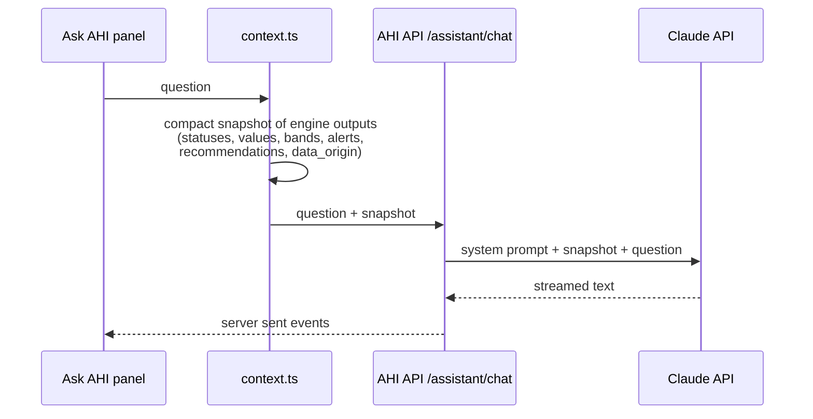

# Ask AHI Assistant

## What it does

**Ask AHI** answers plain language questions about what the app already shows: "How is ORION doing?", "Why is this alert on?", "What should we do now?". It **explains the outputs of the health engine**; it does not compute anything itself.

::: warning Decision support only
The assistant never diagnoses, never suggests medication and never raises, clears or changes an alert, a status or a recommendation. Medical decisions stay with the crew medical officer and the flight surgeon. The engine is the source of truth.
:::

## In the app

- The **Ask AHI** button sits in the top bar (key `K`). It opens a side panel with three starter questions.
- Answers **stream** as they are written. Each answer ends with a **"Based on:"** line naming the readings, alerts or recommendations it used (or "no matching data in the app").
- **Voice in**: a microphone button uses the browser speech recognition where the browser supports it.
- **Read aloud**: a toggle speaks each answer with the browser speech synthesis (the "Based on:" line is shown, not read). A stop button ends an answer while it streams.
- Without the API or without a key the panel shows a calm **"Assistant offline"** state. Monitoring, alerts and recommendations keep working.

## How the demo works



- The browser builds a **grounded snapshot** of the current engine outputs. Missing data is sent as `null` with `NO_DATA`, never as a number; `data_origin` is included, so simulated answers say they are simulated.
- The AHI API (`POST /api/v1/assistant/chat`, server sent events) calls the Claude API with model `claude-opus-5-5` at low effort (configurable in `backend/.env`). The Claude API server side refusal fallback is on: if the model declines, the same call is retried on a fallback model instead of returning an empty reply.
- The endpoint is rate limited (defaults: 6 requests per minute, 60 per hour) and answers 503 "assistant not configured" when no key is set.

### Enabling it

Put a key in `backend/.env` (gitignored, never commit it), then start the API:

```bash
# backend/.env
ANTHROPIC_API_KEY=your-key-here
```

`GET /api/v1/assistant/status` tells the app whether the assistant can answer; it never returns the key.

## The onboard target

Depending on a cloud language model is **not acceptable on a spacecraft**: the Mars communication delay (about 4 to 24 minutes one way[^a1]), blackouts, privacy of crew health data, certification of flight software and network security all rule it out. The demo uses the Claude API only to show how the feature would feel.

The mission architecture keeps the same contract with a different provider:

| Piece | Demo | Onboard target |
| --- | --- | --- |
| Language model | Claude API (cloud) | Small open weight model on the spacecraft computer, quantized, pinned version |
| Speech to text | Browser speech recognition (may use a cloud service) | Local speech to text |
| Grounding | Engine snapshot | Engine snapshot plus a local index of versioned onboard procedures |
| Guardrails | System prompt, refusal fallback | Input and output guardrails (no diagnosis, no medication, citations must match the snapshot) |
| Fallback | "Assistant offline" | Template answer generated from the engine, no model |
| Audit | Request logs | Question, snapshot hash, model version and answer |

The full write up, with the constraints table and the onboard diagram, is in [`docs/assistant-architecture.md`](https://github.com/lucaspalharesbarbosa/astronaut-health-intelligence-platform/blob/master/docs/assistant-architecture.md).

## Status

<StatusBadge status="EXPERIMENTAL" /> Demo only. The panel, the snapshot builder and the endpoint are tested (`assistant.test.ts`, `test_assistant.py`, with the model mocked). <StatusBadge status="CONCEPTUAL" /> for the onboard architecture.

[^a1]: NASA, Space Communications: 7 Things You Need to Know. <https://www.nasa.gov/solar-system/space-communications-7-things-you-need-to-know/>

## Next steps

- [AI and analytics approach](../intelligence/ai-and-analytics)
- [Backend and API](../architecture/backend)
- [Responsible use](../overview/responsible-use)
