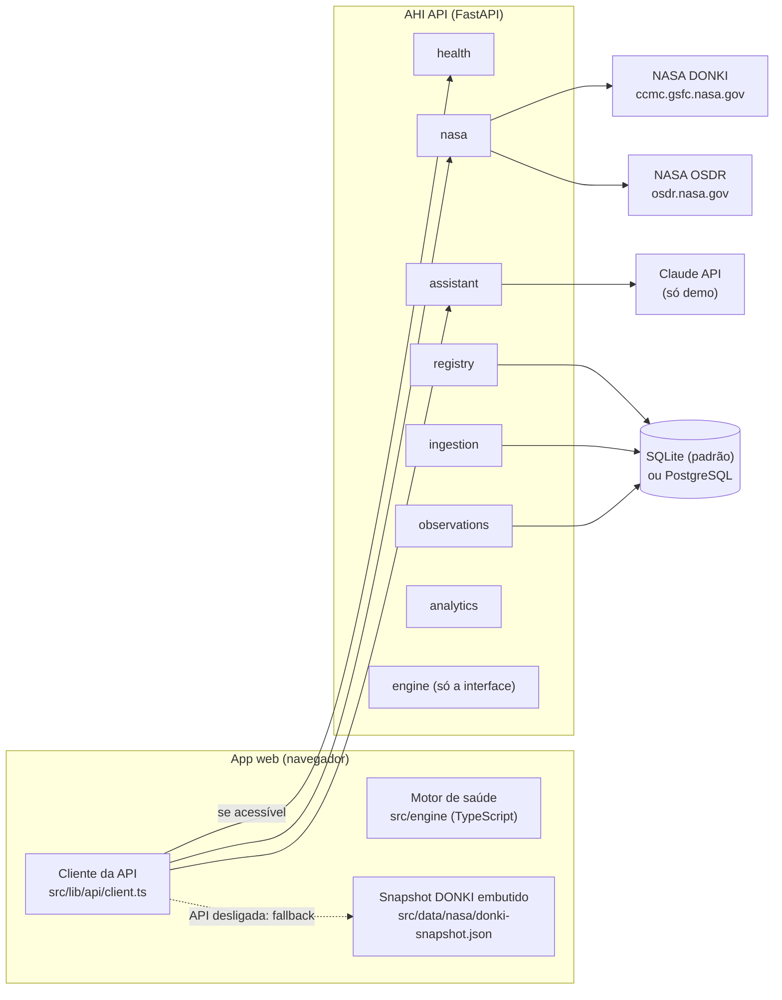

# Backend e API

## O que é {#what-it-is}

A **AHI API** (`backend/`) é um **monólito modular** em Python com FastAPI: um serviço implantável, um módulo por responsabilidade, cada módulo dono do seu router, schemas e tabelas. Ela guarda observações canônicas, lê dados públicos da NASA, hospeda o assistente de demo e um endpoint experimental de análise. Segue a decisão registrada na especificação do produto (seção 7.1): sem microsserviços, sem barramento de mensagens, sem Kubernetes no MVP.

O **app web não precisa dela.** Sem a API o app roda em **modo demo offline**: o motor de saúde roda no navegador e o clima espacial vem de um snapshot real do DONKI embutido. Com a API rodando, o app mostra "Connected to AHI API" e carrega os dados da NASA ao vivo.



## Módulos {#modules}

Todos os endpoints ficam sob `/api/v1`. A documentação interativa fica em `/docs` quando a API está rodando.

| Módulo | Endpoints | Propósito |
| --- | --- | --- |
| `health` | `GET /health`, `/health/live`, `/health/ready` | Status da API e do banco; `/health` é o que o app web consulta |
| `registry` | `POST/GET /astronauts`, `GET /astronauts/{id}`, `POST/GET /missions`, `POST/GET /devices` | Cadastro pseudonimizado: campos desconhecidos, como um nome real, são rejeitados |
| `ingestion` | `POST /observations` (202) | Valida e guarda lotes de `HealthObservation` canônicas |
| `observations` | `GET /observations?subject_id=&metric_code=&data_origin=&start=&end=` | Consulta as observações de um sujeito em ordem UTC |
| `nasa` | `GET /space-weather?days=30`, `GET /nasa/osdr/studies?q=` | Dados públicos reais da NASA, em cache de 15 min no processo |
| `assistant` | `POST /assistant/chat` (server sent events), `GET /assistant/status` | Assistente de demo ([Ask AHI](/pt/product/assistant)) |
| `analytics` | `POST /analytics/multivariate` | Experimental, aprendizado de máquina: caminho de paridade em scikit-learn do detector do navegador ([Detecção de anomalias](/pt/intelligence/anomaly-detection#unusual-combination-experimental)) |
| `engine` | nenhum | Interface documentada para portar o motor TypeScript para Python |

## Regras de ingestão {#ingestion-rules}

A ingestão aplica do lado do servidor as regras de dados da especificação do produto:

- `data_origin` é obrigatório e precisa vir com a sua proveniência: `REAL_PUBLIC` exige um repositório e um accession de dataset, `SIMULATED` exige um `device_id`, `DERIVED` exige `metadata.method`.
- `value: null` só é aceito com `quality.status` `MISSING` ou `INVALID`, e é guardado como NULL, nunca como zero.
- Os timestamps precisam ter fuso horário e são guardados em UTC.
- Um lote é validado como um todo: uma observação inválida dá 422 e nada é guardado.
- A ingestão é **idempotente por `observation_id`**: reenviar a mesma observação não faz nada, reusar um id com conteúdo diferente é informado como rejeitado.

## Conectores da NASA {#nasa-connectors}

Nenhuma chave de API da NASA é necessária. As duas fontes são públicas.

- **DONKI** (Space Weather Database Of Notifications, Knowledge, Information, mantido pelo CCMC no NASA Goddard): `https://ccmc.gsfc.nasa.gov/DONKI/WS/get/{FLR,SEP,CME,GST}`. O CCMC desativou o antigo host `kauai.ccmc.gsfc.nasa.gov`; os caminhos depois de `/DONKI/` não mudaram. Se qualquer um dos quatro feeds falhar, o endpoint responde 502, nunca uma lista parcial que pareceria "sem tempestades".
- **OSDR**, busca de estudos: `https://osdr.nasa.gov/osdr/data/search`, filtrada para estudos humanos; devolve accession, título, link, tipo de projeto, missão e data de publicação. Só disponível com a API rodando.

Os dois são contexto de missão `REAL_PUBLIC`, não medidas de astronautas ([Fontes de dados da NASA](/pt/data/sources)).

## Modo demo offline {#offline-demo-mode}

| Configuração | Comportamento |
| --- | --- |
| `VITE_API_URL` não definida | O app consulta `http://localhost:8000`; se responder, fica ao vivo, senão fica offline |
| `VITE_API_URL=https://...` | O mesmo, contra esse endereço |
| `VITE_API_URL=off` | Nunca chama uma API: para hospedagem estática (por exemplo GitHub Pages) |

Offline, o motor, a simulação e o visualizador 3D funcionam exatamente como online. O clima espacial usa o snapshot embutido; a busca no OSDR e o assistente aparecem como indisponíveis.

### Chave online e offline {#online-and-offline-switch}

A pessoa escolhe como o app usa a API. A chave é um controle segmentado em **"Data and model"**, aba de contexto da NASA; um pequeno chip na barra superior mostra o resultado e abre essa aba.

| Modo | Comportamento |
| --- | --- |
| **"Automatic"** (padrão) | Consulta a API uma vez; usa a API se ela responder, senão volta para a demo offline |
| **"Online"** | Sempre usa a API. Se ela não responde, o painel diz "The AHI API is unreachable", mostra o comando que a inicia (`uvicorn app.main:create_app --factory --port 8000`, dentro de `backend/`) com um botão de copiar, e verifica de novo a cada 30 s. Todo chamador mantém seu caminho offline, então o app continua utilizável |
| **"Offline"** | Nunca abre uma conexão de rede: snapshot DONKI embutido, assistente desligado, lista de estudos do OSDR escondida |

| Chip | Quando |
| --- | --- |
| "Offline demo" | Modo Offline, ou Automatic sem resposta da API |
| "Live NASA data" | A API respondeu |
| "API unreachable" | Modo Online e a API não responde |
| "Checking connection" | Uma consulta está em andamento |

`VITE_API_URL=off` vence a escolha guardada: esse build fica sempre offline e o painel diz isso. A escolha fica guardada no navegador (`ahi.connectivity.v1`); se o armazenamento não estiver disponível (por exemplo numa janela anônima) ela vale só para a sessão. As regras (`parseMode`, `resolveMode`, `chipState`) são funções puras cobertas por `connectivity.test.ts`.

## Tipos gerados {#generated-types}

O schema da API é exportado para `backend/openapi.json` (`python -m app.cli openapi`) e convertido em TypeScript com `npm run api:types` em `frontend/web` (gera `src/types/api.gen.ts`). O contrato escrito à mão em `src/types/domain.ts` e `src/types/nasa.ts` continua sendo a fonte do motor; o arquivo gerado mantém o cliente fiel aos formatos da API.

## Armazenamento e migrações {#storage-and-migrations}

SQLite (`sqlite:///./ahi.db`) é o padrão e não exige configuração. O `docker-compose.yml` na raiz do repositório roda PostgreSQL 17 e a API juntos. As migrações do Alembic rodam na inicialização (`AUTO_MIGRATE=true`) ou à mão com `alembic upgrade head`.

## Interface para portar o motor {#engine-port-seam}

O motor de saúde continua em TypeScript hoje para que o app funcione sem servidor. `app/modules/engine/__init__.py` define um protocolo `HealthEngine` (entrada: observações canônicas do módulo `observations`; saída: os formatos de `domain.ts` marcados como `DERIVED` com o seu método). O plano é portar módulo por módulo, reaproveitando os fixtures do vitest como casos do pytest, mantendo o motor TypeScript como fallback offline. Veja o [Roadmap](/pt/resources/roadmap).

## Como rodar {#running-it}

```bash
cd backend
python -m venv .venv
# Windows: .venv\Scripts\activate    macOS ou Linux: source .venv/bin/activate
pip install -r requirements-dev.txt
uvicorn app.main:create_app --factory --reload --port 8000
# abra http://localhost:8000/docs
```

Ou, na raiz do repositório, `docker compose up --build` (PostgreSQL e a API). Python 3.12 ou mais recente. A configuração vem de `backend/.env` (copie `backend/.env.example`; nunca faça commit do `.env`). Testes: `python -m pytest` em `backend` (o HTTP externo é simulado, as fontes ao vivo da NASA nunca são chamadas).

## Status {#status}

<StatusBadge status="IMPLEMENTED" /> Módulos, conectores, ingestão e o assistente são cobertos pelo pytest. <StatusBadge status="EXPERIMENTAL" /> para o endpoint de análise. <StatusBadge status="PLANNED" /> para o motor em Python, autenticação e controle de acesso por perfil.

## Próximos passos {#next-steps}

- [Visão geral da arquitetura](/pt/architecture/overview)
- [Arquitetura alvo](/pt/architecture/target-architecture): o que ainda é conceitual.
- [Configuração e comandos](/pt/engineering/quick-start)
