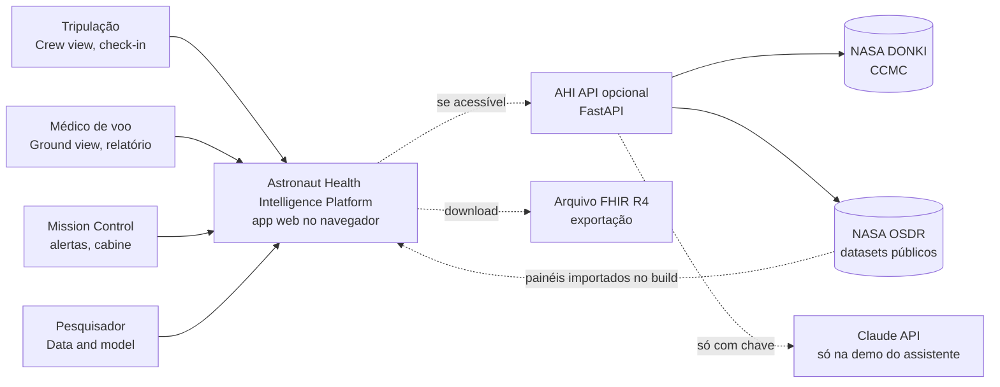
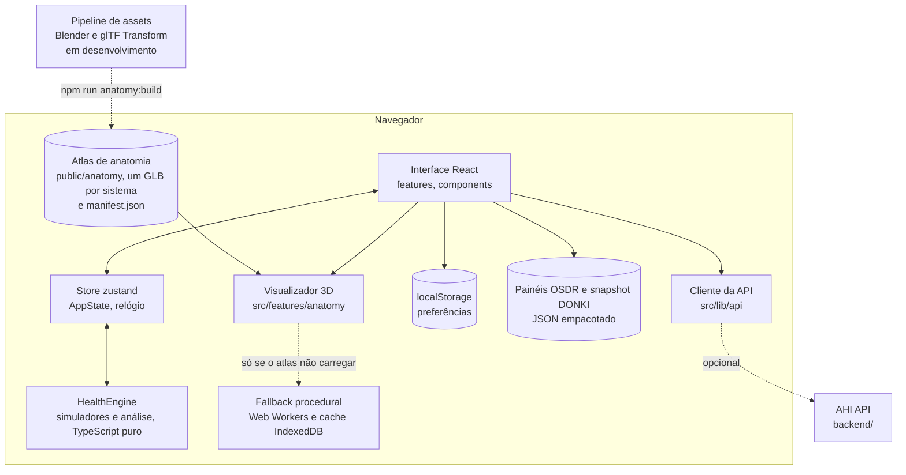
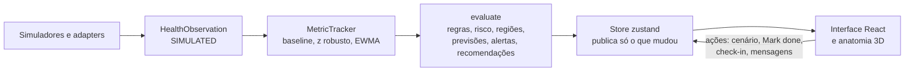

# Visão geral da arquitetura

A Astronaut Health Intelligence Platform (AHI) tem duas partes implantáveis:

- O **app web** (`frontend/web`): simuladores, motor de análise, estado e interface 3D rodam na mesma aba do navegador.
- A **AHI API** opcional (`backend/`): um monólito modular em FastAPI que guarda observações canônicas, lê dados públicos da NASA (DONKI, OSDR), hospeda o assistente de demonstração e um endpoint experimental de análise ([Backend e API](/pt/architecture/backend)).

O app **não depende da API**. Sem ela, roda em **modo demo offline**: tudo funciona, o clima espacial vem de um snapshot real do DONKI empacotado no app, e só a busca ao vivo no OSDR e o assistente ficam indisponíveis. Isso mantém a demo confiável, enquanto os contratos do spec (`HealthObservation` canônico, `data_origin`, regras versionadas) já são compartilhados pelas duas partes. O que ainda é conceitual (autenticação, motor em Python, jobs em segundo plano) está em [Arquitetura alvo](/pt/architecture/target-architecture).

## Stack

| Camada | Tecnologia |
| --- | --- |
| Interface | React 19 + TypeScript |
| Build e servidor de desenvolvimento | Vite 8 |
| Estilo | Tailwind CSS v4 |
| 3D | three.js + react-three-fiber (com drei e postprocessing) |
| Preparação dos assets 3D (em desenvolvimento) | Blender 4.5 LTS (sem interface), glTF Transform, meshoptimizer |
| Estado | zustand |
| Gráficos | Recharts |
| Ícones | lucide-react |
| Backend | Python 3.12, FastAPI, Pydantic, SQLAlchemy, Alembic, httpx, scikit-learn (análise experimental), Anthropic SDK (demo do assistente) |
| Banco de dados | SQLite (padrão), PostgreSQL 17 (Docker Compose) |
| Testes | vitest (web), pytest (backend) |
| Lint | oxlint |
| Documentação | VitePress (este portal) |

Restrições de TypeScript: `erasableSyntaxOnly` (sem `enum` e sem parameter properties; enumerações são uniões de strings) e `noUnusedLocals`.

## Nível 1: contexto

- O navegador nunca chama a NASA ou a Claude API diretamente: quando a AHI API está acessível, ela faz isso pelo app; senão o app usa o que já traz consigo.
- Os painéis do OSDR são importados uma vez por script e empacotados no app. Veja [Catálogo de datasets](/pt/data/dataset-catalog).
- O mesmo vale para a anatomia 3D: o modelo de origem (Z-Anatomy) é baixado pelo pipeline de assets em desenvolvimento, e o app distribui os arquivos já prontos. Veja [Assets de anatomia 3D](/pt/data/anatomy-assets).
- Nenhum equipamento da ISS está conectado.

## Nível 2: contêineres

| Contêiner | Responsabilidade | Página |
| --- | --- | --- |
| Interface React | Telas, interação, 3D, gráficos | [Frontend e estado](/pt/architecture/frontend) |
| Store zustand | Implementa `AppState`, move o relógio, publica fatias que mudaram | [Frontend e estado](/pt/architecture/frontend) |
| HealthEngine | Simulação, baseline, anomalias, risco, previsão, recomendações, alertas, comunicação | [Motor e simulação](/pt/architecture/engine-and-simulation) |
| Visualizador 3D | Atlas anatômico com estruturas selecionáveis, destaques de status, coração e pulmões ao vivo | [Anatomia 3D](/pt/architecture/anatomy-3d) |
| Atlas de anatomia | Arquivos GLB estáticos (meshopt) e `manifest.json`: anatomia de referência de terceiros (Z-Anatomy, CC BY-SA 4.0), gerada pelo pipeline de assets em desenvolvimento | [Assets de anatomia 3D](/pt/data/anatomy-assets) |
| Fallback procedural | Corpo simplificado gerado em código (Web Workers), usado só quando o atlas não carrega | [Anatomia 3D](/pt/architecture/anatomy-3d#fallback) |
| Armazenamento local | Preferências e, no fallback, cache da geometria; nada de dados de saúde | [Governança e privacidade](/pt/data/governance-and-privacy) |
| Painéis OSDR e snapshot DONKI | JSON estático: dados públicos reais como referência e contexto de missão | [Catálogo de datasets](/pt/data/dataset-catalog), [Fontes de dados da NASA](/pt/data/sources) |
| Cliente da API | TypeScript, tipos gerados a partir do OpenAPI; testa a API e cai nos caminhos offline | [Backend e API](/pt/architecture/backend#offline-demo-mode) |
| AHI API (opcional) | Python 3.12, FastAPI: cadastro, ingestão, observações, conectores NASA, assistente, análise | [Backend e API](/pt/architecture/backend) |
| Banco de dados (com a API) | SQLite por padrão, PostgreSQL 17 com Docker Compose | [Backend e API](/pt/architecture/backend#storage-and-migrations) |

## Fluxo em tempo de execução

1. **Adapters** leem o estado simulado e emitem `HealthObservation` com origem, qualidade e contexto.
2. Um **MetricTracker** por pessoa e métrica mantém baseline e detectores, com custo constante por amostra.
3. **`evaluate()`** calcula status, regras, risco, regiões, previsões, alertas, recomendações e auditoria.
4. O **store** publica para a interface só as fatias que mudaram.
5. Ações do usuário voltam ao store e ao motor.

## Contrato central

Tudo gira em torno de `frontend/web/src/types/domain.ts`, compartilhado por motor, store e interface. **Só mudanças aditivas** são permitidas. Detalhes em [Modelo de dados e contratos](/pt/architecture/data-model).

## Decisões de arquitetura

| Decisão | Motivo | Consequência |
| --- | --- | --- |
| App completo no navegador, backend opcional | Demo rápida, offline e reproduzível para o hackathon | O estado do app e a auditoria se perdem ao recarregar; sem autenticação ainda |
| Motor em TypeScript puro, separado da interface | Testável com vitest sem DOM | 430 testes web rodam sem navegador |
| Simulação semeada | Reprodutibilidade de cenários e avaliação | Mesmos dados com a mesma semente |
| Contrato de adapters | Trocar simulação por fonte real sem mudar a interface | Um backend futuro entra pelo mesmo contrato |
| Corpo 3D sobre um atlas anatômico aberto (Z-Anatomy), com fallback procedural | Anatomia real, com estruturas nomeadas que podem ser selecionadas e ligadas aos dados; o fallback mantém o painel funcionando | Os arquivos de anatomia têm licença própria (CC BY-SA 4.0, com atribuição); um pipeline com Blender gera os assets; um GLB por sistema, carregado sob demanda |
| Anatomia e saúde ligadas em um único arquivo (`atlas/health.ts`) | O atlas pode ser reconstruído sem tocar nas regras de saúde | Estruturas sem métrica relacionada ficam só de contexto, sem status |
| Estatística primeiro; ML só experimental e informativo | Explicável e testável | Veja [IA e análise](/pt/intelligence/ai-and-analytics) |

## Próximos passos

- [Frontend e estado](/pt/architecture/frontend).
- [Motor e simulação](/pt/architecture/engine-and-simulation).
- [Backend e API](/pt/architecture/backend).
- [Arquitetura alvo](/pt/architecture/target-architecture): o que ainda é conceitual.
