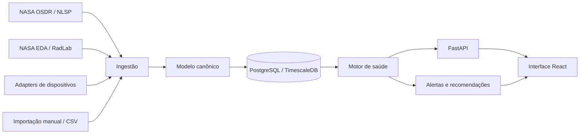
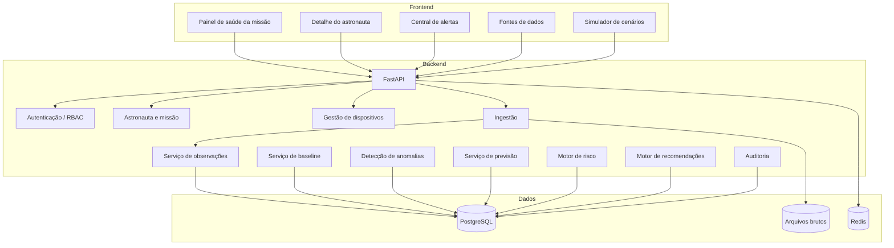
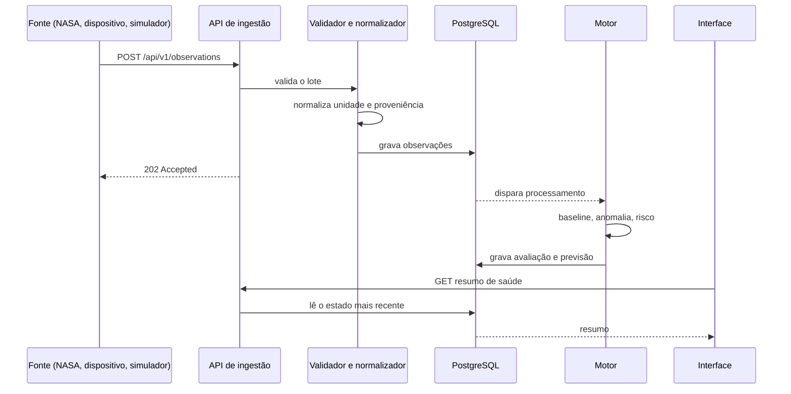

# Arquitetura alvo

::: warning Parcialmente implementado
Esta página é o **desenho alvo** do documento mestre (`PROJECT_MASTER.md`, seções 7 e 10). Parte dele já existe na [AHI API](/pt/architecture/backend): o monólito modular, ingestão, observações, cadastro, conectores NASA, SQLite ou PostgreSQL com Alembic e Docker Compose. Ainda conceitual: os serviços do motor no servidor, jobs em segundo plano, Redis, autenticação e controle de acesso por perfil. O sistema em execução está em [Visão geral da arquitetura](/pt/architecture/overview).
:::

A Astronaut Health Intelligence Platform (AHI) foi feita primeiro no navegador, para a demo do hackathon funcionar offline, e seus contratos (`HealthObservation` canônico, interface de adapters, `data_origin`, regras versionadas) foram escolhidos para que o servidor entrasse sem mudar as regras do motor nem a interface. Foi assim que o backend entrou.

## Decisão: monólito modular

O documento mestre define, para o MVP com backend, um **monólito modular com processamento assíncrono**. Sem microsserviços no início: a equipe precisa mostrar valor rápido, com baixo custo de operação, e evoluir só quando houver necessidade real.

**Evitar no MVP** (seção 7.2): Kafka obrigatório, Kubernetes, microsserviços independentes, feature store complexa e LLM como núcleo de decisão clínica.

## Stack prevista

| Camada | Tecnologia prevista | Status |
| --- | --- | --- |
| Frontend | React + TypeScript + Vite (já existe) | <StatusBadge status="IMPLEMENTED" /> |
| API | Python + FastAPI, schemas Pydantic | <StatusBadge status="IMPLEMENTED" /> [Backend e API](/pt/architecture/backend) |
| Persistência | SQLAlchemy + Alembic, PostgreSQL (TimescaleDB opcional) | <StatusBadge status="IMPLEMENTED" /> PostgreSQL 17 com Docker Compose, SQLite por padrão; sem TimescaleDB |
| Cache e jobs | Redis; Celery, RQ ou worker asyncio | <StatusBadge status="PLANNED" /> (só um cache em processo de 15 min para os dados da NASA) |
| Streaming | Redpanda ou Kafka, só no futuro | <StatusBadge status="PLANNED" /> |
| Ciência de dados | pandas, NumPy, SciPy; scikit-learn, XGBoost e SHAP depois | <StatusBadge status="EXPERIMENTAL" /> NumPy e Isolation Forest do scikit-learn no endpoint de análise; XGBoost e SHAP não implementados ([IA e análise](/pt/intelligence/ai-and-analytics)) |
| Interoperabilidade | HL7 FHIR R4 para exportação e importação | <StatusBadge status="IMPLEMENTED" /> só a exportação em arquivo; importação <StatusBadge status="PLANNED" /> |
| Testes | pytest, httpx, Playwright | <StatusBadge status="IMPLEMENTED" /> pytest com HTTP simulado; vitest para o motor |
| Observabilidade | OpenTelemetry e logs estruturados | <StatusBadge status="IMPLEMENTED" /> logs estruturados de requisição; <StatusBadge status="PLANNED" /> OpenTelemetry |
| Deploy | Docker Compose no MVP | <StatusBadge status="IMPLEMENTED" /> `docker-compose.yml` (PostgreSQL e a API) |

## Contexto alvo

*Conceitual (não implementado).*

## Componentes alvo

*Conceitual (não implementado).*

## Fluxo de ingestão alvo

*Parcialmente implementado: ingestão, validação e persistência existem; o job do motor no servidor não.*

## API alvo

Base local: `http://localhost:8000/api/v1`.

| Método | Rota | Descrição | Status |
| --- | --- | --- | --- |
| POST | `/observations` | Ingestão de observações em lote (`202 Accepted`) | <StatusBadge status="IMPLEMENTED" /> |
| GET | `/observations` | Consulta as observações de um sujeito | <StatusBadge status="IMPLEMENTED" /> |
| POST | `/datasets/import` | Cria um job de importação | <StatusBadge status="PLANNED" /> |
| GET | `/datasets`, `/data-sources` | Lista datasets e fontes | <StatusBadge status="PLANNED" /> |
| POST, GET | `/astronauts`, `/missions`, `/devices` | Cadastro pseudonimizado | <StatusBadge status="IMPLEMENTED" /> |
| GET | `/astronauts/{id}/health`, `/history`, `/baseline`, `/anomalies`, `/risks`, `/predictions`, `/recommendations` | Leituras por astronauta | <StatusBadge status="PLANNED" /> (precisa do motor em Python) |
| POST | `/alerts/{id}/acknowledge` | Reconhecer alerta | <StatusBadge status="PLANNED" /> |
| POST | `/interventions` | Registrar intervenção | <StatusBadge status="PLANNED" /> |
| POST | `/scenarios/{scenario_id}/run` | Executar simulação | <StatusBadge status="PLANNED" /> |
| GET | `/devices/{id}/status` | Status do dispositivo | <StatusBadge status="PLANNED" /> |
| GET | `/health`, `/health/ready`, `/health/live` | Status, prontidão e vida | <StatusBadge status="IMPLEMENTED" /> |

O formato do lote de ingestão está em [Pipeline e qualidade](/pt/data/pipeline-and-quality#esquemas-de-entrega).

## Como o código atual se encaixa

O ponto de encaixe é o **contrato de adapters**. No navegador, cada adapter TypeScript implementa `read`, `readEvents` e `status` e devolve `HealthObservation` ([Modelo de dados e contratos](/pt/architecture/data-model)). O contrato Python previsto tem os mesmos papéis:

| TypeScript (hoje) | Python (alvo) |
| --- | --- |
| construção do adapter | `connect`, `disconnect` |
| `read(simNow)`, `readEvents(from, to)` | `read_observations` |
| `makeObservation` | `normalize` |
| `status(simNow)` | `get_device_status` |

Adapters previstos: `AstroskinSimulatorAdapter`, `ActiwatchSimulatorAdapter`, `ExerciseEquipmentSimulatorAdapter`, `EnvironmentalSensorSimulatorAdapter`, `OsdrDatasetImportAdapter`, `EdaFileImportAdapter` e `RadLabImportAdapter`.

O motor TypeScript seria portado para o backend módulo a módulo; o contrato `HealthObservation` e as regras documentadas continuariam as mesmas. O ponto de encaixe (protocolo `HealthEngine`) já existe em `backend/app/modules/engine`.

## Requisitos não funcionais alvo

Da seção 14 do documento mestre:

| Categoria | Requisito do MVP com backend |
| --- | --- |
| Desempenho | P95 de ingestão abaixo de 2 s em carga de demo |
| Painel | Atualização em até 5 s após o processamento |
| Confiabilidade | Idempotência e nova tentativa na importação |
| Segurança | TLS em ambiente publicado; segredos fora do código |
| Privacidade | Dados pseudonimizados; sem dado pessoal real |
| Autorização | RBAC básico para os perfis |
| Auditoria | Histórico de regras, modelos e ações |
| Observabilidade | Logs estruturados e endpoints de saúde |

::: warning ATENÇÃO
Ter um equipamento a bordo da ISS não significa que exista API pública ou fluxo de dados disponível. A arquitetura alvo não pressupõe acesso a hardware real.
:::

## Próximos passos

- [Visão geral da arquitetura](/pt/architecture/overview): o que existe hoje.
- [Roadmap](/pt/resources/roadmap): ordem prevista das entregas.
- [Governança e privacidade](/pt/data/governance-and-privacy).
