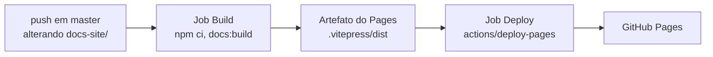

# Documentação e deploy

## O que é publicado

| Artefato | Onde | Status |
| --- | --- | --- |
| Portal de documentação (este site) | GitHub Pages: https://lucaspalharesbarbosa.github.io/astronaut-health-intelligence-platform/ | <StatusBadge status="IMPLEMENTED" /> |
| App da Astronaut Health Intelligence Platform | Só local (`npm run dev` ou `npm run preview`) | <StatusBadge status="NOT_IMPLEMENTED" /> como implantação pública |
| Backend, API, banco | Não existem | <StatusBadge status="PLANNED" /> ([Arquitetura alvo](/pt/architecture/target-architecture)) |

O app gera um build estático (`npx vite build` em `frontend/web/dist`) que poderia ser servido por qualquer hospedagem estática, mas nenhuma implantação pública do app está configurada neste repositório.

## O portal

| Item | Detalhe |
| --- | --- |
| Gerador | VitePress 1.6.4, com `vitepress-plugin-mermaid` e Mermaid 11 |
| Pasta | `docs-site/` |
| Idiomas | Inglês na raiz; português do Brasil em `/pt/`, com os **mesmos caminhos** |
| Base | `/astronaut-health-intelligence-platform/` |
| URLs | Limpas (`cleanUrls`), sem `.html` |
| Busca | Local, com textos traduzidos para o português |
| Diagramas | Blocos de código com a linguagem `mermaid` |
| Notas de rodapé | `markdown-it-footnote`, para referências científicas |
| Links quebrados | O build falha com link interno quebrado (links para `localhost` são ignorados) |

### Componentes do tema

O tema estende o tema padrão do VitePress com componentes globais:

| Componente | Uso |
| --- | --- |
| `PageMeta` | Lê o frontmatter da página e mostra trilha de navegação, status, origem, arquivos de código, testes e data de verificação |
| `<StatusBadge status="..." />` | Selo de status: <StatusBadge status="IMPLEMENTED" /> <StatusBadge status="EXPERIMENTAL" /> <StatusBadge status="PLANNED" /> <StatusBadge status="CONCEPTUAL" /> <StatusBadge status="NOT_IMPLEMENTED" /> |
| `<OriginBadge origin="..." />` | Selo de origem: <OriginBadge origin="REAL_PUBLIC, DERIVED, SIMULATED, MANUAL" /> |
| `<CodeLink path="..." />` | Link para um arquivo do repositório no GitHub, por exemplo <CodeLink path="frontend/web/src/engine/risk.ts" /> |

### Contrato de frontmatter

```yaml
---
title: Baseline pessoal           # título (igual ao H1)
description: Uma frase para busca e SEO.
status: IMPLEMENTED               # IMPLEMENTED | EXPERIMENTAL | PLANNED | CONCEPTUAL | NOT_IMPLEMENTED | DEPRECATED
origin: SIMULATED                 # REAL_PUBLIC | DERIVED | SIMULATED | MANUAL (vários separados por vírgula)
code:
  - frontend/web/src/engine/baseline.ts
tests:
  - frontend/web/src/engine/baseline.test.ts
verified: 2026-11-14              # data da última conferência contra o código ou a fonte
---
```

## Rodar localmente

```bash
cd docs-site
npm install
npm run docs:dev       # servidor de desenvolvimento
npm run docs:build     # build em docs-site/.vitepress/dist
npm run docs:preview   # serve o build
```

## Publicação automática



O workflow `docs-deploy.yml`:

- roda em push para `master` que altera `docs-site/**` ou o próprio workflow, e também manualmente (`workflow_dispatch`);
- usa permissões mínimas (`contents: read`, `pages: write`, `id-token: write`);
- faz uma implantação por vez, sem cancelar uma em andamento;
- usa Node 22 com cache do npm.

Configuração necessária uma vez no repositório: **Settings > Pages > Build and deployment > Source = "GitHub Actions"**.

O workflow `ci.yml` também constrói o portal em todo push e pull request, então um link quebrado bloqueia o merge quando a proteção de branch exige essa checagem. Detalhes em [Estratégia de testes](/pt/engineering/testing#ci).

## Regras de escrita do portal

- Nome oficial na primeira menção: **Astronaut Health Intelligence Platform**; depois, "AHI".
- Sem travessão nem meia-risca em nenhum texto.
- Cada página de funcionalidade declara status e, quando mostra dados, origem.
- Rótulos da interface ficam em inglês, entre aspas ou em código, com a explicação em português.
- Capturas de tela só reais (`docs-site/public/screenshots/`), nunca montagens.
- Diagramas conceituais levam a legenda "Conceitual (não implementado)".

## Próximos passos

- [Configuração, comandos e problemas](/pt/engineering/quick-start).
- [Padrões, contratos e extensões](/pt/engineering/contributing#documentacao).
- [Estrutura do projeto](/pt/engineering/project-structure).
