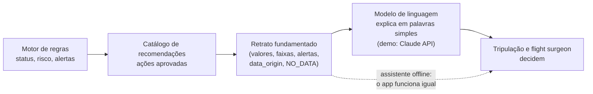

# Abordagem de IA e análise de dados

"Inteligência de saúde" na Astronaut Health Intelligence Platform (AHI) significa **estatística explicável e regras transparentes primeiro**. Aprendizado de máquina e um modelo de linguagem existem, mas cada um em um papel estreito e rotulado, que não pode mudar um status. Esta página diz com precisão o que roda, o que não roda e por quê.

::: tip Em uma frase
Status, risco e alertas vêm só de estatística e de regras versionadas. Um detector **experimental de aprendizado de máquina** acrescenta uma nota informativa "Unusual combination". Um **modelo de linguagem** é usado só pelo assistente opcional Ask AHI, como demo, pela AHI API, para explicar o que o motor já calculou.
:::

## Quatro famílias de técnicas

| Família | O que é | Na AHI | Status |
| --- | --- | --- | --- |
| **Processamento estatístico** | Estatística descritiva sobre os dados recentes de cada pessoa | Mediana, MAD, quantis, z robusto, deriva EWMA, CUSUM, contagens de persistência, médias em janelas de 30 min | <StatusBadge status="IMPLEMENTED" /> |
| **Pontuação por regras** | Regras explícitas e versionadas, com identificador e fórmula documentada | Regras por métrica, regras de exames, três regras combinadas, escore noisy-OR, confiança, catálogo de recomendações, autonomia | <StatusBadge status="IMPLEMENTED" /> |
| **Modelos preditivos e de aprendizado de máquina** | Modelos de séries temporais e modelos treinados | Holt linear amortecido (sem etapa de treino); um Isolation Forest por astronauta para combinações incomuns | <StatusBadge status="IMPLEMENTED" /> Holt, <StatusBadge status="EXPERIMENTAL" /> Isolation Forest |
| **Modelos de linguagem (LLMs)** | Modelos generativos de texto | Ask AHI explica as saídas do motor (demo, Claude API pela AHI API) | <StatusBadge status="EXPERIMENTAL" /> só demo |

### Processamento estatístico

Cada pessoa é comparada consigo mesma. A baseline usa mediana e MAD porque resistem a valores extremos; a deriva usa EWMA porque uma mudança lenta é invisível em uma leitura isolada; o CUSUM pega um deslocamento ainda menor que nunca para. Páginas: [Linha de base pessoal](/pt/intelligence/personal-baseline), [Detecção de anomalias](/pt/intelligence/anomaly-detection).

### Pontuação por regras

Regras transformam estatística em decisões que um humano pode auditar: cada achado tem identificador, nível, frase em linguagem simples e peso, e a fórmula do escore cabe em uma linha. Páginas: [Avaliação de risco](/pt/intelligence/risk-assessment), [Recomendações](/pt/intelligence/recommendations), [Limiares](/pt/intelligence/thresholds).

### Modelos preditivos e de aprendizado de máquina

| Método | Status | Por quê |
| --- | --- | --- |
| Holt linear amortecido com intervalo de 80% | <StatusBadge status="IMPLEMENTED" /> | Simples, estável, não precisa de dados de treino, a incerteza é explícita ([Previsão](/pt/intelligence/forecasting)) |
| Isolation Forest, por astronauta, com branqueamento PCA | <StatusBadge status="EXPERIMENTAL" /> | US-019 do plano. Treinado na janela da própria pessoa, então não precisa de dados de população; só acrescenta uma nota e lista os sinais que contribuíram ([Detecção de anomalias](/pt/intelligence/anomaly-detection#unusual-combination-experimental)). Uma versão com scikit-learn roda no backend para comparação |
| ARIMA | <StatusBadge status="NOT_IMPLEMENTED" /> | P2 no plano; Holt amortecido com elegibilidade explícita cobre os horizontes oferecidos |
| Modelo de risco XGBoost | <StatusBadge status="NOT_IMPLEMENTED" /> | Precisa de um dataset rotulado de desfechos reais, que não existe publicamente |
| Explicações SHAP | <StatusBadge status="NOT_IMPLEMENTED" /> | As regras listam seus fatores; o Isolation Forest lista as contribuições por sinal |
| Regra IQR | <StatusBadge status="NOT_IMPLEMENTED" /> | Coberta pelo z robusto |

### Por que o aprendizado de máquina continua experimental

- **Sem dados reais.** Não há telemetria pública contínua de astronautas nem desfechos rotulados; o detector só viu dados simulados, então pode estar aprendendo principalmente o simulador.
- **Explicação primeiro.** Seção 9.1 do plano: estatística explicável primeiro, depois aprendizado de máquina. Um flight surgeon precisa ver por que um nível mudou, então o detector não pode mudar nenhum.
- **Pessoal, não populacional.** O detector é treinado por astronauta, nos dias da própria pessoa, o mesmo princípio da baseline.
- **Não objetivo.** O plano exclui treinar um modelo clínico robusto com pequenas bases históricas (seção 2.4).

## Modelo de linguagem: o assistente Ask AHI {#language-model-the-ask-ahi-assistant}

<StatusBadge status="EXPERIMENTAL" /> O assistente segue o papel estreito do US-024 e da seção 9.7 do plano: fica **depois** do motor e explica.

| O modelo pode | O modelo não pode |
| --- | --- |
| Explicar status, alertas e recomendações que já estão no app | Inventar um limite clínico |
| Terminar cada resposta com "Based on:" citando o que usou | Diagnosticar |
| Ser desligado, com o app funcionando sem ele | Recomendar medicamento ou criar tratamento |
| Dizer "o app não mostra isso" | Transformar correlação em causalidade, esconder incerteza ou a origem simulada dos dados |

Um modelo em nuvem só é aceitável para a demo do hackathon. Uma missão real precisa de um modelo embarcado e offline; veja [Ask AHI](/pt/product/assistant#the-onboard-target).

## IA no desenvolvimento

O código e estes documentos foram desenvolvidos com ajuda de um assistente de programação com IA (Claude Code). Isso é uma propriedade de como o projeto foi construído, como a escolha do editor; ele não roda dentro da plataforma, não vê dados da tripulação e não toma nenhuma decisão no produto. Todo o comportamento do motor está em código revisado e coberto por testes ([Estratégia de testes](/pt/engineering/testing)).

## Próximos passos

- [Visão geral e status dos métodos](/pt/intelligence/overview)
- [Model card](/pt/validation/model-card)
