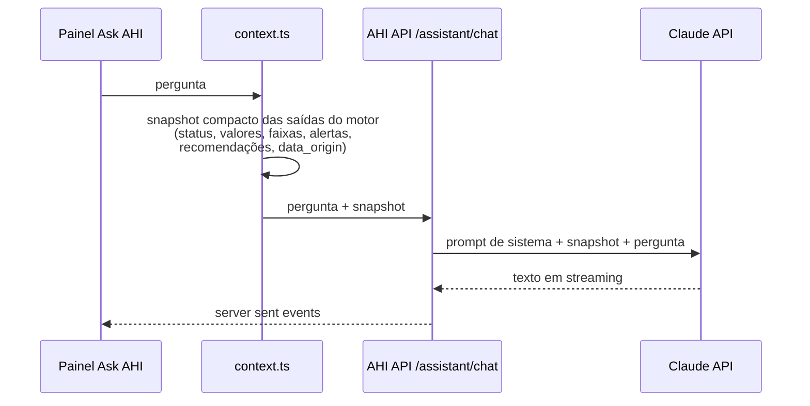

# Assistente Ask AHI

## O que faz {#what-it-does}

O **Ask AHI** responde perguntas em linguagem simples sobre o que o app já mostra: "How is ORION doing?" (como está o ORION?), "Why is this alert on?" (por que este alerta está ativo?), "What should we do now?" (o que devemos fazer agora?). Ele **explica as saídas do motor de saúde**; não calcula nada sozinho.

::: warning Apenas apoio à decisão
O assistente nunca diagnostica, nunca sugere medicação e nunca cria, encerra ou muda um alerta, um status ou uma recomendação. As decisões médicas ficam com o médico da tripulação e o médico de voo. O motor é a fonte da verdade.
:::

## No app {#in-the-app}

- O botão **Ask AHI** fica no canto inferior direito. Ele abre um painel lateral com três perguntas iniciais.
- As respostas chegam **em streaming** enquanto são escritas. Cada resposta termina com uma linha **"Based on:"** (com base em) que nomeia as leituras, alertas ou recomendações usados (ou "no matching data in the app").
- **Voz de entrada**: um botão de microfone usa o reconhecimento de fala do navegador, onde o navegador oferece.
- **Leitura em voz alta**: um botão liga a leitura de cada resposta com a síntese de fala do navegador (a linha "Based on:" é mostrada, não lida). Um botão de parar encerra uma resposta durante o streaming.
- Sem a API ou sem chave, o painel mostra um estado calmo **"Assistant offline"**. Monitoramento, alertas e recomendações continuam funcionando.

## Como a demo funciona {#how-the-demo-works}



- O navegador monta um **snapshot ancorado** das saídas atuais do motor. Dados ausentes vão como `null` com `NO_DATA`, nunca como número; o `data_origin` vai junto, então respostas sobre dados simulados dizem que são simulados.
- A AHI API (`POST /api/v1/assistant/chat`, server sent events) chama a Claude API com o modelo `claude-opus-5-5` em esforço baixo (configurável em `backend/.env`). O fallback de recusa do lado do servidor da Claude API fica ligado: se o modelo recusar, a mesma chamada é refeita em um modelo de fallback em vez de devolver uma resposta vazia.
- O endpoint tem limite de taxa (padrão: 6 pedidos por minuto, 60 por hora) e responde 503 "assistant not configured" quando não há chave.

### Como ativar {#enabling-it}

Coloque uma chave em `backend/.env` (ignorado pelo git, nunca faça commit) e inicie a API:

```bash
# backend/.env
ANTHROPIC_API_KEY=your-key-here
```

`GET /api/v1/assistant/status` diz ao app se o assistente pode responder; nunca devolve a chave.

## O alvo a bordo {#the-onboard-target}

Depender de um modelo de linguagem na nuvem **não é aceitável em uma espaçonave**: o atraso de comunicação com Marte (cerca de 4 a 24 minutos de ida[^a1]), os apagões, a privacidade dos dados de saúde da tripulação, a certificação de software de voo e a segurança de rede excluem essa opção. A demo usa a Claude API só para mostrar como o recurso funcionaria.

A arquitetura de missão mantém o mesmo contrato com outro provedor:

| Peça | Demo | Alvo a bordo |
| --- | --- | --- |
| Modelo de linguagem | Claude API (nuvem) | Modelo pequeno de pesos abertos no computador da espaçonave, quantizado, versão fixa |
| Fala para texto | Reconhecimento de fala do navegador (pode usar um serviço na nuvem) | Fala para texto local |
| Ancoragem | Snapshot do motor | Snapshot do motor mais um índice local de procedimentos de bordo versionados |
| Salvaguardas | Prompt de sistema, fallback de recusa | Salvaguardas de entrada e saída (sem diagnóstico, sem medicação, citações precisam bater com o snapshot) |
| Fallback | "Assistant offline" | Resposta por template gerada a partir do motor, sem modelo |
| Auditoria | Logs de requisição | Pergunta, hash do snapshot, versão do modelo e resposta |

O texto completo, com a tabela de restrições e o diagrama a bordo, está em [`docs/assistant-architecture.md`](https://github.com/lucaspalharesbarbosa/astronaut-health-intelligence-platform/blob/master/docs/assistant-architecture.md).

## Status {#status}

<StatusBadge status="EXPERIMENTAL" /> Apenas demo. O painel, o montador do snapshot e o endpoint são testados (`assistant.test.ts`, `test_assistant.py`, com o modelo simulado). <StatusBadge status="CONCEPTUAL" /> para a arquitetura a bordo.

[^a1]: NASA, Space Communications: 7 Things You Need to Know. <https://www.nasa.gov/solar-system/space-communications-7-things-you-need-to-know/>

## Próximos passos {#next-steps}

- [Abordagem de IA e análise de dados](/pt/intelligence/ai-and-analytics)
- [Backend e API](/pt/architecture/backend)
- [Uso responsável](/pt/overview/responsible-use)
