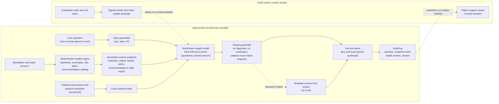

# AHI assistant: demo architecture and the onboard target

AHI includes an assistant ("Ask AHI") that answers plain language questions such as "How is ORION
doing?", "Why is this alert on?" or "What should we do now?". It explains what the health engine already
computed. It never diagnoses, never suggests medication and always defers medical decisions to the crew
medical officer and the flight surgeon.

**Product decision.** Depending on a cloud language model is not acceptable for a spacecraft. For the
hackathon demo we use the Claude API to show how the feature would work, and this document describes the
architecture a real mission would need. The demo keeps the same contract, so the provider can be swapped
without touching the app.

## 1. Principles (both demo and mission)

1. **The deterministic engine is the source of truth.** Baselines, anomaly detection, risk, alerts and
   recommendations come from the rule based engine (`frontend/web/src/engine`), which is tested and
   reproducible. The language model never computes a status, never raises or clears an alert and never
   chooses a recommendation (PROJECT_MASTER section 7: no LLM as the core of clinical decisions).
2. **The model only explains.** It receives a compact, grounded snapshot of the engine outputs and turns it
   into short, plain sentences. Every answer ends with a "Based on:" line naming the readings, alerts or
   recommendations it used.
3. **Unknown stays unknown.** Missing or stale data is sent as `null` with status `NO_DATA`, never as a
   number, and the model is told to say "the app does not show that" instead of guessing.
4. **Simulated stays labeled.** The snapshot carries `data_origin`; when it is `SIMULATED` the answer says so.
5. **The app works without it.** If the assistant is unavailable, monitoring, alerts and recommendations
   keep working and the panel shows a calm "Assistant offline" state.

## 2. Why a cloud model is not acceptable on a real mission

| Constraint | What it means for a cloud assistant |
| --- | --- |
| **Communication delay** | Light time from Mars is about 4 to 24 minutes one way, so a single question and answer takes 8 to 48 minutes plus processing. An assistant is useful in seconds, when the crew is looking at an alert. |
| **Blackouts and limited bandwidth** | Solar conjunction cuts contact with Mars for about two weeks, and the Moon's far side, antenna scheduling (Deep Space Network time is shared) and safe mode events cause gaps. Downlink bandwidth is reserved for science, telemetry and operations. |
| **Availability** | A health tool must work in the worst moment, which is often when the link is degraded. Every external dependency (internet, provider uptime, account, quota, API version) is a failure mode the crew cannot fix. |
| **Privacy** | Crew health data is sensitive medical information. Sending it to a third party service raises consent, data residency and medical confidentiality issues, even pseudonymized. |
| **Certification and change control** | Flight software is verified against a fixed configuration. A hosted model can change behavior with a silent update; the onboard model must be a pinned, versioned, tested artifact. |
| **Security** | An open network path from the vehicle to a commercial endpoint widens the attack surface of the spacecraft network. |

Note: browser speech recognition in Chrome also sends audio to a cloud service. On board, speech to text
must run locally too.

## 3. Ideal onboard architecture

### 3.1 Components

- **Deterministic engine (unchanged).** The same engine that drives the dashboard produces the snapshot.
  The assistant has no other source of health facts.
- **Grounded context snapshot.** A small JSON document (a few kilobytes) with the selected astronaut's
  overall status, each reading with unit and personal normal band, open alerts, active recommendations,
  mission profile, cabin state and data origin. The demo already builds it with a pure, unit tested
  function (`frontend/web/src/features/assistant/context.ts`).
- **Retrieval over onboard procedures.** Medical checklists, the crew medical officer handbook,
  countermeasure procedures and the recommendation catalog rationale, indexed locally (for example a small
  embedding model plus a vector or BM25 index). Retrieved passages carry document ids so answers can cite
  them. Retrieval adds context; it never changes engine outputs.
- **Small open weight model, local inference.** A model in the 3 to 8 billion parameter class, quantized
  (for example 4 bit), served by a local inference runtime (such as llama.cpp or a vendor runtime) behind
  the same HTTP contract the demo uses. The weights are a pinned, hashed, signed artifact. Short answers
  (under about 200 tokens) keep latency in the range of seconds on modest hardware.
- **Guardrails.**
  - Input: size limits, rate limits, topic check (health, mission, app usage), removal of free text
    identifiers.
  - System prompt: the same rules as the demo (plain language, use only the context, say when unknown,
    say simulated, never diagnose, no medication, defer to the crew medical officer and flight surgeon,
    end with "Based on:").
  - Output: a deterministic checker rejects answers that name drugs or doses, contain diagnostic language,
    or cite values that do not match the snapshot (every number in the answer must appear in the context).
  - Fallback: if the model fails, times out or an answer is blocked, the panel shows a template answer
    generated directly from the engine (headline, top factors, open alerts, recommended actions). The crew
    always gets an answer.
- **Audit trail.** Each exchange is logged with the question, a hash of the snapshot, the model and
  index versions, and the answer, so the flight surgeon can review samples after the fact.

### 3.2 Evaluation

- A fixed evaluation set built from the engine scenarios (nominal, progressive fatigue, cabin CO2,
  performance decline, sensor failure, acute cardio) and the question types the crew asks.
- Automatic checks on every candidate model: groundedness (numbers match the snapshot), "Based on:"
  present and correct, simulated data mentioned, refusal to diagnose or name medication, correct "unknown"
  answers for missing data, reading level, length and latency on the target hardware.
- Red team sets for prompt injection (instructions hidden in notes or check-in text), requests for
  medication, and emergency wording (the answer must point to onboard emergency procedures and the crew
  medical officer).
- Clinician review of a sample of answers by flight surgeons before any model is approved for flight.

### 3.3 Update path

Models and indexes are updated only as signed packages, prepared and evaluated on Earth, uplinked in a
contact window, verified on board (signature and hash), and activated by the crew with a rollback to the
previous version kept on disk. Without contact, the assistant keeps running on the last approved version.
Audit samples flow the other way when bandwidth allows.

### 3.4 Hardware and power

- Run on the vehicle's general purpose computing payload (a crew support laptop or server class
  computer), never on flight critical avionics. Radiation tolerant or radiation hardened parts lag
  commercial ones, so plan for modest compute: CPU inference or a low power embedded accelerator.
- A quantized small model needs a few gigabytes of memory and storage. Load on demand and unload when idle.
- Power: inference runs only while a question is answered, so the energy cost is bursts of tens of watts
  for seconds. Budget it like any other crew support payload.
- Thermal and reliability: graceful degradation (fallback to template answers) if the device is
  throttled, rebooted or affected by a radiation induced fault.

## 4. How the demo maps to the target

| Part | Demo (this repository) | Onboard target |
| --- | --- | --- |
| Source of truth | TypeScript engine in the browser | Same engine, on the vehicle |
| Context snapshot | `buildAssistantContext()` (pure, unit tested) | Same function and schema |
| API contract | `POST /api/v1/assistant/chat` (server sent events), `GET /api/v1/assistant/status` | Same contract |
| Provider | `AnthropicProvider`, Claude API (`claude-opus-5-5`, configurable), cloud | Local inference provider implementing the same `AssistantProvider` protocol |
| System prompt and rules | `backend/app/modules/assistant/prompt.py` | Same rules, tuned for the smaller model |
| Retrieval | Not in the demo (the engine snapshot is the only context) | Local index over onboard procedures |
| Guardrails | Prompt rules, input size limits, rate limit, refusal handling | Plus deterministic output checker and template fallback |
| Voice | Browser speech APIs (speech to text may use a cloud service) | Local speech to text and speech synthesis |
| Offline behavior | Calm "Assistant offline" state; the rest of the app works | Template answers from the engine when the model is unavailable |
| Logging | Metadata only (no question or answer text) | Full audit trail on board, reviewed by the flight surgeon |

Swapping the provider is a backend change only: implement `AssistantProvider.open()` for the local
runtime and select it in `build_assistant()` (`backend/app/main.py`). The web app, the snapshot and the
stream format do not change.

## 5. Running the demo assistant

1. Start the API (see `backend/README.md`).
2. Put `ANTHROPIC_API_KEY=...` in `backend/.env` (gitignored, never commit it). Optional: `ASSISTANT_MODEL`,
   `ASSISTANT_EFFORT`, rate limits (see `backend/.env.example`).
3. Restart the API and open "Ask AHI" in the web app (bottom right).

Without a key the endpoint answers `503 assistant not configured` and the panel explains how to enable it.
