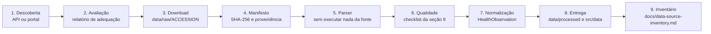

# Guia de Dados do AHI

**O que precisamos, de onde vem e em que formato entregar**

| | |
| --- | --- |
| Projeto | Astronaut Health Intelligence (AHI), NASA Space Apps 2026, *Health Monitoring Software* |
| Público | Time de dados (data engineers, data scientists, pesquisa científica) |
| Base | `PROJECT_MASTER.md` (seções 3, 4, 5, 6, 9, 16 e 17), contrato do app `frontend/web/src/types/domain.ts`, simuladores em `frontend/web/src/engine/`, inventário `docs/data-source-inventory.md` |
| Data | 14/11/2026. Acessos às fontes NASA conferidos nesta data |

---

## Resumo em 1 minuto

1. **Hoje o app mostra 21 métricas, e todas vêm de simuladores ou do check-in digitado no app** (`data_origin` SIMULATED ou MANUAL). A única exceção são dois painéis de exames de sangue reais da missão Inspiration4 (OSD-569 e OSD-575), exibidos como referência histórica.
2. **Nosso trabalho é trocar simulação por dado real onde ele existe**, e onde não existe, **ancorar a simulação em fontes científicas citáveis**. É isso que dá credibilidade ao projeto.
3. **Não existe telemetria fisiológica contínua pública de astronautas** (FC, ECG, SpO₂ minuto a minuto). Não perca tempo procurando "a API dos sinais vitais da ISS": ela não existe para o público. Para essas métricas, a estratégia é calibrar o simulador com faixas publicadas e manter o selo SIMULATED.
4. **Onde há dado real e público com mais impacto:**
   - **Ambiente da cabine da ISS** (CO₂, temperatura, umidade e dose de radiação) no **NASA EDA**. É a prioridade número 1.
   - **Exames laboratoriais humanos** no **NASA OSDR** (já feito: hemograma e painel metabólico do Inspiration4).
   - **Catálogo oficial de medidas** nas **NASA Standard Measures**, para justificar quais métricas monitoramos e por quê.
5. **Todo dado entregue segue o modelo canônico `HealthObservation`** (seção 5), com proveniência completa: fonte, accession, arquivo, SHA-256 e data de download.

---

## 1. Como usar este guia

| Se você precisa... | Vá para |
| --- | --- |
| Entender as regras que não podem ser quebradas | [2. Regras de ouro](#2-regras-de-ouro) |
| Saber o que é simulado e o que é real hoje | [3. Panorama](#3-panorama-simulado-vs-real) |
| Ver cada métrica, unidade e frequência | [4. Catálogo de dados e métricas](#4-catálogo-de-dados-e-métricas) |
| Saber o formato exato de entrega | [5. Modelo de dados](#5-modelo-de-dados-esquemas) |
| Saber onde buscar cada dado na NASA | [6. Fontes oficiais](#6-fontes-oficiais-da-nasa) e [7. Matriz métrica x fonte](#7-matriz-métrica-x-fonte-x-estratégia) |
| Preparar e importar um dataset | [8. Pipeline](#8-pipeline-de-preparação) e [9. Qualidade](#9-checklist-de-qualidade-de-dados) |
| Saber por onde começar | [11. Prioridades](#11-prioridades-e-plano-de-trabalho) |

---

## 2. Regras de ouro

Estas regras vêm do `PROJECT_MASTER.md` (seções 1.1, 4.1 e 17) e são inegociáveis.

1. **Todo registro tem `data_origin`:**
   - `REAL_PUBLIC`: dado obtido de fonte pública.
   - `DERIVED`: valor calculado a partir de dado identificado.
   - `SIMULATED`: valor sintético.
   - `MANUAL`: digitado no app, como o check-in diário.
2. **Nunca misturar sem marcar:**
   - astronauta com participante de estudo análogo (HERA, bed rest);
   - humano com animal;
   - solo com voo;
   - medida contínua com medida pontual;
   - unidades diferentes.
3. **Dado público não é telemetria ao vivo.** Dado real histórico aparece como referência ou replay identificado, nunca como "a tripulação agora".
4. **Não inventar limites clínicos nem "limites oficiais da NASA".** Todo limiar precisa de fonte citável ou do rótulo "demo configuration, not an official limit".
5. **Dado ausente não vira zero nem "normal".** Ausência é `null`, com qualidade `MISSING`, e o app mostra NO_DATA.
6. **Proveniência completa** em todo dado importado: fonte, URL, accession, versão, arquivo, SHA-256, data de download, licença (ou "not stated") e versão do parser.
7. **Privacidade:** só pseudônimos da fonte (C001, AST-01...), sem PII. Não tentar identificar pessoas nem contornar controles de acesso (dados de sequenciamento do OSDR são de acesso controlado).
8. **Correlação não é causalidade.** Ao cruzar ambiente e fisiologia, documente como coocorrência.

---

## 3. Panorama: simulado vs real

| Domínio | O que o app mostra | Origem hoje | Pode virar real? | Prioridade |
| --- | --- | --- | --- | --- |
| Sinais vitais | FC, HRV, SpO₂, respiração, pressão, temperatura da pele | SIMULATED (Bio-Monitor) | **Improvável** como série contínua pública. Calibrar com literatura | P1 (calibração) |
| Sono e atividade | Duração e eficiência do sono, atividade | SIMULATED (actigrafia) | Possível via estudos análogos (marcar como ANALOG) | P1 |
| Exercício | Desempenho em CEVIS, ARED e T2 | SIMULATED | Improvável. Calibrar com literatura de contramedidas | P2 |
| Cognição e autorrelato | Tempo de reação, humor, fadiga, estresse | SIMULATED e MANUAL | Referência de protocolo nas Standard Measures | P2 |
| Hidratação | Índice de hidratação | SIMULATED | Improvável | P2 |
| **Ambiente da cabine** | CO₂, temperatura, umidade | SIMULATED | **Sim: NASA EDA (ISS)** | **P0** |
| **Radiação** | Taxa de dose e dose acumulada | SIMULATED | **Sim: NASA EDA e RadLab** | **P0** |
| **Laboratório** | Hemograma e painel metabólico | **REAL_PUBLIC** (OSD-569, OSD-575) | Já é real. Ampliar | Feito, P1 para ampliar |
| Missão e contexto | Fases, cronograma, atraso de comunicação | Configuração | Sim, a partir de metadados OSDR e EDA | P1 |
| Dispositivos | Estado, bateria, sinal | SIMULATED | Não há fonte pública. Manter simulado | Fora do escopo |

---

## 4. Catálogo de dados e métricas

Os códigos abaixo são os `metric_code` usados pelo app (`src/engine/catalog.ts`). Unidade canônica é a unidade em que o dado deve chegar ao app, depois da normalização. Frequência é a cadência que o simulador usa hoje e que o motor espera.

### 4.1 Sinais vitais (Bio-Monitor, simulado)

Dispositivo de referência: camiseta inteligente do tipo Astroskin/Bio-Monitor (Agência Espacial Canadense). Região do corpo no 3D: coração, pulmões e pele.

| metric_code | Descrição | Unidade | Frequência | Para que o app usa |
| --- | --- | --- | --- | --- |
| `HEART_RATE` | Frequência cardíaca | bpm | 1 min | Baseline por contexto (sono, repouso, trabalho, exercício), alerta agudo, tendência |
| `HRV_RMSSD` | Variabilidade da FC (RMSSD) | ms | janela de 1 min | Recuperação e fadiga (queda vs baseline pessoal) |
| `SPO2` | Saturação de oxigênio | % | 1 min | Alerta agudo (piso de demo 92% e 90%) |
| `RESPIRATORY_RATE` | Frequência respiratória | br/min | 1 min | Alerta agudo, coocorrência com CO₂ |
| `SYSTOLIC_BP` | Pressão sistólica | mmHg | 5 min | Desvio da baseline |
| `DIASTOLIC_BP` | Pressão diastólica | mmHg | 5 min | Desvio da baseline |
| `SKIN_TEMPERATURE` | Temperatura da pele | °C | 1 min | Desvio da baseline (carga térmica) |

### 4.2 Sono e atividade (actigrafia de pulso, simulado)

Dispositivo de referência: Actiwatch Spectrum. Região: cérebro e músculos.

| metric_code | Descrição | Unidade | Frequência | Uso |
| --- | --- | --- | --- | --- |
| `ACTIVITY_LEVEL` | Nível de atividade | score 0 a 100 | contínua | Contexto e tendência |
| `SLEEP_DURATION` | Duração do último sono | h | 1 por dia | Padrão de fadiga, visão de longo prazo |
| `SLEEP_EFFICIENCY` | Eficiência do sono | % | 1 por dia | Padrão de fadiga |

### 4.3 Exercício (CEVIS, ARED, T2, simulado)

Atenção (`PROJECT_MASTER` 5.1): são equipamentos de exercício, não monitores médicos.

| metric_code | Descrição | Unidade | Frequência | Uso |
| --- | --- | --- | --- | --- |
| `EXERCISE_LOAD` | Desempenho da sessão vs média pessoal | % da baseline | por sessão | Queda progressiva de desempenho |
| (diário) `exerciseMinutes` | Minutos de exercício no dia | min | 1 por dia | Aderência ao plano (`MissionDaySummary`) |

### 4.4 Cognição e autorrelato (app, simulado e manual)

| metric_code | Descrição | Unidade | Frequência | Origem |
| --- | --- | --- | --- | --- |
| `REACTION_TIME` | Tempo de reação no teste curto | ms | 1 por dia | SIMULATED |
| `MOOD` | Humor autorrelatado | escala 1 a 5 | 1 por dia | MANUAL (crew) ou SIMULATED |
| `PERCEIVED_FATIGUE` | Fadiga autorrelatada | escala 1 a 5 | 1 por dia | MANUAL ou SIMULATED |
| `STRESS` | Estresse autorrelatado | escala 1 a 5 | 1 por dia | MANUAL ou SIMULATED |
| (tags) `symptoms` | Sintomas (dor de cabeça, congestão...) | lista | 1 por dia | MANUAL ou SIMULATED |

### 4.5 Hidratação (registro de ingestão, simulado)

| metric_code | Descrição | Unidade | Frequência |
| --- | --- | --- | --- |
| `HYDRATION` | Índice de hidratação estimado | score 0 a 100 | 30 min |

### 4.6 Ambiente da cabine (sensores ambientais, simulado, **alvo P0 para dado real**)

Sujeito: `subject_id = "CABIN"`.

| metric_code | Descrição | Unidade | Frequência | Limiar de demo atual (precisa de fonte) |
| --- | --- | --- | --- | --- |
| `CO2` | CO₂ na cabine | ppm | contínua | Watch > 4000, Warning > 5300, Critical > 7500 |
| `CABIN_TEMPERATURE` | Temperatura do ar | °C | contínua | Faixa de conforto 18 a 27 |
| `RELATIVE_HUMIDITY` | Umidade relativa | % | contínua | Faixa de conforto 25 a 70 |

### 4.7 Radiação (dosímetros, simulado, **alvo P0 para dado real**)

| metric_code | Descrição | Unidade | Frequência | Limiar de demo atual |
| --- | --- | --- | --- | --- |
| `RADIATION_DOSE_RATE` | Taxa de dose na área | µGy/h | contínua | High > 100 (evento de partículas) |
| `RADIATION_DOSE` | Dose acumulada pessoal | mGy | 15 min | Watch > 50. Orçamento de missão de demo: 100 mGy em 180 dias |

### 4.8 Laboratório (amostras biológicas, **REAL_PUBLIC**)

Já importados (detalhes em `docs/data-source-inventory.md`):

| Dataset | Conteúdo | Pontos de coleta | Sujeitos |
| --- | --- | --- | --- |
| OSD-569 | Hemograma completo (CBC), 20 analitos | L-92, L-44, L-3, R+1, R+45, R+82, R+194 | C001 a C004 (Inspiration4) |
| OSD-575 | Painel metabólico completo (CMP), 19 analitos | mesmos 7 pontos | mesmos 4 |

O `PROJECT_MASTER` 6.4 também prevê `CORTISOL` e `WBC` como métricas de amostra (WBC já está no CBC).

### 4.9 Contexto da missão (configuração)

| Dado | Valores | Uso |
| --- | --- | --- |
| Fase da missão (`mission_phase`) | `PRE_FLIGHT`, `IN_FLIGHT`, `POST_FLIGHT` | Contexto de toda observação |
| Contexto de atividade (`activity`) | `SLEEP`, `REST`, `WORK`, `EXERCISE`, `EVA` | Baseline por contexto. Hoje vem do cronograma, não de sensor |
| Dia de missão, início, duração planejada | número, data ISO, dias | Visão de longo prazo |
| Perfil de comunicação | ISS 0,5 s; Lua 1,3 s; Marte 4 a 22 min (só ida) | Atraso das mensagens à Terra |

### 4.10 Dispositivos

| Campo | Tipo | Observação |
| --- | --- | --- |
| `state` | `ONLINE`, `DEGRADED`, `DATA_STALE`, `OFFLINE` | Falha de sensor nunca é tratada como "normal" |
| `batteryPct`, `signalPct` | 0 a 100 ou null | Simulado |
| `lastSeenAt` | timestamp | Detecta dado velho (`DATA_STALE`) |

---

## 5. Modelo de dados (esquemas)

A fonte da verdade é `frontend/web/src/types/domain.ts`. Os formatos abaixo são o que o time de dados deve entregar.

### 5.1 HealthObservation (modelo canônico)

Uma linha por medida. Vale para sinais vitais, ambiente (`subject_id: "CABIN"`), laboratório e autorrelato.

```json
{
  "observation_id": "OSD-569:C001:WBC:R+1",
  "subject_id": "C001",
  "mission_id": "INSPIRATION4",
  "device_id": null,
  "metric_code": "WBC",
  "value": 5.0,
  "unit": "Thousand/uL",
  "measured_at": "2021-09-19T00:00:00Z",
  "received_at": "2026-11-14T11:37:00Z",
  "data_origin": "REAL_PUBLIC",
  "source_reference": {
    "repository": "NASA OSDR",
    "dataset_accession": "OSD-569",
    "file_name": "LSDS-7_Complete_Blood_Count_CBC.upload_SUBMITTED.csv",
    "record_reference": "linha 42"
  },
  "quality": { "status": "VALID", "confidence": 1.0, "is_estimated": true },
  "context": { "mission_phase": "POST_FLIGHT", "activity": "REST" },
  "metadata": {
    "original_value": "5.0",
    "original_unit": "Thousand/uL",
    "population_type": "COMMERCIAL_ASTRONAUT",
    "timepoint_label": "R+1",
    "date_note": "A fonte informa só o rótulo R+1 (1 dia após o retorno). A data é estimada a partir do retorno da missão (18/09/2021), por isso is_estimated = true."
  }
}
```

> Exemplo de uma linha real do hemograma (OSD-569, sujeito C001, R+1). `WBC` ainda não é um `metric_code` do app; ele está previsto no `PROJECT_MASTER` 6.4.

| Campo | Obrigatório | Tipo | Regras |
| --- | --- | --- | --- |
| `observation_id` | sim | string | Único. Use uma chave idempotente da origem para deduplicar |
| `subject_id` | sim | string | Pseudônimo. `"CABIN"` para ambiente |
| `mission_id` | recomendado | string | Missão ou estudo |
| `device_id` | recomendado | string | Dispositivo ou instrumento lógico |
| `metric_code` | sim | enum | Um dos códigos da seção 4 |
| `value` | sim | number ou null | **null quando ausente, nunca 0** |
| `unit` | sim | string | Unidade canônica após normalização |
| `measured_at` | sim | ISO 8601 UTC | Sempre UTC. Guarde o fuso original em `metadata` se relevante |
| `received_at` | recomendado | ISO 8601 UTC | Momento da ingestão |
| `data_origin` | sim | enum | `REAL_PUBLIC`, `DERIVED`, `SIMULATED`, `MANUAL` |
| `source_reference` | sim se importado | objeto | Repositório, accession, arquivo, linha |
| `quality.status` | sim | enum | `VALID`, `QUESTIONABLE`, `INVALID`, `MISSING` |
| `quality.confidence` | recomendado | 0 a 1 | Rebaixar para valores estimados ou duvidosos |
| `quality.is_estimated` | recomendado | boolean | true para valores derivados ou interpolados |
| `context.mission_phase` | recomendado | enum | `PRE_FLIGHT`, `IN_FLIGHT`, `POST_FLIGHT` |
| `context.activity` | recomendado | enum | `SLEEP`, `REST`, `WORK`, `EXERCISE`, `EVA` |
| `metadata` | opcional | objeto | Valor e unidade originais, rótulo do ponto de coleta, tipo de população |

**Proposta de padronização em `metadata.population_type`** (atende à regra 2 da seção 2):
`ISS_ASTRONAUT`, `COMMERCIAL_ASTRONAUT`, `ANALOG_PARTICIPANT` (HERA, bed rest, confinamento), `GROUND_CONTROL`, `NOT_APPLICABLE` (cabine).

### 5.2 Lote de ingestão (`POST /api/v1/observations`, `PROJECT_MASTER` 10.2)

Formato para quando existir o backend. Hoje os dados entram como JSON estático.

```json
{
  "subject_id": "AST-01",
  "mission_id": "MISSION-001",
  "source_id": "SIM-ASTROSKIN-001",
  "data_origin": "SIMULATED",
  "observations": [
    { "metric_code": "HEART_RATE", "value": 82, "unit": "bpm", "measured_at": "2026-11-13T14:30:00Z", "quality_status": "VALID" }
  ]
}
```

### 5.3 Ambiente da cabine (formato de entrega do EDA)

Mesmo `HealthObservation`, com `subject_id: "CABIN"` e `metadata` explicando o vínculo com a missão de payload:

```json
{
  "observation_id": "EDA:RR-18:CO2_ppm_ISS:2018-06-30T12:00:00Z",
  "subject_id": "CABIN",
  "mission_id": "RR-18",
  "device_id": "ISS-CABIN-CO2",
  "metric_code": "CO2",
  "value": 2950,
  "unit": "ppm",
  "measured_at": "2018-06-30T12:00:00Z",
  "data_origin": "REAL_PUBLIC",
  "source_reference": { "repository": "NASA EDA", "dataset_accession": "RR-18", "file_name": "<arquivo CSV baixado>", "record_reference": "<linha>" },
  "quality": { "status": "VALID", "confidence": 1.0, "is_estimated": false },
  "context": { "mission_phase": "IN_FLIGHT", "activity": "WORK" },
  "metadata": { "eda_column": "CO2_ppm_ISS", "population_type": "NOT_APPLICABLE", "note": "ISS cabin during payload mission RR-18" }
}
```

> Exemplo ilustrativo: valor, data e nome de arquivo são marcadores. Use os valores reais do arquivo baixado.

### 5.4 Resultado laboratorial (formato longo, já em uso)

Arquivo `data/processed/<OSD>.observations.json`, uma linha por linha da fonte:

| Campo | Exemplo | Regra |
| --- | --- | --- |
| `subject` | C001 | Pseudônimo da fonte |
| `sex` | M | Conferido com os metadados ISA |
| `analyte` | WHITE BLOOD CELL COUNT | Nome da fonte |
| `value` | 5.4 ou null | Não numérico vira null, com o texto bruto preservado |
| `unit` | Thousand/uL | Unidade da fonte |
| `range_low`, `range_high` | 3.8, 10.8 | Faixa do laboratório. **Não é limite da NASA nem é usada para alertas** |
| `timepoint` | R+1 | Rótulo da fonte |
| `days_from_event` | 1 | L-n = n dias antes do lançamento, R+n = n dias após o retorno |
| `phase` | POST_FLIGHT | Derivado do rótulo |
| `data_origin` | REAL_PUBLIC | DERIVED para médias de grupo |

### 5.5 Check-in diário

```json
{
  "id": "CHK-AST-02-2026-11-14",
  "astronautId": "AST-02",
  "at": 1794643200000,
  "mood": 3, "fatigue": 4, "stress": 3, "sleepQuality": 2,
  "symptoms": ["headache"],
  "note": "",
  "data_origin": "MANUAL"
}
```

Escalas 1 a 5. `mood` e `sleepQuality`: 5 é melhor. `fatigue` e `stress`: 5 é pior.

### 5.6 Resumo diário da missão (`MissionDaySummary`)

| Campo | Unidade | Observação |
| --- | --- | --- |
| `missionDay`, `date` | dia, data ISO | 1 até o dia atual |
| `sleepHours` | h | null se ausente |
| `exerciseMinutes`, `exercisePlannedMinutes` | min | Aderência ao plano |
| `restingHr`, `hrv` | bpm, ms | Valores do dia |
| `radiationDoseMgy`, `cumulativeDoseMgy` | mGy | Dose do dia e acumulada |
| `riskLevel` | status | Nível de atenção do dia |
| `data_origin` | enum | Dias antigos hoje são sintetizados (`synthesized: true`) |

### 5.7 Manifesto de dataset (proveniência, `PROJECT_MASTER` 6.5)

Um arquivo `data/manifests/<ACCESSION>.json` por dataset:

```json
{
  "id": "OSD-569",
  "source_name": "NASA Open Science Data Repository (OSDR)",
  "source_url": "https://osdr.nasa.gov/bio/repo/data/studies/OSD-569",
  "dataset_accession": "OSD-569",
  "dataset_version": "OSDR metadata version 4",
  "title": "...",
  "downloaded_at": "2026-11-14T11:37:00Z",
  "license": null,
  "access_classification": "public, anonymous download",
  "file_name": "LSDS-7_Complete_Blood_Count_CBC.upload_SUBMITTED.csv",
  "sha256": "<hash completo>",
  "parser_version": "ahi-osdr-import 1.0.0",
  "study_population": "4 crew members, 2 female and 2 male per sample metadata",
  "mission": "SpaceX Inspiration4",
  "study_design": "Repeated measures, 7 ground time points",
  "collection_phase": "PRE_FLIGHT and POST_FLIGHT",
  "notes": "License not stated in the source.",
  "data_origin": "REAL_PUBLIC"
}
```

Campos sem informação na fonte ficam `null` com a nota "not stated". **Nunca preencha por suposição.**

---

## 6. Fontes oficiais da NASA

Status conferido em 14/11/2026 com chamadas HTTP diretas.

### 6.1 NASA OSDR (Open Science Data Repository): **validado, em uso**

- **O que é:** principal repositório de ciências da vida espacial: estudos, arquivos, metadados ISA, missões, sujeitos e biospecimens.
- **Portal:** https://osdr.nasa.gov/bio/repo/
- **Documentação da API:** https://www.nasa.gov/osdr-api/
- **Endpoints testados (públicos, sem chave):**

| Para | Endpoint |
| --- | --- |
| Buscar estudos | `https://osdr.nasa.gov/osdr/data/search?term=<termo>&type=cgene&from=0&size=100` |
| Metadados de um estudo | `https://osdr.nasa.gov/osdr/data/osd/meta/<n>` |
| Arquivos de um estudo | `https://osdr.nasa.gov/osdr/data/osd/files/<n>` |
| Missões, payloads, hardware, sujeitos, biospecimens | `https://osdr.nasa.gov/geode-py/ws/api/{missions,payloads,hardware,subjects,biospecimens,experiments}` |
| Biological Data API (conferência) | `https://visualization.osdr.nasa.gov/biodata/api/` |

- **O que buscar:**
  - termos `human`, `astronaut`, `Inspiration4`, `crew`, `sleep`, `actigraphy`, `cardiovascular`, `immune`, `cortisol`, `HERA`, `bed rest`;
  - filtro organismo *Homo sapiens*;
  - arquivos tabulares pequenos (CSV ou TSV) com unidade explícita.
- **Cuidados:**
  - A maioria dos estudos *Homo sapiens* são células, organoides ou análogos de solo, não astronautas.
  - **A busca não indexa tudo:** OSD-575 e OSD-656 só foram achados pela lista de "related studies" do OSD-569. Sempre leia as descrições.
  - Os downloads redirecionam para `genelab-alsda-repo-prod.s3.amazonaws.com` (armazenamento oficial do OSDR).
  - Dados de sequenciamento de astronautas são de acesso controlado. Não use.
- **Já feito:** OSD-569 (CBC) e OSD-575 (CMP). Scripts em `frontend/web/scripts/osdr/`.

### 6.2 NASA EDA (Environmental Data Application): **validado, prioridade P0**

- **O que é:** telemetria ambiental real da cabine da ISS (CO₂, temperatura, umidade) e dose de radiação, nos períodos de missões de pesquisa da ISS.
- **Portal:** https://visualization.osdr.nasa.gov/eda/
- **API:** `https://visualization.osdr.nasa.gov/eda/api/missions/` lista **24 missões**:
  - Rodent Research: RR-1, RR-3 a RR-10, RR-12, RR-17 a RR-20, RR-22, RR-23, RR-25, RR-28;
  - APEX-03-1, APEX-03-2, APEX-04;
  - VEG-01A, VEG-01B, VEG-01C.

  O registro de cada missão traz só `name`, `title`, `description` e `link`. **Não há série temporal via API.**
- **Como obter a telemetria:** pela interface, aba **Data Tables**, com download em CSV (página cita "EDA_Telemetry_data").
- **Campos vistos na página:**
  - `CO2_ppm_ISS` e `CO2_ppm_Ground` (cabine vs controle em solo);
  - temperatura e umidade;
  - doses de radiação (GCR e SAA, mais a dose acumulada, "doses in water").
- **Cuidados:**
  - **Nem toda missão tem CO₂.** A página informa a disponibilidade por missão, por exemplo APEX-03-1, APEX-03-2, APEX-04, RR-18, VEG-01A e VEG-01C.
  - As missões são de **roedores e plantas**. O dado é da cabine da ISS naquele período, válido como referência ambiental real, **não é dado de tripulação**. Rotule o `mission_id` com o código da missão de payload.
  - `CO2_ppm_Ground` é controle em solo: não importe como cabine.
  - Registre unidade e método de cálculo de dose descritos na página.
- **Uso no app:** substituir o simulador de cabine por um **replay REAL_PUBLIC** de um período real da ISS. É o maior ganho de credibilidade disponível.

### 6.3 NASA RadLab: **fora do ar na consulta**

- **Portal:** https://visualization.osdr.nasa.gov/radlab/gui/overview/
- **Status em 14/11/2026:** HTTP 500 em `/radlab/`, `/radlab/gui/` e `/radlab/api/`. Tentar de novo depois.
- **O que é:** dados de dosimetria de vários instrumentos e agências, com seleção de instrumento e período.
- **Enquanto isso:** use as doses do EDA. Quando o RadLab voltar, verifique instrumentos com cobertura da ISS, unidade (Gy, Sv, taxa por hora ou dia) e formato de download.

### 6.4 NASA Life Sciences Portal (NLSP): **portal no ar, acesso por recurso**

- **Portal:** https://nlsp.nasa.gov/
- **O que é:** portal de descoberta com dados históricos de ciências da vida e saúde humana (LSDA, HRP), inclusive estudos análogos.
- **Como usar:** busca manual por sono, actigrafia, cognição, HERA e bed rest. **Não assuma API.** Muitos datasets exigem solicitação formal. Registre o que for "acesso sob pedido" no inventário, sem baixar nada restrito.
- **Valor:** pode ser o caminho para dados reais de sono e cognição (de análogos), marcados como `ANALOG_PARTICIPANT`.

### 6.5 NASA Standard Measures: **referência de domínio, não é dataset**

- **Referência:** https://www.nasa.gov/reference/standard-measures/
- **O que é:** o conjunto padronizado de medidas que a NASA coleta antes, durante e depois das missões:
  - atividade e luz por sensor de pulso;
  - relatórios de sono;
  - amostras ligadas a dieta e nutrição;
  - saliva e função imune;
  - testes cognitivos;
  - testes sensório-motores e de equilíbrio;
  - força;
  - microbioma.
- **Uso:** **justificar cientificamente o nosso catálogo de métricas.** Para cada métrica do app, aponte qual Standard Measure a sustenta ou declare que é uma extensão nossa.
- **Artemis II:** https://www.nasa.gov/reference/artemis-ii-standard-measures/. Mostra o que está planejado. Não assuma dados abertos.

### 6.6 NASA HRP: os cinco hazards

- **Referência:** https://www.nasa.gov/hrp/hazards/
- **Uso:** enquadrar cada domínio de dado em um hazard. Isso alimenta o pitch e o model card:
  - Radiation → radiação;
  - Isolation and Confinement → sono, humor e estresse;
  - Distance from Earth → atraso de comunicação;
  - Gravity Fields → exercício e fluidos;
  - Hostile/Closed Environments → CO₂, temperatura e umidade.

### 6.7 Fontes de apoio (não NASA, para calibração)

- **Literatura revisada por pares** sobre fisiologia em voo: faixas de FC, HRV, sono e desempenho de exercício. Sempre com DOI.
- **Normas da NASA para ambiente da cabine:** busque o padrão normativo de habitabilidade, a família NASA-STD-3001 (Volume 2), para fundamentar os limiares de CO₂, temperatura e umidade. Hoje os limiares do app são de demo. Cite a versão e a seção exatas antes de usar qualquer número.
- **HL7 FHIR R4** (https://www.hl7.org/fhir/): só como formato de exportação (já implementado no relatório de turno).

---

## 7. Matriz métrica x fonte x estratégia

| Métrica | Melhor fonte real | Realismo | Estratégia recomendada |
| --- | --- | --- | --- |
| `CO2`, `CABIN_TEMPERATURE`, `RELATIVE_HUMIDITY` | NASA EDA (ISS) | **Alto** | Importar 1 ou 2 missões com CO₂ disponível como replay REAL_PUBLIC |
| `RADIATION_DOSE_RATE`, `RADIATION_DOSE` | NASA EDA (doses), RadLab | **Alto** | Importar a série do EDA. RadLab quando voltar |
| Hemograma e painel metabólico | NASA OSDR | **Feito** | Ampliar com OSD-656 e os painéis multiplex do OSD-575, se houver explicação clara |
| `CORTISOL`, marcadores imunes | OSDR (Inspiration4 e outros estudos humanos) | Médio | Buscar tabelas com unidade clínica, sem ômicas |
| `SLEEP_DURATION`, `SLEEP_EFFICIENCY`, `ACTIVITY_LEVEL` | NLSP e OSDR (análogos) | Médio e baixo | Procurar actigrafia em HERA ou bed rest, rotulada ANALOG. Senão, calibrar com literatura |
| `REACTION_TIME`, `MOOD`, `STRESS`, `PERCEIVED_FATIGUE` | Standard Measures (protocolo), NLSP | Baixo | Usar como referência de protocolo e escala. Manter SIMULATED e MANUAL |
| `HEART_RATE`, `HRV_RMSSD`, `SPO2`, `RESPIRATORY_RATE`, `SYSTOLIC_BP`, `DIASTOLIC_BP`, `SKIN_TEMPERATURE` | Nenhuma série contínua pública encontrada | **Muito baixo** | Calibrar o simulador com faixas publicadas (DOI). Documentar no model card |
| `EXERCISE_LOAD` | Literatura de contramedidas (CEVIS, ARED, T2) | Baixo | Calibração e documentação |
| `HYDRATION` | Nenhuma | Muito baixo | Manter simulado e declarar como limitação |
| Fases e datas de missão | Metadados OSDR e EDA | Alto | Usar datas reais nos replays |

---

## 8. Pipeline de preparação



### Estrutura de pastas (já existente)

| Caminho | Conteúdo |
| --- | --- |
| `data/raw/<ACCESSION>/` | Arquivo original byte a byte e respostas da API como recebidas |
| `data/manifests/<ACCESSION>.json` | Manifesto de proveniência (seção 5.7) |
| `data/processed/<ACCESSION>.observations.json` | Formato longo canônico |
| `frontend/web/src/data/<ACCESSION>.json` | Versão compacta para a interface (alvo: menos de 200 KB) |
| `frontend/web/scripts/<fonte>/` | Scripts reproduzíveis de descoberta e importação |

### Regras do pipeline

1. **Reprodutível:** um comando documentado refaz a importação, como `node scripts/osdr/import.mjs`.
2. **Arquivos baixados são dados não confiáveis:** salve cada um na sua própria pasta, só faça parse como texto e nunca execute nada.
3. **Preserve o valor original** (`metadata.original_value` e `original_unit`) ao converter unidades. Documente o fator de conversão.
4. **Idempotência:** reimportar não duplica (`observation_id` estável).
5. **Prefira o arquivo SUBMITTED ao TRANSFORMED** quando o primeiro tiver coluna de unidade explícita, como aconteceu no OSD-569.

---

## 9. Checklist de qualidade de dados

Baseado no `PROJECT_MASTER` 16 (Data tests). Todo dataset precisa passar antes de entrar no app.

- [ ] **Esquema:** todos os campos obrigatórios da seção 5.1 presentes.
- [ ] **Unidade:** unidade conhecida e compatível com o `metric_code`. Unidade incompatível é rejeitada, não convertida às cegas.
- [ ] **Timestamps:** válidos, em UTC, ordenados. Fuso original registrado.
- [ ] **Ausentes:** `null` com `quality.status = MISSING`. Contagem registrada no manifesto.
- [ ] **Duplicados:** detectados e removidos por chave idempotente. Contagem registrada.
- [ ] **Faixa plausível:** valores fora da faixa física são **sinalizados** (`QUESTIONABLE`), nunca apagados.
- [ ] **Proveniência:** manifesto completo, com SHA-256 conferido.
- [ ] **Coerência com metadados:** sexo, organismo, missão e pontos de coleta batem com o ISA e a descrição. Divergências anotadas no manifesto, como o R+194 do OSD-575.
- [ ] **População:** `population_type` definido. Nada de análogo ou animal rotulado como astronauta.
- [ ] **Licença e acesso:** registrados, ou "not stated".
- [ ] **Sem travessões** em textos gerados para a interface (regra de escrita do projeto).

---

## 10. Critérios de aceite e relatório de adequação

Um dataset só entra no app se:

1. tiver fonte oficial e pública com URL estável;
2. tiver unidade e período identificáveis;
3. tiver população e desenho de estudo verificados nos metadados;
4. passar no checklist da seção 9;
5. tiver um uso claro no app, ou seja, uma tela ou métrica que ele alimenta;
6. vier com o relatório abaixo, salvo no inventário.

### Modelo de relatório de adequação (copie para `docs/data-source-inventory.md`)

```markdown
### <ACCESSION>: <título curto>

| Campo | Valor |
| --- | --- |
| Fonte e URL | |
| Data da consulta | |
| Organismo e população | (ex.: Homo sapiens, 4 astronautas comerciais) |
| Tipo de população | ISS_ASTRONAUT, COMMERCIAL_ASTRONAUT, ANALOG_PARTICIPANT... |
| Missão e fases cobertas | |
| Métricas e unidades | |
| Frequência e período | |
| Arquivos, tamanho e formato | |
| Licença e acesso | |
| Qualidade (ausentes, duplicados, divergências) | |
| Métrica do AHI alimentada | |
| Decisão | Escolhido ou rejeitado, e por quê |
| Limitações | |
```

---

## 11. Prioridades e plano de trabalho

| Prioridade | Entrega | Fonte | Definição de pronto |
| --- | --- | --- | --- |
| **P0** | Replay real do ambiente da ISS (CO₂, temperatura, umidade) | EDA | 1 ou 2 missões com CO₂, manifesto, JSON canônico com `subject_id: CABIN` e REAL_PUBLIC, relatório de adequação |
| **P0** | Série real de dose de radiação | EDA (RadLab se voltar) | Taxa e dose acumulada com unidade e método documentados |
| **P0** | Justificativa científica do catálogo | Standard Measures e HRP hazards | Tabela métrica x Standard Measure x hazard, com links |
| **P1** | Fundamentação dos limiares de demo | Norma de habitabilidade NASA e literatura | Cada limiar com fonte (documento, seção e versão) ou rótulo de demo mantido |
| **P1** | Calibração do simulador de sinais vitais e sono | Literatura com DOI | Faixas por métrica (média, desvio, variação circadiana) com referência |
| **P1** | Dados de sono ou cognição de análogos | NLSP e OSDR | Dataset ANALOG com proveniência, ou registro de "acesso sob pedido" |
| **P1** | Ampliar laboratório | OSDR | Cortisol ou marcadores imunes com unidade clínica |
| **P2** | Dados de exercício | Literatura de contramedidas | Faixas de desempenho documentadas |
| **P2** | Datas reais de missão nos replays | Metadados OSDR e EDA | Fases e datas preenchidas a partir da fonte |

**Sugestão de divisão do time:**
- **Pessoa A:** EDA (P0 ambiente e radiação).
- **Pessoa B:** Standard Measures, hazards e limiares (P0 e P1 de fundamentação).
- **Pessoa C:** OSDR e NLSP (P1 laboratório e análogos).
- **Pessoa D:** literatura e calibração do simulador (P1).

---

## 12. O que não fazer

- Apresentar dado de roedor, planta, célula ou análogo como dado de astronauta.
- Preencher lacunas com zero, média ou valor "típico" sem marcar como `DERIVED` ou `is_estimated`.
- Usar a faixa de referência do laboratório como limite de alerta do app.
- Citar um número como "limite oficial da NASA" sem documento, seção e versão.
- Baixar ou tentar acessar dados de acesso controlado.
- Importar arquivo grande de ômicas para a interface (fora do escopo do dashboard).
- Esquecer de registrar o SHA-256 e a data de download.

---

## 13. Glossário

| Termo | Significado |
| --- | --- |
| Baseline pessoal | Faixa normal de cada pessoa, calculada com o histórico dela (mediana e MAD). O app compara cada um consigo mesmo |
| `data_origin` | Selo de origem: REAL_PUBLIC, DERIVED, SIMULATED ou MANUAL |
| Accession | Identificador do estudo no repositório (ex.: OSD-569) |
| ISA | Formato de metadados (Investigation, Study, Assay) usado no OSDR |
| L-n / R+n | n dias antes do lançamento / n dias após o retorno |
| Replay | Reprodução de uma série histórica real dentro do app, sempre identificada como histórica |
| Análogo | Estudo em solo que imita condições do voo (HERA, bed rest, confinamento) |
| GCR / SAA | Raios cósmicos galácticos / Anomalia do Atlântico Sul (fontes de dose na ISS) |
| HRV RMSSD | Medida de variabilidade da frequência cardíaca |

---

## 14. Referências

| Fonte | URL |
| --- | --- |
| NASA OSDR | https://osdr.nasa.gov/bio/repo/ |
| OSDR Public API | https://www.nasa.gov/osdr-api/ |
| OSDR FAQ (acesso a dados) | https://science.nasa.gov/reference/osdr-faq/ |
| OSDR Visualization Portal | https://visualization.osdr.nasa.gov/ |
| Biological Data API | https://visualization.osdr.nasa.gov/biodata/api/ |
| Environmental Data Application (EDA) | https://visualization.osdr.nasa.gov/eda/ |
| EDA API (missões) | https://visualization.osdr.nasa.gov/eda/api/missions/ |
| RadLab | https://visualization.osdr.nasa.gov/radlab/gui/overview/ |
| NASA Life Sciences Portal | https://nlsp.nasa.gov/ |
| NASA Standard Measures | https://www.nasa.gov/reference/standard-measures/ |
| Artemis II Standard Measures | https://www.nasa.gov/reference/artemis-ii-standard-measures/ |
| NASA HRP Five Hazards | https://www.nasa.gov/hrp/hazards/ |
| Wearable tech na ISS (Actiwatch) | https://www.nasa.gov/missions/station/iss-research/wearable-tech-for-space-station-research/ |
| Bio-Monitor (CSA) | https://www.csa-asc.gc.ca/eng/sciences/bio-monitor.asp |
| NASA Exercise Countermeasures | https://www.nasa.gov/reference/jsc-exercise-countermeasures/ |
| HL7 FHIR R4 | https://www.hl7.org/fhir/ |

Documentos internos: `PROJECT_MASTER.md`, `docs/data-source-inventory.md`, `docs/model-card.md`, `frontend/web/src/engine/README.md`, `frontend/web/src/types/domain.ts`.
